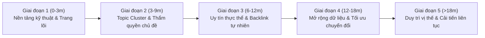

# Bộ quy tắc SEO website bền vững

> Phiên bản: 1.27
> Cập nhật: 09/11/2026
> Mục đích: Dùng làm rule, checklist và tiêu chuẩn nghiệm thu SEO cho mọi website được xây dựng hoặc tối ưu sau này.

## 1. Tư tưởng cốt lõi

SEO không được xây trên một định dạng hiển thị mà Google có thể thay đổi hoặc loại bỏ. Website phải vẫn có giá trị khi Rich Result, Featured Snippet, AI Overview hoặc một Search Feature bất kỳ không còn xuất hiện.

Thứ tự ưu tiên bắt buộc:

1. Nền tảng kỹ thuật có thể crawl, render và index chính xác.
2. Nội dung đáp ứng đúng nhu cầu tìm kiếm.
3. Cấu trúc thông tin rõ ràng cho người dùng và máy tìm kiếm.
4. Bằng chứng, độ tin cậy và trải nghiệm thực tế.
5. Hành trình chuyển đổi phục vụ mục tiêu kinh doanh.
6. Schema và Search Features là lớp tăng cường, không phải nền móng.

### Khung tín hiệu nén (Signal Compression Framework — Whitehat SEO 2026)

Hệ thống tìm kiếm hiện đại và các mô hình AI không đánh giá website dựa trên các mánh khóe onpage cục bộ hay một biến số riêng lẻ, mà tổng hợp và "nén" (synthesize/compress) hàng loạt tín hiệu độc lập thành các nhóm đánh giá chất lượng cốt lõi:

1. **Uy tín tổng thể website (Site Authority & Entity Trust):** Sự kết hợp giữa bộ nhận diện thương hiệu nhất quán, hồ sơ doanh nghiệp minh bạch, nội dung chuyên sâu và các liên kết giới thiệu tự nhiên.
2. **Tín hiệu hành vi người dùng (User Interaction & Engagement Signals):** Khả năng thu hút đúng người tìm kiếm (Search Intent), đáp ứng trọn vẹn nhu cầu ngay sau khi nhấp chuột và dẫn dắt người đọc qua các bước hành trình tự nhiên mà không gây gián đoạn hay thất vọng.
3. **Tín hiệu hạ thứ hạng (Demotion Signals):** Các cảnh báo tiêu cực từ hệ thống khi phát hiện lỗi kỹ thuật render/tải chậm, nội dung mỏng, xào xáo, nhồi nhét từ khóa hoặc thiếu minh bạch pháp nhân.
4. **Thẩm quyền và năng lực chuyên môn (Topical Authority & Real E-E-A-T):** Trình độ chuyên môn thực tế, kinh nghiệm thực chiến từ chuyên gia có thật, phân biệt rõ dữ kiện với quan điểm và có dẫn chứng kiểm chứng được.
5. **Chất lượng trải nghiệm từng trang (Page Quality):** Bố cục thông tin phân cấp rõ ràng, dễ đọc trên thiết bị di động, tốc độ phản hồi nhanh và lời kêu gọi hành động (CTA) minh bạch.
6. **Chất lượng bài đánh giá / so sánh thực tế (Product & Service Reviews Standard):** Đánh giá khách quan, có phương pháp thực nghiệm, nêu rõ ưu - nhược điểm và đối tượng phù hợp, cấm xào xáo thông số của nhà sản xuất.
7. **Độ bao phủ và chiều sâu chủ đề (Topical Depth):** Xây dựng mạng lưới nội dung chuyên sâu theo cấu trúc Topic Cluster chặt chẽ thay vì viết bài dàn trải, rời rạc.

**Bốn nguyên tắc triển khai xuyên suốt (XÂY – NÉ – DUY TRÌ – THEO DÕI):**

- **XÂY (Build):** Phát triển tài sản thực chất do doanh nghiệp sở hữu: thương hiệu đồng bộ, nội dung chuyên sâu, bằng chứng năng lực thực tế và liên kết tự nhiên từ các đối tác cùng ngành.
- **NÉ (Avoid):** Chủ động kiểm soát và triệt tiêu các tín hiệu Demotion: loại bỏ nội dung mỏng, tránh tạo trang tự động hàng loạt (scaled content abuse), sửa triệt để lỗi render/mobile và cấm đánh giá ảo.
- **DUY TRÌ (Maintain):** Định kỳ cập nhật vòng đời nội dung evergreen, tối ưu trải nghiệm đọc, xử lý liên kết gãy và củng cố niềm tin khách hàng theo thời gian.
- **THEO DÕI (Observe):** Ra quyết định dựa trên dữ liệu telemetry thực tế từ Google Search Console, GA4 và phản hồi người dùng; tuyệt đối không chạy theo các tin đồn thuật toán hay các trường dữ liệu thử nghiệm nội bộ của nền tảng tìm kiếm.

## 2. Quy ước mức độ

- **MUST**: Bắt buộc. Không đạt thì chưa được coi là hoàn thành SEO.
- **SHOULD**: Nên thực hiện, trừ khi có lý do cụ thể và được ghi lại.
- **MAY**: Tùy chọn, chỉ làm khi có giá trị rõ ràng và chi phí hợp lý.

## 3. Các quy tắc bắt buộc

### 3.1. Không phụ thuộc vào Search Features

- **MUST** không lấy một Rich Result hoặc vị trí hiển thị cụ thể làm nền tảng của chiến lược SEO.
- **MUST** không cam kết Google sẽ hiển thị Rich Result, Featured Snippet, Knowledge Panel, AI Overview hoặc trích dẫn AI.
- **MUST** xem Search Features là lưu lượng và khả năng hiển thị bổ sung, không phải tài sản do doanh nghiệp sở hữu.
- **MUST** kiểm tra tài liệu chính thức hiện hành của Google trước khi triển khai một tính năng tìm kiếm hoặc một loại structured data.
- **SHOULD** thiết kế nội dung để vẫn hữu ích và có khả năng chuyển đổi khi chỉ xuất hiện dưới dạng kết quả tìm kiếm thông thường.
- **SHOULD** có phương án đo lường không phụ thuộc vào một Search Feature duy nhất.

### 3.2. Crawl và render

- **MUST** trả về mã trạng thái HTTP đúng với nội dung: `200`, `301`, `404`, `410` hoặc `5xx` đúng tình huống.
- **MUST** không chặn nhầm tài nguyên cần thiết trong `robots.txt`.
- **MUST** để nội dung chính, liên kết và metadata quan trọng có thể được Googlebot render.
- **MUST** dùng thẻ `<a href="...">` thật cho các liên kết điều hướng có giá trị SEO.
- **MUST** tránh nội dung quan trọng chỉ xuất hiện sau thao tác khó tái tạo hoặc phụ thuộc hoàn toàn vào JavaScript lỗi.
- **SHOULD** ưu tiên HTML có nghĩa ngay trong phản hồi đầu tiên đối với nội dung cần index.
- **SHOULD** kiểm tra website bằng JavaScript bật và tắt khi có nguy cơ nội dung bị mất trong quá trình render.

#### Giới hạn fetch của Googlebot

Theo tài liệu Google Search Central được kiểm tra ngày 09/11/2026, Googlebot for Search chỉ fetch **2MB đầu tiên** của mỗi URL thuộc loại tệp được hỗ trợ; PDF có giới hạn riêng 64MB. Giới hạn áp dụng trên dữ liệu chưa nén. CSS, JavaScript và tài nguyên ngoài được fetch riêng và có giới hạn cho từng request.

- **MUST** giữ response HTML có kích thước hợp lý và đo byte sau khi giải nén khi điều tra crawl/index; không chỉ nhìn transfer size đã gzip/Brotli.
- **MUST** bảo đảm metadata, nội dung chính, link crawlable và structured data quan trọng không nằm sau ngưỡng fetch.
- **SHOULD** chuyển CSS/JS inline không thiết yếu thành tài nguyên ngoài khi việc đó giảm HTML mà không làm hỏng critical rendering path.
- **MUST NOT** suy diễn rằng Schema càng gần đầu `<head>` càng được xếp hạng cao; mục tiêu là nằm trong phần Googlebot thực sự fetch và khớp nội dung hiển thị.

Nguồn: [Googlebot — Google Search Central](https://developers.google.com/search/docs/crawling-indexing/googlebot).

#### Semantic HTML, DOM và ranh giới nội dung

Semantic HTML là điều kiện kỹ thuật giúp trình duyệt, công nghệ hỗ trợ và hệ thống xử lý tài liệu nhận biết cấu trúc nội dung rõ hơn. Nó có thể hỗ trợ parsing và trích xuất, nhưng không bảo đảm xếp hạng, Entity Salience, Featured Snippet hoặc AI citation.

- **MUST** dùng phần tử theo đúng ý nghĩa và content model, không chọn thẻ chỉ vì kỳ vọng SEO.
- **MUST** có một vùng nội dung chính rõ ràng; thông thường mỗi document chỉ có một `<main>` đang hiển thị.
- **MUST** dùng heading thật (`<h1>`–`<h6>`) cho tiêu đề, không giả heading bằng `<div>` hoặc CSS.
- **MUST** giữ thứ bậc heading phản ánh cấu trúc nội dung, không chọn cấp heading theo kích thước chữ.
- **MUST** không khai báo quan hệ Entity/Schema không tồn tại trong nội dung hoặc nghiệp vụ thật.
- **SHOULD** ưu tiên DOM đơn giản, ít wrapper vô nghĩa và thứ tự nguồn hợp lý.
- **SHOULD** để nội dung chính xuất hiện trong `<main>` và tách navigation/boilerplate theo landmark phù hợp.
- **SHOULD** xem semantic boundary là tín hiệu cấu trúc hỗ trợ, không phải “bức tường” đảm bảo thuật toán bỏ qua hoặc gán nội dung chính xác tuyệt đối.

#### Vai trò của các phần tử semantic

| Phần tử | Dùng khi | Không nên mặc định |
|---|---|---|
| `<header>` | Phần mở đầu của trang hoặc section; có thể chứa tiêu đề, logo, metadata hoặc navigation | Không tự động xác nhận Organization hoặc publisher. |
| `<nav>` | Khối liên kết điều hướng chính hoặc quan trọng, nên có accessible name khi có nhiều nav | Không phải mọi nhóm link đều cần bọc trong nav. |
| `<main>` | Nội dung chính, độc nhất của document | Không tự động tương đương `mainEntityOfPage`. |
| `<article>` | Nội dung tự chứa, có thể phân phối hoặc sử dụng tương đối độc lập | Không dùng cho mọi card/khối chỉ để “tăng ngữ nghĩa”. |
| `<section>` | Nhóm nội dung theo chủ đề, thường có heading nhận diện | Không bảo đảm trở thành entity boundary hoặc RAG chunk. |
| `<aside>` | Nội dung bổ trợ/tangential so với nội dung xung quanh | Không bảo đảm bot loại nội dung khỏi thực thể chính. |
| `<footer>` | Phần cuối của trang hoặc section, có thể chứa provenance, policy hoặc navigation | Không tự động chứng minh độ tin cậy hay quyền tác giả. |

Các phần tử semantic **MUST** được chọn theo tiêu chuẩn HTML và ý nghĩa nội dung. Schema.org là lớp metadata riêng; không suy ra ánh xạ Schema tự động chỉ từ tên thẻ HTML.

#### Blueprint tài liệu tham khảo

```html
<!doctype html>
<html lang="vi">
  <head>...</head>
  <body>
    <header>
      <a href="/" aria-label="Trang chủ">...</a>
      <nav aria-label="Điều hướng chính">...</nav>
    </header>

    <main id="main-content">
      <article>
        <header>
          <h1>Tiêu đề mô tả chủ đề chính</h1>
          <p>Câu trả lời hoặc phần mở đầu phù hợp với intent.</p>
        </header>

        <section id="khai-niem" aria-labelledby="khai-niem-title">
          <h2 id="khai-niem-title">Khái niệm</h2>
          <p>...</p>
        </section>

        <section id="du-lieu" aria-labelledby="du-lieu-title">
          <h2 id="du-lieu-title">Dữ liệu và bằng chứng</h2>
          <figure>...</figure>
          <table>
            <caption>Mô tả dữ liệu trong bảng</caption>
            ...
          </table>
        </section>
      </article>

      <aside aria-label="Thông tin liên quan">...</aside>
    </main>

    <footer>...</footer>
  </body>
</html>
```

Blueprint này là điểm khởi đầu, không phải template bắt buộc cho mọi trang. Cấu trúc **MUST** thay đổi theo loại nội dung và trải nghiệm thực tế.

#### Section, heading và anchor

- `<section>` **SHOULD** có heading nhận diện khi nội dung cần xuất hiện như một phần độc lập trong outline.
- **MUST** không tạo section chỉ để bọc layout hoặc áp CSS; dùng `<div>` khi không có ý nghĩa semantic phù hợp.
- `id` **SHOULD** được thêm khi cần fragment navigation, `aria-labelledby`, deep link hoặc tham chiếu ổn định; không bắt buộc mọi section có `id`.
- Heading **MUST** mô tả nội dung phần, không chỉ chứa từ khóa hoặc nhãn chung chung.
- Fragment URL **MUST** trỏ tới ID duy nhất và cuộn tới nội dung không bị sticky UI che khuất.

#### Bảng, hình ảnh và dữ liệu có cấu trúc trong DOM

- Bảng dữ liệu **MUST** dùng `<table>` khi có quan hệ hàng/cột; không dùng table cho layout.
- Bảng **SHOULD** có `<caption>` mô tả mục đích và `<th>`/`scope` phù hợp để người dùng và công nghệ hỗ trợ hiểu quan hệ dữ liệu.
- Hình ảnh có thông tin **MUST** có `alt` đúng mục đích; biểu đồ phức tạp **SHOULD** có mô tả hoặc dữ liệu thay thế.
- `<figure>`/`<figcaption>` **SHOULD** dùng khi media có caption gắn với nội dung.
- Markup đúng có thể hỗ trợ extraction nhưng **MUST** không được quảng bá như bảo đảm Featured Snippet hoặc AI answer.

#### Đồng bộ Semantic DOM và Schema JSON-LD

- **MUST** giữ Schema nhất quán với nội dung hiển thị và trạng thái thực tế của trang.
- **MUST** không tạo thuộc tính, review, tác giả, FAQ, giá, offer hoặc entity chỉ tồn tại trong JSON-LD.
- **MUST** dùng `@id` ổn định để nối các node Schema khi đồ thị cần định danh; không bắt buộc mọi section DOM phải có node `WebPageElement`.
- **SHOULD** dùng fragment `@id` trùng ID DOM khi có nhu cầu tham chiếu một phần hiển thị cụ thể và mapping đó có giá trị bảo trì rõ ràng.
- **SHOULD** giữ `name`, headline và thuộc tính Schema nhất quán về nghĩa với heading/nội dung, nhưng không cần sao chép máy móc mọi chuỗi ký tự nếu ngữ cảnh cho phép diễn đạt khác.
- **MUST** kiểm tra tài liệu chính thức hiện hành trước khi triển khai loại structured data nhằm đủ điều kiện cho Search Feature.
- **MUST** không thêm đồ thị Schema phức tạp nếu không thể kiểm tra, duy trì hoặc giải thích giá trị của từng node/relationship.

#### Mức bằng chứng và giới hạn diễn giải

- Semantic HTML cải thiện cấu trúc tài liệu, accessibility và khả năng bảo trì: **technical prerequisite**.
- Semantic HTML có thể giúp parser nhận diện vùng nội dung: **lợi ích hợp lý nhưng phụ thuộc implementation**.
- Mỗi `<section>` chắc chắn trở thành một RAG chunk: **không được coi là sự thật phổ quát**.
- `<aside>` cô lập hoàn toàn nội dung khỏi entity chính: **không được coi là bảo đảm**.
- Dùng semantic HTML làm tăng thứ hạng hoặc citation trực tiếp: **không được tuyên bố khi thiếu bằng chứng**.
- Semantic DOM và Schema bổ trợ nhau nhưng không bắt buộc lúc nào cũng phải triển khai đồng thời.

#### Audit Semantic HTML

1. Kiểm tra rendered DOM, không chỉ source trước JavaScript.
2. Kiểm tra landmark và accessible name trong Accessibility Tree.
3. Xác nhận một `<main>` hiển thị và nội dung chính nằm đúng vùng.
4. Rà soát heading hierarchy, section có ý nghĩa và thứ tự DOM.
5. Kiểm tra article/aside/nav/footer được dùng đúng mục đích.
6. Kiểm tra link, bảng, figure, form và control bằng bàn phím/screen reader khi phù hợp.
7. Đối chiếu Schema với nội dung hiển thị và dữ liệu thật.
8. Chạy validator/Rich Results Test phù hợp nhưng không xem công cụ pass là bằng chứng chất lượng nội dung.

Checklist nghiệm thu:

- [ ] Có `lang` phù hợp trên `<html>`.
- [ ] Có một `<main>` hiển thị và nội dung chính nằm trong đó.
- [ ] Landmark có accessible name khi cần phân biệt nhiều vùng cùng loại.
- [ ] Heading thật, đúng cấp logic và không dùng để tạo style.
- [ ] `<article>`, `<section>` và `<aside>` được dùng theo nghĩa, không theo kỳ vọng SEO.
- [ ] Section có heading khi cần nhận diện độc lập; ID chỉ được thêm khi có mục đích.
- [ ] Table, caption, header cell, figure và alt text đúng ngữ nghĩa.
- [ ] DOM sau render giữ đủ nội dung và quan hệ quan trọng.
- [ ] Schema khớp nội dung thật và không khai khống.
- [ ] Không có tuyên bố nội bộ rằng semantic markup bảo đảm ranking, extraction hoặc citation.

### 3.3. Index và canonical

- **MUST** xác định rõ URL nào được phép index và URL nào không.
- **MUST** dùng canonical tự tham chiếu cho trang chuẩn khi phù hợp.
- **MUST** bảo đảm canonical, redirect, sitemap và internal link cùng trỏ về một phiên bản URL chuẩn.
- **MUST** không dùng `noindex`, canonical hoặc robots.txt để che lỗi kiến trúc URL mà chưa hiểu hậu quả.
- **MUST** loại bỏ hoặc xử lý trang trùng lặp, trang tham số và trang mỏng không có mục đích tìm kiếm rõ ràng.
- **SHOULD** dùng URL ngắn, ổn định, dễ đọc và không phụ thuộc vào cấu trúc có khả năng thay đổi thường xuyên.

### 3.4. Kiến trúc và internal link

- **MUST** tổ chức website theo nhu cầu của người dùng, dịch vụ/sản phẩm và quan hệ chủ đề.
- **MUST** bảo đảm trang quan trọng có internal link từ các trang liên quan và không trở thành trang mồ côi.
- **MUST** dùng anchor text mô tả đúng trang đích, tránh lạm dụng từ khóa chính xác một cách máy móc.
- **SHOULD** giữ đường đi từ trang chủ đến trang kinh doanh quan trọng ngắn và hợp lý.
- **SHOULD** dùng breadcrumb khi website có cấu trúc phân cấp.
- **SHOULD** liên kết giữa nội dung thông tin và trang chuyển đổi theo đúng ngữ cảnh, không chèn CTA vô lý.

#### Nguyên tắc cấu trúc website

Một cấu trúc tốt phải giúp người dùng tìm thấy thông tin, giúp crawler khám phá URL, thể hiện quan hệ chủ đề và phân bổ internal link tới đúng trang quan trọng.

- **MUST** xây taxonomy theo cách người dùng hiểu sản phẩm, dịch vụ và chủ đề; không chỉ theo cơ cấu nội bộ của doanh nghiệp.
- **MUST** đặt nội dung/sản phẩm cùng mục đích vào nhóm hợp lý và có trang hub/category khi nhóm cần điểm tổng hợp.
- **MUST** để mỗi trang có vai trò, parent/topic và đường dẫn điều hướng có thể giải thích được.
- **MUST** không tạo nhiều URL gần giống nhau nếu không có intent, nội dung hoặc giá trị sử dụng riêng.
- **MUST** ưu tiên trang chiến lược trong navigation, hub, category hoặc contextual internal link phù hợp.
- **MUST** tránh orphan page và dead-end page không có bước đi tiếp theo hợp lý.
- **SHOULD** giữ hierarchy nông vừa đủ nhưng không ép mọi URL về cùng một tầng chỉ để giảm số click.
- **SHOULD** dùng nhãn menu/category theo ngôn ngữ người dùng, rõ nghĩa khi đứng độc lập.
- **SHOULD** thiết kế structure đồng thời với Persona, Search Intent, Page Role và DLN.
- **SHOULD** giới hạn số lựa chọn trong navigation theo khả năng hiểu và nhiệm vụ người dùng, không nhồi toàn bộ sitemap vào menu.

#### Mô hình phân cấp tham khảo

```text
Trang chủ
├── Nhóm dịch vụ/sản phẩm
│   ├── Trang danh mục hoặc hub
│   ├── Trang dịch vụ/sản phẩm
│   └── Nội dung hỗ trợ liên quan
├── Trung tâm kiến thức
│   ├── Topic hub
│   └── Bài hướng dẫn/case study/câu hỏi
└── Thông tin doanh nghiệp
    ├── Giới thiệu và bằng chứng
    ├── Liên hệ
    └── Chính sách
```

Đây là mô hình tham khảo, không phải template bắt buộc. Kiến trúc **MUST** phản ánh mô hình kinh doanh, hành vi tìm kiếm và hành trình quyết định thực tế.

#### URL và hierarchy

- **MUST** dùng URL ổn định, dễ đọc và phản ánh nội dung thay vì tham số/ký hiệu không cần thiết.
- **MUST** không đổi URL chỉ để thêm từ khóa hoặc làm đường dẫn “đẹp hơn” nếu lợi ích không vượt rủi ro migration.
- **MUST** giữ một phiên bản URL chuẩn nhất quán về protocol, hostname, slash, chữ hoa/thường và tham số.
- **SHOULD** dùng cấu trúc thư mục khi nó giúp thể hiện nhóm nội dung và quản trị, không kéo dài URL chỉ để mô phỏng toàn bộ breadcrumb.
- **SHOULD** tránh gắn ngày tháng hoặc cấu trúc tổ chức dễ thay đổi vào URL nếu không có nhu cầu sản phẩm/nội dung rõ ràng.
- **SHOULD** giữ slug ngắn gọn, mô tả đúng và không nhồi nhiều biến thể từ khóa.

#### Click depth và khả năng khám phá

- **MUST** không áp dụng một con số click depth cứng cho mọi website.
- **MUST** bảo đảm trang quan trọng có thể được khám phá qua link HTML từ các trang có liên quan.
- **MUST** xem xét cả số bước, prominence, context và tần suất internal link; không chỉ đếm click.
- **SHOULD** giữ các trang kinh doanh/chủ đề quan trọng gần những điểm vào chính và hub liên quan.
- **SHOULD** kiểm tra crawl depth, orphan pages, pages with low inbound links và navigation sau mỗi thay đổi lớn.
- **MAY** dùng search/filter để hỗ trợ người dùng, nhưng chức năng search nội bộ không thay thế kiến trúc link crawlable.

#### Hub, category và topic cluster

- Trang hub/category **MUST** có mục đích và giá trị riêng; không chỉ là danh sách link tự động nếu người dùng cần định hướng.
- Hub **SHOULD** giải thích phạm vi chủ đề, phân nhóm lựa chọn và dẫn tới các bước DLN phù hợp.
- Trang con **SHOULD** link về hub/parent và sang các trang liên quan khi có lý do cho người đọc.
- **MUST** tránh tạo cluster chỉ bằng anchor exact-match mà thiếu nội dung, quan hệ thực thể hoặc hành trình hợp lý.
- **SHOULD** phân biệt topic hub, trang chuyển đổi và bài hỗ trợ để tránh các URL cạnh tranh cùng intent.

#### Topic Cluster: Quy trình 8 bước triển khai Pillar Page và Cluster Content

Mô hình Topic Cluster giúp website xác lập thẩm quyền chuyên môn (Topical Authority) bằng cách tổ chức nội dung thành các cụm tri thức có tính hệ thống cao:

- **Pillar Page (Trang trụ cột):** Là cẩm nang toàn cảnh, bao quát chiều rộng của một chủ đề cốt lõi, cung cấp cái nhìn tổng quan đầy đủ và liên kết dẫn hướng đến các bài viết chuyên sâu.
- **Cluster Content (Bài viết vệ tinh):** Là các nội dung chuyên sâu giải quyết triệt để từng khía cạnh, câu hỏi hoặc vấn đề cụ thể của người tìm kiếm.
- **Semantic Internal Linking (Mạng liên kết ngữ nghĩa):** Liên kết 2 chiều có chủ đích, giúp người dùng và công cụ tìm kiếm hiểu rõ cấu trúc phân cấp và mối quan hệ giữa các thực thể thông tin.

**Quy trình 8 bước triển khai chuẩn:**

1. **Xác định lĩnh vực cốt lõi (Core Domain):** Lựa chọn các chủ đề gắn liền với chuyên môn thực tế, thế mạnh nghiệp vụ và dịch vụ cốt lõi của doanh nghiệp.
2. **Nghiên cứu nhu cầu tìm kiếm (Intent & Question Mapping):** Phân tích các câu hỏi, nỗi lo ngại, tiêu chí so sánh và quyết định thực tế của khách hàng mục tiêu.
3. **Bản đồ phân nhóm chủ đề (Cluster Architecture):** Phân chia chủ đề lớn thành các nhóm nội dung liên quan mật thiết theo ngữ nghĩa.
4. **Xây dựng Pillar Page:** Viết trang trụ cột bao quát toàn diện các khía cạnh cơ bản, có cấu trúc mục lục rõ ràng và định hướng đọc thông minh.
5. **Phát triển Cluster Content:** Sản xuất từng bài viết ngách giải quyết thấu đáo một câu hỏi vi mô, có bằng chứng thực tế và giải pháp hành động cụ thể.
6. **Thiết lập Semantic Internal Linking 2 chiều:**
   - Pillar Page **MUST** đặt liên kết hướng tới tất cả các bài viết trong cluster tương ứng.
   - Mọi bài Cluster Content **MUST** liên kết ngược về Pillar Page với anchor text tự nhiên và chuẩn ngữ cảnh.
   - Các bài Cluster Content cùng cụm **SHOULD** liên kết chéo sang nhau khi nội dung bổ trợ trực tiếp cho quyết định tiếp theo của người đọc.
7. **Rà soát xung đột từ khóa (Cannibalization Audit):** **MUST** kiểm tra để mỗi URL chỉ nhắm một Primary Intent duy nhất; không xuất bản 2 trang cùng tranh chấp một mục đích tìm kiếm.
8. **Đo lường và mở rộng theo chu kỳ:** Dùng dữ liệu Search Console để phát hiện các truy vấn mới nảy sinh và cập nhật bổ sung bài viết ngách vào cluster.

- **MUST NOT** chạy đua theo số lượng bài viết; Topical Authority được đo bằng chiều sâu chuyên môn, tính xác thực và mức độ thỏa mãn Search Intent, không phải số lượng URL rỗng.

#### Kiểm soát trang trùng lặp và phát sinh URL

- **MUST** có rule cho filter, sort, search parameter, pagination, tag, archive và faceted navigation.
- **MUST** xác định URL nào có giá trị index riêng, URL nào canonical/noindex hoặc không nên được tạo/crawl.
- **MUST** không dùng canonical để bù cho việc hệ thống tạo vô hạn URL không cần thiết.
- **MUST** hợp nhất, redirect hoặc phân vai rõ các trang có intent chồng lấn.
- **SHOULD** đánh giá log/crawl data để phát hiện crawl space bị tiêu tốn bởi parameter và trang mỏng.
- **SHOULD** tránh tag/category gần như đồng nghĩa nếu không có chiến lược nội dung khác biệt.

#### Tái cấu trúc website đang hoạt động

1. Crawl và lưu inventory URL, status, canonical, internal link, traffic, conversion và backlink.
2. Gán vai trò: giữ nguyên, cập nhật, hợp nhất, chuyển hướng hoặc loại bỏ.
3. Thiết kế cấu trúc đích và mapping URL cũ → URL mới.
4. Kiểm tra redirect một bước, canonical, navigation, breadcrumb, sitemap và link nội bộ.
5. Triển khai theo phạm vi có thể QA/rollback; tránh đổi URL diện rộng không cần thiết.
6. Crawl trước/sau deploy và kiểm tra trang quan trọng bằng Search Console/analytics.
7. Theo dõi index, traffic, conversion, 404, redirect và log trong thời gian phù hợp.

Mọi thay đổi cấu trúc đang hoạt động **MUST** có baseline, redirect mapping, owner, QA và phương án rollback.

#### Checklist kiến trúc website

- [ ] Taxonomy phản ánh nhu cầu người dùng và mô hình kinh doanh.
- [ ] Mỗi URL có Page Role, intent, parent/topic và bước DLN rõ ràng.
- [ ] Trang quan trọng xuất hiện trong navigation/hub/context phù hợp.
- [ ] Không có orphan page hoặc dead-end page quan trọng.
- [ ] URL chuẩn nhất quán, dễ đọc và ổn định.
- [ ] Hub/category có giá trị định hướng, không chỉ là trang link mỏng.
- [ ] Trang cùng chủ đề được kết nối bằng link có ngữ cảnh.
- [ ] Filter, parameter, tag, pagination và search URL có rule index/crawl rõ ràng.
- [ ] Không có nhóm URL gần giống cùng cạnh tranh một intent mà chưa được phân vai.
- [ ] Migration/restructure có redirect mapping, QA, baseline và theo dõi sau triển khai.

#### HTML hyperlink chuẩn

Liên kết điều hướng thông thường **MUST** dùng thẻ `<a>` với `href` hợp lệ:

```html
<a href="/hoc-seo/">Học SEO</a>
```

- **MUST** dùng `<a href="...">` khi hành động đưa người dùng tới URL, tài liệu, email, số điện thoại hoặc vị trí khác trong trang.
- **MUST** dùng `<button>` cho hành động thay đổi trạng thái giao diện hoặc thực thi chức năng mà không điều hướng.
- **MUST** không dùng `<span>`, `<div>` hoặc phần tử không tương tác kết hợp JavaScript để giả lập hyperlink.
- **MUST** không đặt URL điều hướng chỉ trong `onclick` nếu không có `href` tương đương.
- **MUST** bảo đảm link quan trọng tồn tại trong HTML sau render và có thể được phát hiện mà không cần hover hoặc thao tác đặc biệt.
- **MUST** để `href` trỏ đến URL hợp lệ; không dùng `href="#"`, `javascript:void(0)` hoặc URL rỗng làm liên kết điều hướng thật.
- **SHOULD** dùng đường dẫn tương đối hoặc tuyệt đối nhất quán theo kiến trúc website.
- **SHOULD** để server trả status/redirect phù hợp cho URL đích, không tạo chuỗi redirect không cần thiết.

#### Anchor text và khả năng truy cập

- **MUST** để mục đích liên kết có thể hiểu từ link text hoặc ngữ cảnh gần nhất.
- **MUST** mô tả đúng nội dung hoặc hành động tại trang đích.
- **MUST** tránh các anchor mơ hồ lặp lại như “tại đây”, “xem thêm” hoặc “bấm vào đây” khi đứng riêng sẽ mất nghĩa.
- **MUST** không nhồi từ khóa, lặp exact-match máy móc hoặc tạo hàng loạt liên kết thiếu giá trị.
- **MUST** giữ accessible name của link nhất quán với nội dung người dùng nhìn thấy.
- **MUST** để link có trạng thái focus rõ ràng và sử dụng được bằng bàn phím.
- **SHOULD** giữ anchor ngắn gọn, tự nhiên và đủ phân biệt với các link lân cận.
- **SHOULD** tránh nhiều link cạnh nhau có cùng text nhưng dẫn tới các trang hoàn toàn khác nhau nếu không có ngữ cảnh phân biệt.
- Link chỉ có icon **MUST** có accessible name phù hợp bằng text ẩn, `aria-label` hoặc giải pháp tương đương.
- Hình ảnh nằm trong link **MUST** có `alt` mô tả mục đích liên kết, trừ khi đã có text link đủ rõ trong cùng phần tử.

Ví dụ:

```html
<!-- Nên dùng -->
<a href="/huong-dan-hoc-seo/">Hướng dẫn học SEO từ cơ bản</a>

<!-- Thiếu ngữ nghĩa khi đứng riêng -->
<a href="/huong-dan-hoc-seo/">Xem thêm tại đây</a>
```

#### Hành vi và an toàn của liên kết

- **MUST** không tự động mở tab mới nếu không có lý do trải nghiệm rõ ràng.
- Link dùng `target="_blank"` **SHOULD** có `rel="noopener noreferrer"` khi phù hợp và **SHOULD** báo cho người dùng nếu việc mở tab mới không dễ dự đoán.
- **MUST** dùng scheme phù hợp cho `mailto:`, `tel:` và các giao thức được hỗ trợ.
- **MUST** kiểm tra fragment link trỏ tới một `id` tồn tại, duy nhất và không bị sticky header che khi cuộn tới.
- **SHOULD** giữ vùng nhấp đủ lớn trên thiết bị cảm ứng nhưng không biến cả khu vực lớn, khó dự đoán thành một link duy nhất.
- **SHOULD** dùng style giúp người dùng nhận biết link mà không chỉ dựa vào màu sắc khi ngữ cảnh không đủ rõ.

#### Bốn câu hỏi kiểm tra một internal link

1. Googlebot có thể phát hiện liên kết trong HTML sau render không?
2. Anchor text có diễn đạt đúng trang đích và có accessible name rõ ràng không?
3. Liên kết có giúp người đọc hiểu thêm hoặc giải quyết một nhu cầu cụ thể không?
4. Sau khi nhấp, người dùng tiến tới bậc nào trong hành trình O → C → P → R → A?

Nếu không trả lời được câu 3 hoặc 4, liên kết cần được xem lại dù anchor có chứa từ khóa.

#### Quy tắc phân bổ internal link

- **MUST** không áp dụng một con số internal link lý tưởng cho mọi trang.
- **MUST** không xem số lượng liên kết hoặc tỷ lệ exact-match là mục tiêu độc lập.
- **MUST** cân nhắc mục đích trang, độ dài, cấu trúc, nhu cầu người dùng và vai trò trong DLN.
- **MUST** không để trang quan trọng trở thành orphan page.
- **SHOULD** ưu tiên link trong ngữ cảnh nơi người đọc thực sự cần nội dung đích.
- **SHOULD** dùng navigation, breadcrumb, contextual link và related content theo đúng vai trò, không xem mọi loại link là tương đương.
- **SHOULD** kiểm tra link depth, inbound internal links, broken links, redirect links và trang đích sau mỗi thay đổi kiến trúc lớn.
- **SHOULD** cập nhật/xóa link khi trang đích không còn phù hợp thay vì giữ liên kết cũ chỉ vì từng có giá trị SEO.

#### Checklist HTML Links

- [ ] Dùng `<a>` và có `href` hợp lệ cho điều hướng.
- [ ] Link xuất hiện trong HTML sau render.
- [ ] URL đích trả status phù hợp và không qua redirect chain không cần thiết.
- [ ] Anchor mô tả đúng trang đích, tự nhiên và hiểu được theo ngữ cảnh.
- [ ] Link có accessible name, focus state và dùng được bằng bàn phím.
- [ ] Link icon/hình ảnh có nhãn thay thế phù hợp.
- [ ] Fragment, `mailto:` và `tel:` hoạt động đúng.
- [ ] Link mở tab mới có lý do và thuộc tính an toàn phù hợp.
- [ ] Link giúp người đọc hoàn thành nhiệm vụ hoặc tiến tới bước DLN tiếp theo.
- [ ] Không có orphan page, broken link hoặc link tới URL không còn phù hợp.

### 3.5. Search intent và chất lượng nội dung

- **MUST** xác định trước mỗi trang phục vụ ai, câu hỏi nào và bước nào trong hành trình ra quyết định.
- **MUST** để một URL có một mục tiêu tìm kiếm chính rõ ràng.
- **MUST** cung cấp câu trả lời trực tiếp, đầy đủ và phù hợp với ý định tìm kiếm thay vì chỉ kéo dài nội dung.
- **MUST** không tạo hàng loạt trang chỉ thay địa danh, từ khóa hoặc vài câu chữ mà không có giá trị riêng.
- **MUST** phân biệt rõ dữ kiện, kinh nghiệm, quan điểm và nội dung quảng cáo.
- **SHOULD** bổ sung ví dụ thực tế, quy trình, hình ảnh gốc, dữ liệu, tác giả hoặc bằng chứng khi chúng giúp người đọc tin và hành động.
- **SHOULD** cập nhật hoặc hợp nhất nội dung cũ thay vì tiếp tục xuất bản các trang cạnh tranh cùng một ý định.

#### Khớp Search Intent với vai trò trang

- **MUST** xác định intent từ ngôn ngữ truy vấn, SERP thực tế, hành vi khách hàng và mục tiêu kinh doanh; không gán intent chỉ từ một nhãn từ khóa do công cụ cung cấp.
- **MUST** chọn một vai trò chính cho URL — tìm hiểu, so sánh, kiểm chứng, xem giá hoặc hành động — đồng thời ghi nhận intent phụ nếu SERP và hành trình ra quyết định có tính hỗn hợp.
- Trang dịch vụ hoặc truy vấn có intent thương mại/chuyển đổi **MUST** giúp người đọc đánh giá offer, đối tượng phù hợp, phạm vi, quy trình, bằng chứng, rủi ro, cách xác định giá và phương thức liên hệ; không được biến thành một bài kiến thức chung chỉ để kéo traffic.
- Bài kiến thức **MUST** hoàn thành câu trả lời trước khi đưa CTA và không được giả dạng nội dung hướng dẫn để che một trang bán hàng thiếu thông tin.
- Khi người tìm kiếm cần báo giá hoặc hành động, trang **MUST** có CTA rõ ràng và cho biết người dùng cần cung cấp gì, sẽ nhận lại gì và bước tiếp theo diễn ra như thế nào.
- **MUST** xem xét lại intent khi URL có impression nhưng CTR thấp, có traffic nhưng không hoàn thành nhiệm vụ, hoặc SERP đã chuyển sang loại trang khác; không mặc định vấn đề nằm ở mật độ từ khóa.

#### Chuẩn hóa 4 nhóm Search Intent: Cấu trúc nội dung và vị trí CTA

Mọi trang xuất bản **MUST** được xếp vào đúng nhóm Search Intent chủ đạo để thiết kế cấu trúc nội dung và vị trí kêu gọi hành động (CTA) tương ứng:

| Nhóm Search Intent | Đặc điểm & Kỳ vọng người dùng | Tiêu chuẩn cấu trúc nội dung | Nguyên tắc bố trí Call-to-Action (CTA) |
|---|---|---|---|
| **Informational** *(Tìm kiếm thông tin)* | Người dùng muốn hiểu định nghĩa, nguyên nhân, hướng dẫn kỹ thuật hoặc giải pháp cho một vấn đề ("là gì", "tại sao", "cách làm"). | - Trả lời trực diện ngay đầu trang (Direct Answer).<br>- Phân tích nguyên nhân và phương pháp thực hiện cụ thể.<br>- Bổ sung hình ảnh thực tế, biểu đồ, ví dụ minh họa.<br>- Phân biệt rõ dữ kiện thực tế và quan điểm chủ quan. | - **Soft CTA**: Liên kết đọc tiếp, checklist/tài liệu tải về, nhận bản tin, hoặc form tư vấn không bắt buộc.<br>- **MUST NOT** chèn pop-up che khuất hoặc ép buộc điền form báo giá/mua hàng ngay đầu bài. |
| **Navigational** *(Tìm thương hiệu / điều hướng)* | Người dùng muốn truy cập vào đúng thương hiệu, trang chủ, dịch vụ cụ thể, bảng giá, trang đăng nhập hoặc liên hệ của doanh nghiệp. | - Nhận diện thương hiệu đồng nhất (logo, tên miền, NAP).<br>- Menu điều hướng, breadcrumb và sitemap rõ ràng.<br>- Thông tin liên hệ, văn phòng và pháp nhân minh bạch.<br>- Tốc độ phản hồi cực nhanh trên mobile. | - **Navigation CTA**: Nút dẫn trực tiếp tới Cổng khách hàng, Đăng nhập, Bảng giá, Hotline hoặc Form liên hệ chính. |
| **Commercial Investigation** *(Nghiên cứu & So sánh)* | Người dùng đang trong giai đoạn cân nhắc, so sánh tính năng, chi phí, ưu nhược điểm giữa các giải pháp hoặc đơn vị cung cấp trước khi mua. | - Bảng so sánh đa chiều, tiêu chí đánh giá khách quan.<br>- Phân tích rõ Ưu điểm (Pros) VÀ Nhược điểm (Cons).<br>- Xác định rõ đối tượng phù hợp và KHÔNG phù hợp.<br>- Bằng chứng năng lực, case study thực tế và phản hồi khách hàng. | - **Consideration CTA**: Đặt lịch demo, xem bảng báo giá chi tiết, tải tài liệu phân tích giải pháp hoặc yêu cầu tư vấn theo bài toán riêng. |
| **Transactional** *(Giao dịch / Chốt dịch vụ)* | Người dùng đã sẵn sàng hành động: mua sắm, đăng ký dịch vụ, yêu cầu báo giá hoặc ký kết hợp đồng. | - Thông tin sản phẩm/dịch vụ rõ ràng, chi phí minh bạch.<br>- Phạm vi công việc, cam kết bảo hành và quy trình bàn giao.<br>- Bằng chứng pháp lý, hợp đồng mẫu, chính sách hoàn tiền.<br>- Rào cản thao tác tối thiểu, biểu mẫu tinh gọn. | - **Direct Transactional CTA**: Nút gọi ngay, nút nhắn tin Zalo, form yêu cầu báo giá 1 bước; hiển thị rõ cam kết bảo mật và thời gian phản hồi. |

#### Tiêu chuẩn chất lượng cho nội dung Review, So sánh và Đánh giá giải pháp

Các trang đánh giá sản phẩm, review công nghệ hoặc so sánh giải pháp dịch vụ **MUST** tuân thủ tiêu chuẩn chất lượng cao để vượt qua các thuật toán đánh giá (Reviews System) của Google:

- **MUST** có phương pháp trải nghiệm hoặc tiêu chí đánh giá rõ ràng: Nêu rõ quá trình thử nghiệm, môi trường kiểm thử, thời gian sử dụng hoặc số liệu đo đạc thực tế; không đưa ra nhận định cảm tính thiếu căn cứ.
- **MUST** phân tích công tâm cả Ưu điểm (Pros) VÀ Nhược điểm / Giới hạn (Cons): Bất kỳ giải pháp nào cũng có giới hạn; việc che giấu khuyết điểm để thiên vị bán hàng sẽ kích hoạt tín hiệu tiêu cực về độ tin cậy.
- **MUST** xác định rõ đối tượng phù hợp VÀ đối tượng KHÔNG phù hợp: Chỉ rõ trường hợp nào nên chọn giải pháp này, và trường hợp nào nên cân nhắc phương án thay thế khác.
- **SHOULD** cung cấp hình ảnh thực tế, ảnh chụp màn hình kiểm thử hoặc dữ liệu gốc do chính tác giả thực hiện; tránh sử dụng ảnh stock quảng cáo của nhà sản xuất.
- **MUST** đưa ra kết luận có căn cứ dựa trên so sánh định lượng với ít nhất một giải pháp thay thế tương đương trên thị trường.
- **MUST** cập nhật nội dung đánh giá định kỳ khi sản phẩm, phiên bản phần mềm hoặc chính sách giá của nhà cung cấp có sự thay đổi.
- **MUST NOT** chỉ xào xáo lại thông số kỹ thuật có sẵn từ brochure của nhà sản xuất mà không bổ sung bất kỳ góc nhìn chuyên môn độc lập nào.
- **MUST NOT** sử dụng đánh giá giả mạo (fake reviews), hồ sơ chuyên gia ảo hoặc nhận tiền tài trợ để viết bài thiên lệch mà không công khai mối quan hệ tài chính (sponsorship disclosure).

#### Kiểm soát và phòng ngừa các tín hiệu Demotion (Hạ thứ hạng)

Website cần chủ động nhận diện và triệt tiêu các lỗi kích hoạt tín hiệu Demotion khiến công cụ tìm kiếm giảm thứ hạng hoặc hạn chế crawl:

**1. Nhóm lỗi nội dung:**
- Nội dung quá mỏng (thin content): Trang có quá ít thông tin hữu ích so với kỳ vọng của truy vấn.
- Nội dung trùng lặp hoặc sao chép (duplicate / scraped content): Lấy lại nội dung từ nơi khác hoặc giữa các trang nội bộ mà không có giá trị gia tăng.
- Nội dung tạo hàng loạt không có giá trị (scaled content abuse): Dùng AI hoặc template tự động để tạo hàng trăm URL chỉ thay tên địa danh hoặc từ khóa (doorway pages).
- Thông tin lỗi thời hoặc sai lệch kỹ thuật: Gây tổn hại đến quyết định của người dùng.

**2. Nhóm lỗi kỹ thuật & trải nghiệm:**
- Tốc độ tải trang kém (Poor Core Web Vitals) và thời gian phản hồi máy chủ (TTFB) chậm kéo dài.
- Lỗi render JavaScript: Nội dung chính hoặc liên kết quan trọng không xuất hiện trong DOM ban đầu khiến crawler bỏ sót.
- Liên kết hỏng (Broken links / 404 / 500) và chuỗi chuyển hướng vòng lặp (redirect chains).
- Cấu trúc điều hướng bế tắc (dead-end pages) không có lối ra hoặc bẫy crawl parameter.
- Thiết lập canonical hoặc robots directives xung đột, làm rối loạn tín hiệu index.

**3. Nhóm lỗi uy tín và thương hiệu:**
- Thông tin doanh nghiệp thiếu minh bạch, không có địa chỉ, số điện thoại hoặc pháp nhân chịu trách nhiệm.
- Hồ sơ tác giả giả mạo, thiếu chuyên môn thực tế trong lĩnh vực viết bài.
- Backlink thiếu tự nhiên: Mua bán backlink hàng loạt, tham gia mạng lưới link farms hoặc PBN kém chất lượng.
- Quảng cáo hoặc pop-up che khuất nội dung chính (intrusive interstitials) gây cản trở người đọc di động.

**Quy trình 5 bước Audit và xử lý rủi ro Demotion:**

1. **Audit toàn diện URL:** Thu thập dữ liệu toàn bộ URL từ Search Console, GA4 và crawler để có bức tranh toàn cảnh về index, traffic, bounce rate và liên kết.
2. **Phân loại hành động (Keep - Update - Consolidate - Prune):**
   - *Giữ nguyên (Keep):* Các trang có traffic tốt, chuyển đổi ổn định và đáp ứng đúng intent.
   - *Cập nhật (Update):* Các trang evergreen có vị trí 8-20, thông tin hữu ích nhưng chưa tối ưu CTR, thiếu bằng chứng hoặc giao diện cũ.
   - *Hợp nhất (Consolidate):* Gộp các trang có intent trùng lặp vào một Pillar Page toàn diện bằng redirect 301.
   - *Loại bỏ (Prune):* Chỉ xóa và trả mã 410 đối với các URL rác, URL parameter lỗi hoặc nội dung hoàn toàn không còn giá trị.
3. **Khắc phục triệt để lỗi kỹ thuật:** Tối ưu DOM, nén tài nguyên, dọn dẹp broken links và đảm bảo render hoàn chỉnh trên thiết bị di động.
4. **Bổ sung bằng chứng và thông tin xác thực:** Cập nhật thông tin tác giả thật, dữ liệu kiểm nghiệm, case study và đồng bộ NAP doanh nghiệp.
5. **Theo dõi sau tối ưu:** Giám sát chặt chẽ telemetry (CTR, impressions, index status) trong 30–90 ngày để đánh giá mức độ phục hồi tín hiệu.

- **MUST NOT** xóa bài viết hàng loạt chỉ vì trang có lưu lượng truy cập thấp. Nhiều trang ngách có traffic khiêm tốn nhưng đóng vai trò quan trọng trong việc hoàn thiện Topical Authority hoặc hỗ trợ chốt chuyển đổi trong phễu DLN.

#### Ứng phó Core Update, Spam Update và biến động SERP

"Biến động đa sóng" chỉ là cách mô tả nhiều nhịp tăng/giảm quan sát được trong dữ liệu, **không phải tên cơ chế hoặc thuật ngữ chính thức của Google**.

- **MUST** xác nhận ngày bắt đầu/kết thúc rollout trên Google Search Status Dashboard trước khi gán biến động cho một update.
- Với Core Update, **SHOULD** đợi ít nhất một tuần sau khi rollout kết thúc rồi mới so sánh dữ liệu; đối chiếu khoảng sau update với khoảng trước khi rollout bắt đầu.
- **MUST** phân tích riêng page, query, search type, device, country, demand, seasonality và thay đổi tracking; không kết luận chỉ từ một biểu đồ traffic tổng.
- **MUST NOT** đổi cấu trúc URL, canonical, redirect hoặc xóa bài hàng loạt trong lúc rollout chỉ để phản ứng với dao động ngắn hạn.
- **SHOULD** ưu tiên cải thiện bền vững: intent, tính chính xác, bằng chứng, trải nghiệm thực, tác giả/nguồn, cấu trúc đọc và internal link.
- **MUST** xem xóa nội dung là phương án cuối; chỉ prune khi nội dung không thể cứu, không có vai trò cho người dùng/kiến trúc và đã có mapping URL, redirect/status cùng kế hoạch theo dõi.

Nguồn: [Google Search's Core Updates](https://developers.google.com/search/docs/appearance/core-updates), [Google Search Status Dashboard](https://status.search.google.com/).

#### Ranh giới chính sách spam cần kiểm soát

- **Scaled content abuse** là tạo nhiều trang chủ yếu để thao túng thứ hạng và không giúp người dùng, bất kể nội dung được tạo bằng AI, con người hay quy trình kết hợp. **MUST NOT** gọi mọi nội dung có AI hỗ trợ là spam; phải đánh giá mục đích, tính nguyên bản và giá trị bổ sung.
- **Site reputation abuse** nhắm vào nội dung bên thứ ba được đăng chủ yếu để tận dụng tín hiệu xếp hạng sẵn có của host. **MUST NOT** coi mọi bài khách, nội dung tài trợ, UGC hoặc nội dung bên thứ ba là vi phạm nếu mục đích và quy trình biên tập hợp lệ.
- **MUST** công khai quan hệ tài trợ/affiliate, gắn `rel="sponsored"` hoặc `nofollow` phù hợp và không cho bên thứ ba xuất bản ngoài phạm vi biên tập chỉ để mượn uy tín domain.

Nguồn: [Spam Policies for Google Web Search](https://developers.google.com/search/docs/essentials/spam-policies).

#### Cách dùng số liệu và phát biểu về spam

- Con số **40 tỷ trang spam mỗi ngày** là số Google công bố trong báo cáo về năm 2020, mô tả số trang spam được phát hiện; **MUST NOT** trình bày nó như số đo hiện hành năm 2026 hoặc đồng nhất "phát hiện" với "chặn hoàn toàn".
- SpamBrain là hệ thống phòng chống spam dựa trên AI của Google. **MUST NOT** chuyển mô tả này thành tuyên bố không có nguồn rằng Google "tiêu diệt AI slop", nhận diện chính xác mọi nội dung AI hoặc sẽ tăng ngưỡng phạt theo một lịch cố định.
- Phát biểu “scaled content là vấn đề lớn hơn link spam” được nhiều bài tường thuật quy cho Gary Illyes tại Search Central Live 2026, nhưng hiện thiếu bản ghi/tài liệu Google trực tiếp. Nếu dùng, **MUST** ghi là phát biểu được tường thuật, không gọi là chính sách hoặc so sánh định lượng chính thức.
- **MUST** dựa hành động trên Spam Policies và dữ liệu website, không dựa trên ngôn ngữ giật gân như “tiêu diệt”, “quét sạch” hoặc “phạt ngày càng nặng”.

Nguồn: [How we fought Search spam in 2020](https://developers.google.com/search/blog/2021/04/how-we-fought-search-spam-2020), [Google Search spam updates](https://developers.google.com/search/docs/appearance/spam-updates).

#### Page-level và site-wide: không chọn một bỏ một

Hệ thống xếp hạng của Google được thiết kế chủ yếu để đánh giá cấp trang, nhưng Google cũng dùng các tín hiệu và bộ phân loại toàn site. Vì vậy, cả hai mệnh đề “Google chỉ đánh giá URL” và “một trang xấu làm cả domain bị phạt” đều quá đơn giản.

- **MUST** audit ở cấp URL/template/section và cấp site; xác định pattern thay vì suy từ một bài tăng hoặc giảm hạng.
- **MUST NOT** `noindex` một trang chỉ vì trang đó traffic thấp. `noindex` chỉ phù hợp khi URL không có giá trị xuất hiện độc lập trong Search hoặc có lý do sản phẩm/pháp lý rõ ràng.
- **SHOULD** dùng inventory URL để phân loại Keep → Update → Consolidate → Noindex/Remove; mỗi quyết định phải có intent, internal link, impression/click, conversion, backlink và vai trò trong kiến trúc.
- **MUST** hiểu rằng một số trang tốt có thể vẫn xếp hạng trên site có vấn đề, và một số trang yếu có thể kém hạng trên site mạnh; không dùng hiện tượng này để phủ nhận site-wide signals.

Nguồn: [Google Search ranking systems guide](https://developers.google.com/search/docs/appearance/ranking-systems-guide).

#### Bốn chiều tự đánh giá chất lượng nội dung

Google Search Central nêu bốn chiều để người làm nội dung tự đánh giá. Đây là khung biên tập hữu ích, **không phải bốn điểm ranking công khai hoặc công thức chấm điểm thuật toán**:

1. **Effort — Nỗ lực:** Có lao động con người hoặc hệ thống thực chất như nghiên cứu, phân tích, thử nghiệm, biên tập và kiểm chứng; ghi nguồn không thay thế nỗ lực nguyên bản.
2. **Originality — Tính nguyên bản:** Có thông tin, góc nhìn hoặc phương pháp chưa sẵn có ở mọi nguồn khác; không chỉ tóm tắt hoặc xáo lại.
3. **Talent or skill — Tài năng/kỹ năng:** Chất lượng thể hiện qua khả năng giải quyết nhu cầu: viết rõ, video sản xuất tốt, công cụ hoạt động hoặc chuyên môn phù hợp. Không phải chủ đề nào cũng đòi bằng cấp chuyên gia.
4. **Accuracy — Tính chính xác:** Thông tin phải đúng; nội dung YMYL phải có độ chính xác cao và phù hợp đồng thuận chuyên môn đã được xác lập.

- **MUST** có owner biên tập chịu trách nhiệm kiểm chứng output AI; không xuất bản hàng loạt từ prompt/template mà không có oversight và curation.
- **SHOULD** lưu bằng chứng sản xuất phù hợp: nguồn, ghi chú nghiên cứu, dữ liệu, ảnh/case thật, người review và ngày xác minh.

Nguồn: [Creating helpful, reliable, people-first content](https://developers.google.com/search/docs/fundamentals/creating-helpful-content), [Guidance on generative AI content](https://developers.google.com/search/docs/fundamentals/using-gen-ai-content).

#### Commodity Content Test — heuristic biên tập nội bộ

Hai câu hỏi sau là phép thử biên tập của dự án, không phải bài test hay tín hiệu thuật toán được Google công bố:

1. **Giá trị không thể thay thế:** Trang cung cấp điều gì mà người đọc không dễ dàng tìm thấy ở các trang tổng hợp khác?
2. **Brand-swap test:** Nếu thay tên doanh nghiệp bằng tên đối thủ mà toàn bộ tuyên bố, ví dụ và bằng chứng vẫn giữ nguyên, trang có nguy cơ là nội dung commodity.

- **MUST** xem test này là cảnh báo để review, không phải lý do tự động xóa/noindex.
- **MUST NOT** nhân template lên hàng loạt URL chỉ bằng cách đổi từ khóa, địa danh, ngành hoặc tên thương hiệu.
- **SHOULD** làm cho mỗi trang cần index có intent riêng và bằng chứng phù hợp như case study, hình ảnh, dữ liệu, quy trình, phạm vi, giới hạn hoặc góc nhìn thực tế.
- Template **MAY** được tái sử dụng cho UI và cấu trúc; rủi ro nằm ở việc nhân bản nội dung không có giá trị độc lập, không phải bản thân template.

#### Customer-first SEO: khách hàng là trọng tâm, từ khóa là công cụ

Thứ tự ra quyết định bắt buộc:

1. Hiểu nghiệp vụ và mô hình kinh doanh.
2. Xác định khách hàng và vấn đề cần giải quyết.
3. Mô hình hóa hành trình ra quyết định.
4. Xác định vai trò nội dung và trang cần có.
5. Nghiên cứu từ khóa để kiểm chứng và mở rộng nhu cầu.
6. Thiết kế URL, internal link, CTA và KPI.
7. Sản xuất, xuất bản, đo lường và cải thiện.

- **MUST** không bắt đầu chiến lược SEO chỉ bằng seed keyword, search volume, keyword difficulty hoặc CPC.
- **MUST** hiểu sản phẩm/dịch vụ, phân khúc, hành vi mua, lợi thế cạnh tranh và rào cản quyết định trước khi lập content plan lớn.
- **MUST** trả lời được sáu câu hỏi trước khi phê duyệt một cụm nội dung:
  - **Persona:** Nội dung phục vụ ai?
  - **Intent:** Họ thật sự muốn giải quyết điều gì?
  - **Insight:** Động cơ, kỳ vọng và nỗi lo phía sau truy vấn là gì?
  - **Offer:** Doanh nghiệp tạo ra giá trị phù hợp nào?
  - **Proof:** Bằng chứng nào giúp khách hàng tin tưởng?
  - **CTA:** Hành động tiếp theo phù hợp nhất là gì?
- **MUST** đánh giá cơ hội từ khóa bằng mức độ phù hợp với khách hàng và giá trị kinh doanh, không chỉ bằng lượng tìm kiếm.
- **MUST** không tạo một URL riêng cho mọi biến thể từ khóa nếu chúng cùng intent và cùng vai trò trang.
- **MUST** nhận diện từ đồng nghĩa, tiền tố/hậu tố, thực thể liên quan, chồng lấn intent và nguy cơ cannibalization trước khi mở URL mới.
- **SHOULD** ưu tiên truy vấn nhỏ nhưng sát nhu cầu và có khả năng chuyển đổi hơn truy vấn lớn nhưng sai đối tượng.
- **SHOULD** xem search volume, CPC và keyword difficulty là dữ liệu tham khảo, không phải quyết định chiến lược tự động.

#### Value-first content: giúp người đọc trước khi bán hàng

Một nội dung SEO phải có giá trị sử dụng độc lập, kể cả khi người đọc không đăng ký, không mua hàng và không trở thành khách hàng.

- **MUST** xác định người đọc sẽ hiểu thêm, làm được hoặc quyết định tốt hơn điều gì sau khi đọc.
- **MUST** viết bằng ngôn ngữ người đọc có thể hiểu và sử dụng; bước tối ưu từ khóa không được làm câu chữ gượng ép, sai nghĩa hoặc che khuất câu trả lời chính.
- **MUST** không spin, xáo câu hoặc diễn đạt lại nội dung cũ chỉ để tạo cảm giác “mới”. Chỉ cập nhật khi có dữ kiện, trải nghiệm, ví dụ, bối cảnh hoặc khuyến nghị mới tạo thêm giá trị thực.
- **MUST** không cố tình giấu bước thiết yếu để ép người đọc mua khóa học, để lại thông tin hoặc thuê dịch vụ.
- **MUST** giải thích đủ bốn lớp khi nội dung mang tính hướng dẫn:
  - **What:** Cần làm việc gì?
  - **Why:** Vì sao cần làm?
  - **When:** Khi nào nên hoặc không nên áp dụng?
  - **Verify:** Làm sao kiểm tra kết quả đúng hay sai?
- **MUST** phân biệt nội dung giáo dục với quảng cáo; CTA không được làm sai lệch hoặc cắt ngang câu trả lời chính.
- **MUST** không hứa chắc kết quả khi còn phụ thuộc vào thời gian, cạnh tranh, dữ liệu, nền tảng hoặc điều kiện triển khai.
- **SHOULD** cung cấp ví dụ, bước thực hiện, công cụ kiểm tra, điều kiện ngoại lệ và lỗi thường gặp.
- **SHOULD** để người đọc có thể tự thực hiện những việc phù hợp với năng lực và mức độ rủi ro của họ.
- **SHOULD** làm rõ giá trị khác biệt của dịch vụ chuyên nghiệp: chiến lược, kinh nghiệm, xử lý tình huống phức tạp, tốc độ và trách nhiệm triển khai — không phải quyền tiếp cận một bước kiến thức bị cố tình che giấu.

#### Nội dung evergreen và vòng đời tài sản

- **MUST** phân loại nội dung là evergreen, nhạy thời gian hay theo sự kiện để xác định kỳ vọng tuổi thọ và lịch kiểm tra phù hợp; không mặc định mọi bài viết có thể tạo traffic hoặc khách hàng lâu dài.
- Nội dung evergreen **MUST** được rà soát khi dữ kiện, giá, sản phẩm, quy định, intent/SERP, liên kết hoặc hiệu quả chuyển đổi thay đổi. “Evergreen” không có nghĩa là xuất bản một lần rồi không cần bảo trì.
- **MUST** không đổi ngày xuất bản/cập nhật chỉ để tạo tín hiệu freshness. `dateModified` chỉ thay đổi khi nội dung có chỉnh sửa thực chất và phần thay đổi phải kiểm tra được.
- **MUST** đánh giá giá trị dài hạn bằng traffic phù hợp, task completion, assisted conversion, lead/doanh thu và chi phí sản xuất–duy trì; không gọi organic traffic là “miễn phí” và không cam kết một bài sẽ giữ hạng hoặc mang khách trong một khoảng thời gian cố định.
- Khi so sánh SEO với quảng cáo trả phí, **MUST** xem xét thời gian tạo kết quả, khả năng kiểm soát phân phối, chi phí duy trì, biên lợi nhuận, rủi ro nền tảng và vai trò của từng kênh; không mô tả hai kênh như lựa chọn loại trừ nhau.

#### Sổ bảo trì nội dung và nhịp review theo rủi ro

- Mỗi URL chiến lược **SHOULD** có owner, ngày review gần nhất, trigger review tiếp theo, nguồn dữ liệu quan trọng và trạng thái `Keep / Update / Consolidate / Retire`.
- **MUST** đặt nhịp review theo rủi ro và tốc độ thay đổi: pháp lý, giá, sản phẩm, YMYL và nội dung nhạy thời gian cần kiểm tra thường xuyên hơn nội dung ổn định. Không áp dụng máy móc quy tắc “mọi URL audit mỗi quý”.
- Trigger review **SHOULD** bao gồm: nguồn thay đổi, sản phẩm/giá/chính sách thay đổi, intent/SERP đổi, traffic/conversion bất thường, broken link, feedback người dùng hoặc bằng chứng mới.
- Trước đợt làm mới lớn, **MUST** lưu baseline theo URL/query/conversion và change log. **SHOULD** triển khai theo lô URL hoặc topic cluster có thể quan sát, thay vì sửa toàn site cùng lúc khi không có sự cố khẩn cấp.
- Mỗi lần cập nhật **MUST** ghi rõ nội dung nào thay đổi, lý do, nguồn/bằng chứng, owner và mốc đánh giá lại; không dùng “làm mới” như một task không có tiêu chí nghiệm thu.

Tham khảo biên tập: [GTV SEO — 8 chiến lược SEO bền vững](https://gtvseo.com/seo-ben-vung/). Các ngưỡng và cam kết định lượng trong bài không được đưa vào rule khi chưa có baseline và nguồn kiểm chứng phù hợp.

#### Bảy dạng nội dung tạo giá trị và niềm tin

1. **Kể chuyện thật:** Trình bày bài toán, bối cảnh, cách xử lý, kết quả, giới hạn và điều chưa làm tốt.
2. **Để khách hàng kể:** Ghi nhận trải nghiệm, kết quả và điểm chưa hài lòng mà không bóp méo lời chứng thực.
3. **Phản biện có căn cứ:** Chỉ đưa quan điểm khác khi có kiến thức, dữ liệu, nguồn hoặc lập luận có thể kiểm tra.
4. **Chỉ cách làm cụ thể:** Cung cấp các bước, ví dụ, công cụ và cách xác nhận hoàn thành.
5. **Thể hiện năng lực đúng mức:** Chứng minh phương pháp và phạm vi năng lực, không tự nhận “tốt nhất” nếu không có căn cứ.
6. **Giải đáp rào cản quyết định:** Làm rõ thời gian, chi phí, điều kiện, rủi ro, giới hạn và kỳ vọng thực tế.
7. **Cho đi trước, bán sau:** Chia sẻ kiến thức, tài liệu, công cụ hoặc kinh nghiệm đủ để người nhận sử dụng được.

Quy tắc kiểm chứng bảy dạng nội dung:

- Case study **MUST** nêu bối cảnh và giới hạn; không chỉ chọn số đẹp rồi suy rộng.
- Testimonial **MUST** là phản hồi thật và có quyền sử dụng phù hợp.
- Nội dung phản biện **MUST** tách dữ kiện khỏi quan điểm.
- Hướng dẫn **MUST** có tiêu chí hoàn thành hoặc phương pháp kiểm tra.
- Nội dung năng lực **MUST** có proof phù hợp với tuyên bố.
- Nội dung trả lời rủi ro **MUST** tránh cam kết tuyệt đối khi không kiểm soát được kết quả.
- Nội dung miễn phí **SHOULD** đủ hữu ích mà không cần CTA; CTA chỉ là lựa chọn tiếp theo.

#### Vai trò của value-first content trong DLN

- **Orient:** Giúp người đọc gọi đúng tên vấn đề và tránh hiểu sai.
- **Choose:** Cung cấp tiêu chí, lựa chọn và đánh đổi để tự so sánh.
- **Prove:** Đưa bằng chứng, case study, demo, quy trình và giới hạn thực tế.
- **Rate:** Làm rõ chi phí, phạm vi, nguồn lực, thời gian và giá trị nhận được.
- **Act:** Đưa ra hành động phù hợp, minh bạch và không gây áp lực sai lệch.

Không phải mọi nội dung đều phải tạo đơn hàng trực tiếp. KPI của một bài định hướng hoặc hướng dẫn có thể là giải quyết được nhiệm vụ, tạo engaged visit, dẫn sang bước quyết định tiếp theo, tăng branded demand hoặc hỗ trợ conversion ở một phiên khác.

#### Mô hình Keyword Intelligence

Mỗi cơ hội tìm kiếm nên được đặt trong chuỗi dữ liệu sau:

`Entity → Search Intent → Persona → Decision Stage → Page Role → URL → Content → Internal Link → CTA → KPI`

| Thành phần | Câu hỏi phải trả lời |
|---|---|
| Entity | Người dùng và công cụ tìm kiếm đang nói về thực thể/chủ đề nào? |
| Search Intent | Người tìm kiếm muốn biết, so sánh, kiểm chứng, xem giá hay hành động? |
| Persona | Nhóm khách hàng nào phát sinh truy vấn và họ có đặc điểm gì liên quan? |
| Decision Stage | Truy vấn nằm ở bậc nào trong hành trình ra quyết định? |
| Page Role | Trang có nhiệm vụ định hướng, giáo dục, so sánh, chứng minh, báo giá hay chuyển đổi? |
| URL | Đã có URL phù hợp chưa; cần tạo mới, hợp nhất hay cập nhật? |
| Content | Nội dung và bằng chứng nào cần thiết để hoàn thành nhiệm vụ trang? |
| Internal Link | Người dùng đến từ đâu và nên được dẫn tới bước nào tiếp theo? |
| CTA | Hành động hợp lý nhất ở mức độ sẵn sàng hiện tại là gì? |
| KPI | Chỉ số nào chứng minh trang hỗ trợ kinh doanh, không chỉ tạo impression? |

Một dòng keyword thiếu Persona, Page Role, URL, CTA hoặc KPI chỉ là dữ liệu thô, chưa phải kế hoạch SEO.

#### Decision Ladder Navigation (DLN)

Nội dung và navigation **SHOULD** hỗ trợ năm bậc quyết định:

1. **O — Orient:** Giúp khách hàng nhận diện và hiểu đúng vấn đề.
2. **C — Choose:** Giúp so sánh phương án và tiêu chí lựa chọn.
3. **P — Prove:** Cung cấp bằng chứng, năng lực, trải nghiệm và mức độ tin cậy.
4. **R — Rate:** Làm rõ giá, phạm vi, điều kiện, chi phí và đánh đổi.
5. **A — Act:** Giúp người dùng thực hiện hành động phù hợp.

Quy tắc áp dụng DLN:

- **MUST** không ép mọi truy vấn đi thẳng tới CTA bán hàng nếu người dùng chưa đủ thông tin để quyết định.
- **MUST** có đường dẫn hợp lý từ nội dung định hướng đến lựa chọn, bằng chứng, giá và hành động.
- **MUST** tránh tạo năm trang máy móc cho mọi chủ đề; có thể kết hợp nhiều bậc trên một trang khi intent và SERP cho thấy điều đó phù hợp.
- **SHOULD** xác định lỗ hổng hành trình, không chỉ lỗ hổng từ khóa.
- **SHOULD** dùng internal link và CTA để đưa người dùng sang bậc tiếp theo thay vì chèn liên kết theo mật độ từ khóa.

#### Đo hành trình thực tế và tối ưu chuyển đổi

DLN mô tả hành trình website **chủ đích thiết kế**; Path Exploration mô tả hành trình người dùng **thực tế đã đi**. Tối ưu đúng cần so sánh hai lớp dữ liệu này.

- **MUST** không dùng heatmap hoặc session recording làm nguồn dữ liệu duy nhất để quyết định thay đổi UX/CRO.
- **MUST** không kết luận một URL cuối phiên là điểm rơi có vấn đề trước khi kiểm tra người dùng đã hoàn thành mục tiêu hay chưa.
- **MUST** không coi Bounce Rate, Time on Page hoặc một chỉ số tương tác đơn lẻ là tín hiệu xếp hạng trực tiếp, cũng không kết luận Google hạ hạng chỉ từ biến động của các chỉ số này. Chúng chỉ là dữ liệu chẩn đoán và phải được đọc cùng intent, task completion, nguồn traffic, chuyển đổi và dữ liệu Search Console.
- **MUST** xác định vai trò của mỗi URL, internal link và CTA trong hành trình DLN.
- **MUST** kiểm tra nguồn vào, chuỗi trang, hành động, điểm dừng và trạng thái conversion trước khi đưa ra giả thuyết tối ưu.
- **MUST** phân biệt:
  - **Successful endpoint:** Người dùng đã hoàn thành hành động mong muốn.
  - **Expected exit:** Người dùng nhận đủ thông tin hoặc rời đi ở điểm hợp lý.
  - **Unresolved exit:** Người dùng chưa tìm được thông tin hoặc bước tiếp theo.
  - **Broken journey:** Lỗi kỹ thuật, liên kết cụt, form lỗi hoặc CTA không hoạt động.
- **SHOULD** dùng heatmap để quan sát phân bố click và scroll.
- **SHOULD** dùng recording để quan sát cách người dùng tương tác, do dự hoặc gặp lỗi.
- **SHOULD** dùng Path Exploration để đánh giá nguồn vào, chuỗi URL, nhánh hành trình và điểm thoát.
- **SHOULD** kết hợp dữ liệu định lượng với recording, phản hồi khách hàng và kiểm tra usability trước khi thay đổi thiết kế.
- **SHOULD** ưu tiên sửa lỗ hổng thông tin, bước điều hướng hoặc lỗi tracking trước khi thử thay đổi màu sắc CTA.

Khung phân tích một điểm dừng:

1. Người dùng đến từ nguồn, truy vấn hoặc landing page nào?
2. URL hiện tại thuộc bậc O, C, P, R hay A?
3. Người dùng đã xem hoặc làm gì trước khi đến đây?
4. Trang có cung cấp bước tiếp theo phù hợp không?
5. Có form, cuộc gọi, tin nhắn, tải tài liệu hoặc hành động chuyển đổi không?
6. Hành động có được hoàn thành và tracking có ghi nhận chính xác không?
7. Nếu chưa hoàn thành, nguyên nhân có thể là thiếu thông tin, thiếu tin cậy, giá, UX hay lỗi kỹ thuật?
8. Dữ liệu nào cần thu thập thêm trước khi thay đổi?

#### Chuẩn đo lường form và lead

- **MUST** chỉ ghi nhận conversion khi hệ thống xác nhận gửi form thành công, không ghi nhận khi người dùng mới click nút submit.
- **MUST** gửi event `generate_lead` hoặc event conversion tương đương sau trạng thái thành công.
- **MUST** có cơ chế chống đếm trùng khi reload trang, gửi lại request hoặc quay lại Thank You Page.
- **MUST** kiểm tra event trong chế độ debug và đối chiếu với dữ liệu form/CRM trước khi dùng làm KPI.
- **SHOULD** dùng Thank You Page riêng chỉ có thể truy cập theo luồng gửi thành công khi kiến trúc hệ thống cho phép.
- **SHOULD** dùng transaction/lead ID hoặc cơ chế idempotency phù hợp để deduplicate conversion.
- **SHOULD** chặn Thank You Page khỏi index và không dùng URL này như một landing page organic.
- **SHOULD** thiết kế Thank You Page với thông báo xác nhận, kỳ vọng bước tiếp theo và hành động bổ sung phù hợp.
- **MAY** đo form không chuyển trang bằng event gửi thành công nếu không thể hoặc không nên redirect.
- **MAY** dùng conversion phụ để đo bước vi mô, nhưng phải phân biệt rõ với primary conversion trong báo cáo.

#### Kiểm chứng dữ liệu từ khóa và AI

- **MUST** kiểm chứng đề xuất từ công cụ bằng SERP thực tế trước khi quyết định intent, loại trang và URL.
- **MUST** đối chiếu dữ liệu sau xuất bản bằng Google Search Console, analytics, dữ liệu chuyển đổi và phản hồi khách hàng.
- **MUST** không xuất bản tự động chỉ vì AI đã phân nhóm hoặc sinh outline.
- **MUST** review thủ công các cụm có intent mơ hồ, SERP hỗn hợp, giá trị kinh doanh cao hoặc nguy cơ trùng URL.
- **SHOULD** dùng AI để mở rộng biến thể, phân nhóm sơ bộ, phát hiện entity và khoảng trống; không dùng AI làm nguồn sự thật duy nhất.
- **SHOULD** lưu lý do gán intent, page role và URL để có thể audit hoặc sửa khi dữ liệu thực tế thay đổi.
- **SHOULD** đặt ngưỡng chất lượng và điều kiện xuất bản; tự động hóa chỉ được mở rộng sau khi mẫu nhỏ đã được kiểm chứng.

### 3.6. Entity và độ tin cậy

- **MUST** thể hiện nhất quán tên doanh nghiệp, thông tin liên hệ, địa chỉ, dịch vụ và nhận diện thương hiệu.
- **MUST** có thông tin doanh nghiệp, chính sách cần thiết và phương thức liên hệ thật.
- **MUST** không tạo tác giả, đánh giá, chứng nhận, số liệu hoặc trải nghiệm giả.
- **SHOULD** mô tả rõ ai chịu trách nhiệm cho nội dung và vì sao nguồn đó đáng tin.
- **SHOULD** liên kết đến nguồn gốc hoặc tài liệu chính thức khi đưa ra tuyên bố cần kiểm chứng.
- **SHOULD** thể hiện bằng chứng năng lực như dự án, quy trình, hình ảnh thực tế, hồ sơ pháp lý hoặc phản hồi có thể xác minh.

### 3.7. Trải nghiệm trang và khả năng sử dụng

- **MUST** hoạt động tốt trên mobile trước khi nghiệm thu.
- **MUST** không để animation, popup, banner hoặc hiệu ứng che nội dung và cản trở thao tác.
- **MUST** dùng heading theo cấu trúc nội dung, không dùng chỉ vì kích thước chữ.
- **MUST** cung cấp `alt` có ý nghĩa cho ảnh truyền tải thông tin; ảnh trang trí dùng `alt=""`.
- **MUST** bảo đảm liên kết, nút và form có nhãn rõ ràng, dùng được bằng bàn phím khi phù hợp.
- **SHOULD** tối ưu Core Web Vitals và hiệu năng thực tế nhưng không hy sinh nội dung hoặc chức năng cốt lõi chỉ để đạt điểm công cụ.
- **SHOULD** nén ảnh, đặt kích thước ảnh, lazy-load tài nguyên ngoài màn hình và hạn chế JavaScript không cần thiết.

#### Checklist mobile-first 134–143

| ID | Hạng mục | Tiêu chuẩn nghiệm thu | Công cụ kiểm tra | Trọng số |
|---:|---|---|---|---|
| 134 | Responsive Design | Layout hiển thị tốt tại 320px, 360px, tablet và desktop; không cuộn ngang ngoài ý muốn, cắt nội dung hoặc chồng lấn nút điều khiển. | Chrome DevTools, BrowserStack, thiết bị thật | **MUST — Bắt buộc** |
| 135 | Viewport meta tag | Có `<meta name="viewport" content="width=device-width, initial-scale=1">`; không vô hiệu hóa khả năng phóng to bằng `user-scalable=no` hoặc giới hạn `maximum-scale`. | View Source, Chrome DevTools | **MUST — Bắt buộc** |
| 136 | Nội dung mobile và desktop tương đương | Nội dung chính, heading, title, meta, robots directives, structured data và hình ảnh/video quan trọng phải tương đương giữa mobile và desktop; cách trình bày được phép khác nhau. | Google URL Inspection, Mobile Googlebot Render, Screaming Frog | **MUST — Bắt buộc** |
| 137 | Chữ dễ đọc trên mobile | Nội dung chính đọc được mà không cần phóng to; cỡ chữ, chiều cao dòng và độ dài dòng phù hợp. Khoảng 16 CSS px là mốc tham khảo phổ biến, không phải quy định xếp hạng cứng. | Chrome DevTools, Lighthouse, axe DevTools | **SHOULD — Quan trọng** |
| 138 | Tap target đủ lớn | Nút và liên kết cảm ứng nên đạt khoảng 48 × 48 CSS px và có khoảng cách phù hợp; không thấp hơn mức WCAG 2.2 là 24 × 24 CSS px nếu không thuộc ngoại lệ. | Lighthouse, axe DevTools, thiết bị thật | **SHOULD — Quan trọng** |
| 139 | Không có interstitial xâm lấn | Popup và quảng cáo không che nội dung chính khi người dùng vào hoặc chuyển trang. Hộp thoại pháp lý, đăng nhập và banner nhỏ chỉ được chấp nhận khi cần thiết và dễ đóng. | Google URL Inspection, kiểm tra trực tiếp | **MUST — Bắt buộc** |
| 140 | Không phụ thuộc thao tác hover | Menu, tooltip và hành động phải dùng được bằng cảm ứng, bàn phím và chuột. Nội dung xuất hiện khi hover phải có cách tương đương bằng chạm hoặc focus. | Chrome DevTools Device Mode, thiết bị thật, axe DevTools | **SHOULD — Quan trọng** |
| 141 | Thứ tự hiển thị và focus nhất quán | Sau khi bố cục responsive sắp xếp lại, thứ tự hiển thị phải khớp với thứ tự DOM và tab focus; focus không được nhảy sai trình tự. | Chrome DevTools Accessibility Tree, keyboard test, axe DevTools | **SHOULD — Quan trọng** |
| 142 | Biểu mẫu tối ưu cho mobile | Form có label, input type, autocomplete và thông báo lỗi phù hợp; mở đúng loại bàn phím; trường nhập và nút không bị bàn phím che hoặc làm trang phóng to ngoài ý muốn. | Lighthouse, axe DevTools, thiết bị thật | **SHOULD — Quan trọng** |
| 143 | Sticky UI không che nội dung | Sticky header, cookie banner, chat và CTA cài ứng dụng không che nội dung chính, trường nhập hoặc nút thao tác; thành phần phủ phải dễ đóng và sử dụng. | Chrome DevTools, Lighthouse, kiểm tra trực tiếp | **SHOULD — Quan trọng** |

Quy tắc nghiệm thu nhóm 134–143:

- Tất cả mục **MUST** phải đạt trước khi phát hành.
- Mục **SHOULD** chưa đạt phải có lý do, người chịu trách nhiệm và kế hoạch xử lý được ghi lại.
- Kiểm tra bằng trình giả lập không thay thế hoàn toàn kiểm tra trên ít nhất một thiết bị cảm ứng thật.
- Phải kiểm tra cả trạng thái mặc định, menu mở, popup mở, form đang nhập, bàn phím ảo xuất hiện và trang ở mức zoom lớn.

### 3.8. Chuyển đổi và giá trị kinh doanh

- **MUST** xác định hành động chính của từng loại trang: gọi điện, gửi form, nhắn tin, mua hàng, đăng ký hoặc đọc tiếp.
- **MUST** để CTA phù hợp với ý định và mức độ sẵn sàng của người dùng.
- **MUST** theo dõi chuyển đổi quan trọng thay vì chỉ theo dõi thứ hạng và lượt truy cập.
- **SHOULD** trả lời các rào cản ra quyết định như phạm vi, giá, quy trình, thời gian, bằng chứng và rủi ro.
- **SHOULD** kiểm tra form, số điện thoại, email và liên kết nhắn tin sau mỗi lần deploy.

### 3.9. Offpage SEO và backlink

Offpage SEO là hoạt động bên ngoài website nhằm xây dựng mức độ được biết đến, uy tín, quan hệ và tín hiệu tham khảo. Backlink là một phần của Offpage SEO, không phải toàn bộ chiến lược.

#### Nguyên tắc cốt lõi

- **MUST** ưu tiên chất lượng hơn số lượng, liên quan hơn ngẫu nhiên và tự nhiên hơn máy móc.
- **MUST** không dùng tổng số backlink làm KPI thành công độc lập.
- **MUST** không đánh giá backlink chỉ bằng một chỉ số bên thứ ba như DA, DR, traffic ước tính hoặc spam score.
- **MUST** xem xét giá trị cho người đọc, mức độ liên quan và uy tín thực tế của nguồn liên kết.
- **MUST** không tạo hàng loạt backlink giống nhau chỉ để thao túng tín hiệu xếp hạng.
- **SHOULD** ưu tiên liên kết có khả năng mang lại độc giả phù hợp, referral traffic, nhận diện hoặc sự tin cậy ngay cả khi không xét tác động xếp hạng.
- **SHOULD** xây Offpage SEO như hoạt động phát triển thương hiệu và quan hệ dài hạn, không phải chiến dịch mua số lượng liên kết ngắn hạn.

#### Khung đánh giá một backlink

| Yếu tố | Câu hỏi đánh giá |
|---|---|
| Uy tín nguồn | Website và tác giả có danh tính, nội dung, độc giả và lịch sử đáng tin không? |
| Liên quan chủ đề | Chủ đề của website, trang nguồn và đoạn văn có liên quan hợp lý tới trang đích không? |
| Vị trí liên kết | Link có nằm trong nội dung chính, nơi người đọc thực sự cần tham khảo, hay ở vị trí chèn máy móc? |
| Ngữ cảnh | Nội dung xung quanh giải thích đúng lý do dẫn nguồn và khớp với nội dung trang đích không? |
| Giá trị cho người dùng | Người đọc có nhận thêm thông tin, bằng chứng, công cụ hoặc bước tiếp theo hữu ích khi nhấp link không? |
| Khả năng biên tập | Liên kết có được lựa chọn vì giá trị nội dung hay ai cũng có thể mua/đặt tự động? |
| Tính tự nhiên | Anchor, trang đích, thời điểm và mô hình tăng trưởng có hợp lý với hoạt động thật của thương hiệu không? |
| Khả năng tạo kết quả | Link có thể tạo referral traffic, brand search, lead, quan hệ hoặc nhận diện không? |
| Rủi ro | Nguồn có dấu hiệu bán link đại trà, mạng site, nội dung rác, hack, cloaking hoặc thao túng anchor không? |

Không có một yếu tố đơn lẻ quyết định chất lượng. Backlink **SHOULD** được đánh giá trong tổng thể nguồn, trang, ngữ cảnh, mục tiêu và rủi ro.

#### Nguyên tắc anchor text và trang đích

- **MUST** để anchor mô tả tự nhiên theo ngữ cảnh; không ép mọi liên kết dùng từ khóa chính xác.
- **MUST** dẫn đến URL phù hợp nhất với lời giới thiệu của trang nguồn.
- **MUST** không chuyển hướng link sang trang không liên quan sau khi đã được đặt.
- **SHOULD** để hồ sơ anchor phản ánh cách người thật nhắc tới thương hiệu: tên thương hiệu, URL, chủ đề, sản phẩm và cụm từ ngữ cảnh.
- **SHOULD** ưu tiên deep link tới tài nguyên hữu ích khi hợp lý thay vì dồn mọi backlink về trang chủ.

#### Cách tạo backlink có giá trị

- Tạo nghiên cứu, dữ liệu, công cụ, template, hướng dẫn hoặc tài nguyên gốc đáng được tham khảo.
- Xuất bản case study minh bạch về phương pháp, dữ liệu và giới hạn.
- Xây quan hệ với đối tác, hiệp hội, khách hàng, nhà cung cấp, báo chí và cộng đồng liên quan.
- Đóng góp chuyên môn thật cho bài phỏng vấn, hội thảo, podcast hoặc nội dung cộng tác.
- Phát hiện và đề nghị sửa brand mention chưa có link khi liên kết giúp người đọc xác minh hoặc tìm hiểu thêm.
- Cập nhật tài nguyên lỗi thời hoặc broken link bằng một tài nguyên thay thế thực sự phù hợp.

Mọi hoạt động outreach **MUST** bắt đầu bằng giá trị và mức độ phù hợp; không gửi hàng loạt đề nghị không liên quan.

#### Brand mention và uy tín ngoài website

- **SHOULD** theo dõi cả brand mention có link và không có link.
- **SHOULD** xây sự hiện diện nhất quán trên báo chí, cộng đồng, nền tảng ngành và hồ sơ doanh nghiệp phù hợp.
- **MUST** giữ tên thương hiệu, thông tin doanh nghiệp, sản phẩm/dịch vụ và người đại diện nhất quán.
- **MUST** không tạo đánh giá, testimonial, thảo luận cộng đồng hoặc bài báo giả.
- **SHOULD** đánh giá chất lượng mention bằng mức độ liên quan, nguồn, ngữ cảnh và tác động tới nhận diện/niềm tin, không chỉ việc có link.

#### Liên kết trả phí, tài trợ và do người dùng tạo

- **MUST** minh bạch quan hệ thương mại hoặc tài trợ theo quy định và chính sách nền tảng áp dụng.
- **MUST** dùng thuộc tính liên kết phù hợp như `rel="sponsored"`, `rel="ugc"` hoặc `nofollow` khi bản chất liên kết yêu cầu.
- **MUST** không che giấu giao dịch mua bán liên kết dưới dạng bài biên tập độc lập.
- **MUST** không coi link trả phí là bằng chứng khách quan về uy tín.

#### Theo dõi và xử lý rủi ro backlink

- **MUST** điều tra thay đổi bất thường về backlink, anchor, trang đích hoặc referral traffic trước khi hành động.
- **MUST** không vội xóa hoặc từ chối liên kết chỉ vì một công cụ bên thứ ba gắn nhãn độc hại.
- **MUST** lưu bằng chứng, nguồn và lý do khi thực hiện biện pháp xử lý liên kết.
- **SHOULD** ưu tiên xử lý nguyên nhân do chính đội ngũ tạo ra như link mua, mạng site hoặc chiến dịch anchor thao túng.
- **SHOULD** theo dõi backlink mất, broken destination, redirect chain và link tới URL không còn tồn tại.
- Disavow là công cụ nâng cao và **MUST NOT** được dùng như thao tác dọn “link độc” định kỳ. Phần lớn website không cần dùng công cụ này.
- **MUST** chỉ cân nhắc disavow khi có số lượng đáng kể liên kết spam/nhân tạo/kém chất lượng **và** chúng đã gây hoặc có khả năng cao gây manual action, đặc biệt khi website hoặc đơn vị SEO đã tham gia link scheme.
- Trước disavow, **MUST** kiểm tra Manual Actions, xác minh nguồn link và cố gắng gỡ/qualify các link do mình kiểm soát; file disavow **MUST** được review bởi người có kinh nghiệm vì dùng sai có thể làm giảm hiệu suất Search.

Nguồn: [Disavow links to your site — Search Console Help](https://support.google.com/webmasters/answer/2648487).

#### KPI Offpage SEO

- Referral traffic và conversion từ nguồn liên kết.
- Số referring domains/trang có liên quan và chất lượng biên tập thực.
- Brand mention có link và không có link trên nguồn phù hợp.
- Tăng trưởng branded search và direct demand khi có thể đối chiếu.
- Tài nguyên nào thu hút liên kết tự nhiên và vì sao.
- Quan hệ, cơ hội truyền thông, partnership hoặc lead phát sinh.
- Mức độ tập trung rủi ro theo nguồn, anchor, trang đích và loại chiến dịch.

Số backlink mới chỉ là chỉ số chẩn đoán. Kết quả Offpage SEO phải được đánh giá bằng mức độ liên quan, uy tín, referral, thương hiệu và giá trị kinh doanh.

### 3.10. Local SEO và đồng bộ thay đổi Website ↔ Google

Local SEO không phải thao tác “đẩy Map” riêng lẻ. Google cho biết kết quả địa phương chủ yếu dựa trên **mức độ liên quan, khoảng cách và độ nổi bật**; không có cách hợp lệ nào bảo đảm vị trí hoặc vượt qua khoảng cách bằng tương tác nhân tạo.

#### Nguyên tắc Google Business Profile

- **MUST** dùng tên thương hiệu đúng như doanh nghiệp thể hiện ngoài đời; không chèn thêm dịch vụ, địa danh, slogan hoặc từ khóa vào tên hồ sơ nếu chúng không thuộc tên thật.
- **MUST** khai báo địa chỉ, vùng phục vụ, số điện thoại, giờ làm việc, website và danh mục đúng thực tế. Văn phòng ảo, địa điểm không tồn tại hoặc nơi không đủ điều kiện **MUST NOT** được dùng để tạo hồ sơ.
- **MUST** ẩn địa chỉ trên Business Profile nếu doanh nghiệp không tiếp khách tại đó và chỉ phục vụ tại địa điểm của khách.
- **MUST** giữ thông tin cốt lõi nhất quán về ý nghĩa giữa website, Business Profile, Maps, Schema và các hồ sơ quan trọng khác. Khác biệt nhỏ về cách viết tắt hoặc dấu câu không phải lý do để sửa hàng loạt nếu thông tin vẫn chỉ cùng một thực thể.
- **MUST** chọn ít danh mục nhưng cụ thể và đúng hoạt động thực tế; không chọn danh mục chỉ vì đối thủ đang dùng hoặc vì muốn phủ thêm từ khóa.
- **MUST** chỉ xin đánh giá từ khách hàng có trải nghiệm thật, không trả tiền/tặng quà, không yêu cầu số sao hoặc nội dung cụ thể, không dùng nhân viên/người thân/tài khoản hàng loạt để tạo review, Q&A, lượt chỉ đường hay tương tác giả.
- **SHOULD** phản hồi cả đánh giá tích cực và tiêu cực một cách trung thực, không tiết lộ dữ liệu cá nhân và không gây áp lực buộc khách sửa/xóa đánh giá.
- **SHOULD** đăng ảnh thật, rõ, đủ sáng và phản ánh đúng địa điểm, đội ngũ, sản phẩm hoặc dịch vụ. Ảnh có thể giúp khách nhận biết và ra quyết định, nhưng tần suất đăng, tên file, EXIF hoặc geotag **MUST NOT** được tuyên bố là yếu tố bảo đảm tăng hạng.
- **MUST NOT** dùng PBN, social stack hàng loạt, anchor chính xác, review giả, Local Guide thuê, click chỉ đường hoặc hành vi mô phỏng cảm biến để thao túng kết quả địa phương.

#### Bắt buộc phân loại tác động sau mỗi thay đổi website

Mọi thay đổi **MUST** được kiểm tra xem có tác động tới một trong các nhóm sau không: `Identity | Location | Contact | Hours | Offer/Category | URL/Domain | Media | Business status`.

Nếu có, phần bàn giao **MUST** kèm mục **“Việc cần làm trên Google”** gồm: nền tảng cần cập nhật, trường/URL cụ thể, bằng chứng cần chuẩn bị, thời điểm thực hiện, người chịu trách nhiệm và cách xác minh. Thay đổi trên Business Profile, Search Console hoặc nền tảng bên ngoài **MUST NOT** được tự ý thực hiện nếu chưa được chủ sở hữu cho phép.

#### Website thay đổi → việc cần làm trên Google

| Thay đổi trên website/doanh nghiệp | Hành động bắt buộc hoặc cần xem xét |
|---|---|
| Tên thương hiệu hoặc pháp nhân | Xác minh tên dùng ngoài đời và hồ sơ pháp lý; đồng bộ nội dung hiển thị và Schema. Chỉ sửa tên Business Profile khi thương hiệu thực sự đổi; chuẩn bị khả năng bị review hoặc yêu cầu xác minh lại. |
| Địa chỉ, văn phòng, vùng phục vụ hoặc tọa độ | Kiểm tra địa điểm có đủ điều kiện Business Profile; cập nhật địa chỉ/pin/vùng phục vụ trên Maps, địa chỉ hiển thị, liên kết bản đồ và `PostalAddress`/`GeoCoordinates`; rà hồ sơ trùng và địa chỉ cũ. |
| Số điện thoại hoặc kênh liên hệ | Cập nhật liên kết gọi trên website, Schema và số chính/phụ trên Business Profile; cập nhật citation quan trọng; kiểm tra click-to-call và duy trì chuyển tiếp số cũ nếu phù hợp. |
| Giờ làm việc, ngày lễ hoặc tạm nghỉ | Đồng bộ website và Business Profile; dùng **Special hours** cho ngày lễ hoặc lịch khác thường, dùng trạng thái tạm đóng khi doanh nghiệp nghỉ từ 7 ngày trở lên hoặc chưa rõ ngày mở lại. |
| Dịch vụ, sản phẩm hoặc danh mục kinh doanh | Cập nhật trang dịch vụ thật trước; sau đó rà Services/Products/Description/Category trên Business Profile. Không tạo dịch vụ hoặc danh mục chỉ để phủ từ khóa. |
| Đổi slug hoặc URL landing page | Tạo `301` từ URL cũ tới trang mới tương ứng; cập nhật canonical, internal link, sitemap và mọi website/appointment/menu/service link trong Business Profile đang trỏ URL cũ; kiểm tra bằng URL Inspection khi trang quan trọng. |
| Đổi domain hoặc subdomain | Lập mapping URL và `301`, xác minh property cũ/mới, dùng Change of Address chỉ khi đúng trường hợp đổi domain/subdomain, gửi sitemap mới, cập nhật URL Business Profile và hồ sơ ngoài website; giữ redirect tối thiểu một năm. |
| Xuất bản/cập nhật trang local quan trọng | Kiểm tra indexability, canonical, internal link và sitemap; `lastmod` chỉ đổi khi nội dung thay đổi đáng kể. Chỉ đổi link trên Business Profile nếu URL mới là trang đại diện phù hợp nhất, không phải doorway page. |
| Ngừng dịch vụ, đóng địa điểm hoặc xóa trang | Xử lý URL bằng trang thay thế phù hợp, `404`/`410` hoặc `301` theo intent; đồng thời xóa thông tin lỗi thời khỏi Services, Posts, link, danh mục, giờ và vùng phục vụ trên Business Profile. |
| Đổi logo hoặc hình ảnh nhận diện | Đồng bộ ảnh hiển thị, Open Graph/favicon và Schema khi phù hợp; tải ảnh thật, hiện hành lên Business Profile. Không chỉnh metadata/geotag với lời hứa tăng hạng. |

#### Quy trình sau khi cập nhật

1. Lưu ảnh chụp/trạng thái trước khi sửa, trường đã sửa, người thực hiện và thời điểm.
2. Kiểm tra trạng thái Business Profile là **Accepted, Pending** hay **Not approved**; thay đổi thường được duyệt nhanh nhưng có thể mất tới 30 ngày, không gửi lặp lại liên tục khi đang chờ.
3. Kiểm tra Search Console: indexability, URL Inspection, sitemap, lỗi redirect và hiệu suất của URL bị tác động.
4. Gắn UTM cho link website/appointment trên Business Profile khi cần đo lường; URL canonical trên trang vẫn phải sạch và ổn định.
5. Ghi chú ngày thay đổi và theo dõi tối thiểu Business Profile Performance, Search Console, analytics, cuộc gọi, chỉ đường và lead; không kết luận từ biến động thứ hạng đơn ngày.

#### Những đề xuất từ case study không được coi là rule đã xác thực

- Không coi geotag/EXIF, tên file ảnh, “đăng ảnh mỗi ngày”, “đăng bài mỗi ngày” hoặc một số lượng review cố định là yêu cầu xếp hạng của Google.
- Không coi Schema/NAP markup là cách bảo đảm lên Local Pack; markup giúp máy hiểu dữ liệu nhưng không thay thế hồ sơ doanh nghiệp thật và đủ điều kiện.
- Không dùng lượt chỉ đường, review, Q&A, Local Guide hoặc tín hiệu thiết bị nhân tạo để “đánh bại” yếu tố khoảng cách.
- Không nhân bản hồ sơ mạng xã hội, citation, PBN hoặc backlink exact-match hàng loạt. Chỉ xây hiện diện ở nguồn phù hợp, có người dùng thật và thông tin chính xác.

Nguồn kiểm chứng: [Guidelines for representing your business on Google](https://support.google.com/business/answer/3038177), [Tips to improve local ranking on Google](https://support.google.com/business/answer/7091), [Prohibited & restricted content on Maps](https://support.google.com/contributionpolicy/answer/7400114), [Manage Business Profile photos & videos](https://support.google.com/business/answer/6103862), [Edit business hours](https://support.google.com/business/answer/15300403), [Set special hours](https://support.google.com/business/answer/6303076), [Understand Business Profile edits](https://support.google.com/business/answer/3038311), [Google site moves](https://developers.google.com/search/docs/crawling-indexing/site-move-with-url-changes).

Nguồn tham khảo thực chiến, không dùng làm chính sách chính thức: [GTV SEO — Case Study Google Map](https://gtvseo.com/case-study-google-map/).

### 3.11. Phân tích website và đối thủ SEO

Phân tích đối thủ dùng để hiểu mặt bằng kết quả tìm kiếm, nhu cầu người dùng và khoảng trống có thể phục vụ tốt hơn; **MUST NOT** biến thành việc sao chép nội dung, backlink hoặc cấu trúc của trang đang đứng đầu. Đối thủ kinh doanh và đối thủ đang xuất hiện trên SERP có thể là hai nhóm khác nhau.

#### Phạm vi và mẫu phân tích

- **MUST** xác định trước thị trường, ngôn ngữ, quốc gia/khu vực, thiết bị, thời gian, search type và cụm truy vấn cần phân tích.
- **MUST** chọn đối thủ theo từng intent/cụm truy vấn và loại trang thực sự xuất hiện trên SERP; không mặc định một danh sách đối thủ cho toàn domain.
- **MUST** ghi nhận cả organic result, Local Pack, hình ảnh, video, shopping, forum, AI feature và các SERP feature khác có thể làm thay đổi hành vi click.
- **SHOULD** lấy mẫu nhiều truy vấn đại diện cho topic và funnel thay vì suy luận từ một từ khóa head term.
- **SHOULD** kiểm tra cả cấp URL, template, section và toàn site; dữ liệu domain không thay thế phân tích trang đang cạnh tranh trực tiếp.
- **MUST** ghi rõ vị trí và thiết bị mô phỏng khi dùng rank tracker. Incognito, đổi IP hoặc VPN không tạo ra một thứ hạng “toàn quốc” tuyệt đối và **MUST NOT** được coi là phép đo chuẩn duy nhất.

#### Thứ tự ưu tiên dữ liệu

1. **Dữ liệu sở hữu:** Search Console, analytics, CRM/lead, log máy chủ, dữ liệu bán hàng và phản hồi khách hàng.
2. **Quan sát trực tiếp:** SERP theo bối cảnh đã khai báo, nội dung/indexability/render của URL và trải nghiệm thực tế.
3. **Dữ liệu bên thứ ba:** backlink, traffic, keyword, difficulty, authority score và ước tính thị trường.

- **MUST** ưu tiên Search Console cho hiệu suất website trên Google, đồng thời hiểu giới hạn về query ẩn danh, data truncation, canonical aggregation, múi giờ và độ trễ dữ liệu.
- **MUST** coi traffic, keyword, backlink và độ khó của đối thủ từ công cụ bên thứ ba là **ước tính**, không phải dữ liệu Google hoặc dữ liệu analytics thật của đối thủ.
- **MUST** đối chiếu ít nhất hai loại bằng chứng trước thay đổi có rủi ro cao; không sửa website chỉ vì một tool báo điểm thấp.
- **MUST** ghi tên công cụ, ngày lấy dữ liệu, phạm vi database, location/device và chế độ `domain / subdomain / exact URL / prefix` để báo cáo có thể tái lập.

#### Khung phân tích bắt buộc

| Lớp | Câu hỏi cần trả lời |
|---|---|
| Intent và SERP | Google đang ưu tiên loại trang, định dạng và mục đích nào? SERP có hỗn hợp intent không? |
| Giá trị nội dung | Đối thủ giải quyết task nào tốt, còn thiếu điều kiện, bằng chứng, dữ liệu, trải nghiệm hoặc góc nhìn nào? |
| Chất lượng và niềm tin | Ai chịu trách nhiệm nội dung, nguồn nào được dùng, tuyên bố có kiểm chứng được và có bằng chứng trải nghiệm thật không? |
| Kiến trúc | URL, navigation, breadcrumb, internal link và topic cluster giúp người dùng/bot tìm nội dung ra sao? |
| Kỹ thuật | Indexability, canonical, status, render, mobile, hiệu năng, structured data và media có vấn đề gì? |
| Snippet và CTR | Title, description, rich result và định dạng kết quả có diễn đạt đúng giá trị trang không? |
| Offpage và thương hiệu | Link/mention có liên quan, có giá trị biên tập và có khả năng đưa người dùng thật tới trang không? |
| Chuyển đổi | CTA, bằng chứng, form, liên hệ, giá/phạm vi và các rào cản ra quyết định được xử lý thế nào? |

Mỗi phát hiện **MUST** được chuyển thành: `bằng chứng → giả thuyết → tác động dự kiến → mức tin cậy → công sức/rủi ro → cách đo → người phụ trách`. “Đối thủ đang làm” không phải lý do triển khai độc lập.

#### Phân tích backlink và anchor của đối thủ

- **MUST** phân biệt backlink toàn domain với backlink tới exact URL đang xếp hạng; hai phạm vi trả lời hai câu hỏi khác nhau.
- **SHOULD** xem xét nguồn, trang đặt link, ngữ cảnh, mức liên quan, khả năng biên tập, anchor, trang đích, referral tiềm năng và mô hình tăng trưởng thay vì chỉ đếm link/referring domain.
- **MUST NOT** dùng các ngưỡng `DR < 30`, `UR > 20`, `TF`, số external link trên trang hoặc spam score như quy tắc loại/giữ tự động. Đây là chỉ số riêng của công cụ, không phải tín hiệu hoặc ngưỡng phạt Google công bố.
- **MUST NOT** suy ra rằng website cần số referring domain bằng hoặc lớn hơn đối thủ mới có thể xếp hạng.
- **MUST NOT** sao chép exact-match anchor, mua cùng danh sách link hoặc dựng link chỉ để khớp tỷ lệ của đối thủ. Link tạo chủ yếu để thao túng xếp hạng có thể vi phạm chính sách spam.
- **MUST** coi backlink mà công cụ không phát hiện là dữ liệu thiếu, không tự động suy luận rằng đối thủ “che link” hoặc kết luận nguyên nhân xếp hạng.

#### Các ngưỡng và kết luận không được đưa vào rule

- Không có tỷ lệ anchor text tối ưu chung cho mọi ngành hoặc từ khóa; ví dụ 20% trong một case không chứng minh quan hệ nhân quả.
- Keyword Difficulty, DA, PA, DR, UR, TF và CF không phải chỉ số của Google và không được dùng để cam kết thời gian, chi phí hoặc thứ hạng.
- Không mặc định Offpage là yếu tố quyết định chính trong mọi thị trường; mức độ quan trọng phải được đánh giá cùng intent, nội dung, kỹ thuật, thương hiệu, UX và dữ liệu thực tế.
- Không dùng một lần tìm kiếm thủ công làm báo cáo thứ hạng; kết quả có thể thay đổi theo vị trí, thiết bị, ngôn ngữ, thời gian và ngữ cảnh.
- Danh sách và giá công cụ trong bài tham khảo có thể lỗi thời; việc chọn công cụ **MUST** dựa trên nhu cầu, chất lượng dữ liệu, quyền riêng tư, consent, chi phí hiện tại và khả năng tích hợp.

#### Nhịp phân tích và nghiệm thu

- **SHOULD** tạo baseline trước chiến dịch hoặc thay đổi lớn, sau đó review khi intent/SERP thay đổi, đối thủ mới xuất hiện, traffic/conversion biến động hoặc theo chu kỳ phù hợp với ngành.
- **MUST** tách quan sát, suy luận và quyết định trong báo cáo; mọi dự báo phải có giả định và khoảng bất định.
- **MUST** đánh giá kết quả bằng impression, click, CTR, landing page/query, engaged visit, conversion, lead/doanh thu và chi phí; average position chỉ là chỉ số chẩn đoán.
- **SHOULD** thử nghiệm theo nhóm URL hoặc thay đổi có thể cô lập, ghi change log và so sánh với baseline; không triển khai toàn site chỉ để bắt chước đối thủ.

Nguồn kiểm chứng: [Google guidance on third-party SEO tools & advice](https://developers.google.com/search/docs/fundamentals/third-party-seo), [Search Console Performance filtering and comparison](https://support.google.com/webmasters/answer/17011165), [About Search Console data](https://support.google.com/webmasters/answer/96568), [Google Search spam policies](https://developers.google.com/search/docs/essentials/spam-policies).

Nguồn tham khảo thực chiến, không dùng làm tiêu chuẩn thuật toán: [GTV SEO — Cách phân tích website đối thủ cạnh tranh SEO](https://gtvseo.com/phan-tich-website/).

### 3.12. Content brief theo loại trang — không dùng một “mẫu chuẩn SEO” duy nhất

Không có một mẫu bài viết, số chữ, mật độ từ khóa hoặc thứ tự block nào bảo đảm thứ hạng. Template **MAY** chuẩn hóa quy trình và UI, nhưng content brief **MUST** được tạo theo intent, page role, sản phẩm/dịch vụ thật, dữ liệu sẵn có và nhiệm vụ người dùng cần hoàn thành.

#### Yêu cầu chung cho mọi trang nội dung

- **MUST** xác định primary intent, đối tượng, task chính, bằng chứng cần có và hành động tiếp theo trước khi viết.
- **MUST** dùng `<title>`, H1 và heading mô tả đúng nội dung; chúng nên nhất quán về chủ đề nhưng không bắt buộc chứa cùng một exact-match keyword hoặc giống nhau từng ký tự.
- **MUST** viết tự nhiên, dùng thuật ngữ chính xác và bao phủ các khái niệm cần thiết; không dùng mật độ từ khóa, số lần lặp hoặc điểm plugin làm tiêu chí nghiệm thu.
- **MUST** không kéo dài nội dung để đạt word count. Độ dài được quyết định bởi mức độ cần thiết để hoàn thành task, giải thích điều kiện/ngoại lệ và cung cấp bằng chứng.
- **SHOULD** trả lời trực tiếp sau heading khi điều đó giúp người đọc, nhưng không ép mọi đoạn thành 40–75 từ và không tuyên bố cấu trúc này bảo đảm Featured Snippet hoặc AI citation.
- **MUST** dùng heading theo cấu trúc ý nghĩa; list cho nội dung liệt kê, table cho dữ liệu hàng/cột, figure/caption cho hình cần giải thích. Không định dạng chỉ để chèn từ khóa.
- **MUST** đặt ảnh, video, sơ đồ hoặc screenshot khi chúng giúp người đọc hiểu/xác minh tốt hơn; alt mô tả đúng mục đích ảnh, ảnh trang trí dùng `alt=""`. Không chèn từ khóa vào mọi alt hoặc đổi tên file hàng loạt với lời hứa tăng hạng.
- **MUST** dùng internal link và external citation khi chúng tạo bước tiếp theo hoặc giúp kiểm chứng; anchor mô tả tự nhiên, không áp tỷ lệ exact-match và không có số link lý tưởng chung.
- **MUST** công khai người/đơn vị chịu trách nhiệm, nguồn, phương pháp, ngày kiểm tra hoặc ngày cập nhật khi chúng quan trọng với độ tin cậy; không tạo tác giả/chứng chỉ/trải nghiệm giả.
- **SHOULD** có mục lục cho nội dung dài hoặc nhiều nhánh khi nó thực sự cải thiện điều hướng; mục lục không phải yêu cầu xếp hạng cho mọi bài.

#### Brief cho bài kiến thức/chuyên môn

Bài kiến thức **MUST** trả lời câu hỏi và giúp người đọc áp dụng, không chỉ tổng hợp những gì các trang khác đã nói. Brief **SHOULD** xem xét:

1. Câu trả lời hoặc định nghĩa trực tiếp, phạm vi thuật ngữ và đối tượng áp dụng.
2. Bối cảnh, nguyên nhân/cơ chế, quy trình hoặc cách thực hiện.
3. Điều kiện, ngoại lệ, giới hạn, rủi ro và lỗi thường gặp.
4. Ví dụ, case, dữ liệu, hình ảnh hoặc kinh nghiệm thực tế có thể kiểm chứng.
5. Nguồn gốc cho số liệu/tuyên bố; ưu tiên tài liệu chính thức hoặc nguồn sơ cấp.
6. Bước tiếp theo hợp lý và internal link phục vụ hành trình người đọc.

- Nội dung YMYL **MUST** có tiêu chuẩn chính xác, nguồn và review chuyên môn tương xứng rủi ro; Schema tác giả không thay thế chuyên môn thật.
- Bài dựa trên nguồn khác **MUST** bổ sung phân tích hoặc giá trị nguyên bản, không chỉ viết lại/tóm tắt.
- `Article`/`BlogPosting` **MAY** mô tả bài và tác giả khi dữ liệu khớp nội dung thật; markup không tự tạo uy tín hoặc thứ hạng.

#### Brief cho trang sản phẩm

Trang sản phẩm **MUST** giúp người mua xác định đây có phải lựa chọn phù hợp và có thể hoàn thành hành động mua/đăng ký. Tùy sản phẩm, brief **SHOULD** gồm:

- Tên/variant, ảnh thật, giá, tình trạng, SKU/MPN/GTIN/brand khi có và chính xác.
- Lợi ích gắn với use case, thông số kỹ thuật chính xác, kích thước/chất liệu/tương thích và nội dung trong hộp.
- Hướng dẫn sử dụng, bảo quản, an toàn, bảo hành, đổi trả, giao hàng và giới hạn sản phẩm.
- Ảnh/video nhiều góc hoặc demo khi hữu ích; không dùng ảnh không phản ánh đúng sản phẩm.
- So sánh variant/phiên bản theo tiêu chí khách quan khi giúp lựa chọn; không bịa ưu thế của mình hoặc nhược điểm đối thủ.
- CTA, trạng thái mua hàng và thông tin giao dịch nhất quán với backend.

- Thông số chung từ nhà sản xuất **MAY** trùng về dữ kiện; **MUST NOT** viết sai thông số chỉ để tạo “unique content”. Phần giá trị riêng nên đến từ ảnh, thử nghiệm, hướng dẫn, so sánh, hỗ trợ và kinh nghiệm thật.
- `Product`/`Offer`/`AggregateRating` **MAY** được dùng khi trang và dữ liệu đủ điều kiện; giá, availability, rating và review trong markup **MUST** khớp nội dung hiển thị và dữ liệu thật.
- Review sản phẩm **MUST** dựa trên trải nghiệm thật, hiển thị cho người dùng và tuân thủ chính sách review. Structured data hợp lệ chỉ tạo **eligibility**, không bảo đảm sao hoặc Rich Result.

#### Brief cho trang dịch vụ

Trang dịch vụ **MUST** giúp khách hàng đánh giá offer và giảm rủi ro ra quyết định. Tùy dịch vụ, brief **SHOULD** gồm:

- Vấn đề được giải quyết, đối tượng phù hợp/không phù hợp và kết quả đầu ra.
- Phạm vi bao gồm/không bao gồm, quy trình, mốc thời gian, trách nhiệm hai bên và tiêu chí nghiệm thu.
- Cách xác định giá, khoảng giá hoặc lý do cần khảo sát; không dùng “liên hệ” để che mọi thông tin có thể công khai.
- Case study, hình ảnh thật, deliverable mẫu, năng lực đội ngũ, pháp lý/chứng nhận có thể kiểm chứng.
- Rủi ro, giới hạn, phụ thuộc và chính sách bảo hành/hỗ trợ.
- CTA phù hợp như gọi, nhắn tin, đặt lịch hoặc yêu cầu báo giá; form chỉ thu dữ liệu thực sự cần thiết.
- FAQ dựa trên câu hỏi thật của khách khi giúp giải quyết rào cản; không tạo FAQ chỉ để săn Rich Result.

- Mỗi landing page dịch vụ **MUST** có intent, offer hoặc phạm vi độc lập. Không nhân trang theo địa danh/từ khóa nếu nội dung và năng lực phục vụ không khác biệt thực chất.
- Testimonial, logo khách hàng, chứng chỉ và case **MUST** là thật, được phép công bố và không trình bày gây hiểu sai.
- **MUST NOT** dùng khái niệm “testimonial schema” như một loại Rich Result riêng. `Review`/`AggregateRating` chỉ được dùng cho loại đối tượng Google hỗ trợ, đúng chính sách, hiển thị rõ trên trang và không phải review tự phục vụ bị cấm.

#### Tiêu chí nghiệm thu và đo lường

- **MUST** review thủ công tính đúng, đầy đủ, intent, khả năng hoàn thành task, nguồn và bằng chứng; điểm Yoast/Surfer/plugin chỉ là gợi ý chẩn đoán.
- **MUST** kiểm tra title/snippet thực tế, indexability, mobile, link, media, structured data và conversion path trên output cuối.
- **SHOULD** theo dõi theo page role: query/impression/click/CTR, engaged visit, scroll hoặc task completion phù hợp, CTA, lead/giao dịch và phản hồi khách hàng.
- **MUST** cập nhật khi dữ kiện, giá, availability, quy trình, luật/chính sách, intent hoặc sản phẩm thay đổi; không sửa ngày chỉ để tạo cảm giác mới.

Nguồn kiểm chứng: [Creating helpful, reliable, people-first content](https://developers.google.com/search/docs/fundamentals/creating-helpful-content), [Title links in Google Search](https://developers.google.com/search/docs/appearance/title-link), [Google link best practices](https://developers.google.com/search/docs/crawling-indexing/links-crawlable), [Product structured data](https://developers.google.com/search/docs/appearance/structured-data/product), [Review snippet guidelines](https://developers.google.com/search/docs/appearance/structured-data/review-snippet).

Nguồn tham khảo thực hành, không dùng làm công thức xếp hạng: [GTV SEO — Mẫu bài viết chuẩn SEO](https://gtvseo.com/mau-bai-viet-chuan-seo/).

### 3.13. Traffic acquisition — tăng đúng người, không chạy theo pageview

Traffic là đầu vào của hành trình người dùng, không phải kết quả kinh doanh tự thân. Mọi kế hoạch tăng traffic **MUST** xác định đối tượng, nhu cầu, landing page, hành động mong muốn, chi phí và cách đo chất lượng trước khi chọn kênh.

#### Nguyên tắc cốt lõi

- **MUST** ưu tiên traffic phù hợp có khả năng hoàn thành task hoặc tạo giá trị, không tối ưu tổng session/pageview độc lập với lead, giao dịch, retention hoặc mục tiêu sản phẩm.
- **MUST** phân biệt `Owned` (website, email/list có consent, cộng đồng sở hữu), `Earned` (organic search, mention, referral tự nhiên), và `Paid` (ads, tài trợ, creator/partner trả phí) để đánh giá chi phí, quyền kiểm soát và rủi ro phụ thuộc.
- **MUST** không tuyên bố traffic, dwell time, time on site, social share hoặc “tương tác sâu” tự động tạo E-E-A-T hay trực tiếp nâng hạng Google. Tương quan không chứng minh quan hệ nhân quả.
- **MUST** hiểu quảng cáo Google và các kênh trả phí không làm tăng hoặc giảm thứ hạng organic chỉ vì đã mua traffic.
- **MUST** không cam kết organic traffic luôn rẻ hơn, bền vững hơn hoặc có conversion rate cao hơn paid/social/email; kết luận phải dựa trên dữ liệu ngành, cohort, attribution và tổng chi phí thực tế.
- **SHOULD** đa dạng hóa kênh khi một nguồn chiếm tỷ trọng rủi ro cao, nhưng không dàn trải sang kênh thiếu audience fit hoặc không đủ năng lực vận hành.

#### Điều kiện chọn một chiến thuật phân phối

Mỗi đề xuất **MUST** trả lời được:

1. Audience cụ thể ở đâu và đang có intent/trạng thái nhận biết nào?
2. Tài sản nào được phân phối và vì sao nó đáng được click, lưu, chia sẻ hoặc quay lại?
3. Landing page có khớp thông điệp, thiết bị và hành động tiếp theo không?
4. Kênh là owned, earned hay paid; chi phí sản xuất, phân phối và vận hành là bao nhiêu?
5. Có cần consent, disclosure tài trợ, quyền sử dụng media, moderation hoặc điều khoản nền tảng không?
6. Primary conversion, quality metric, guardrail và thời gian đánh giá là gì?
7. Kết quả nào dẫn tới mở rộng, sửa, giữ hoặc dừng?

#### Nhóm chiến thuật được phép khi có audience fit

- **Organic Search:** sửa crawl/index, intent, nội dung, title/snippet, internal link, mobile và hiệu năng; mở rộng topic/long-tail chỉ khi có nhu cầu và giá trị độc lập, không tạo URL cho mọi biến thể.
- **Content refresh:** cập nhật khi dữ kiện, sản phẩm, intent, nguồn hoặc hiệu suất thay đổi; không đổi ngày hoặc viết lại máy móc chỉ để tạo “freshness”.
- **Tài sản có giá trị:** nghiên cứu, dữ liệu, template, calculator, checklist, demo, case, infographic hoặc video **MAY** được tạo khi định dạng giúp hoàn thành task tốt hơn; không mặc định video/infographic luôn tăng traffic hay conversion.
- **Internal distribution:** liên kết các tài nguyên có quan hệ để người dùng tiếp tục hành trình và bot khám phá trang; thời gian onsite tăng có thể là kết quả UX nhưng không phải KPI ranking cần thao túng.
- **Email:** chỉ gửi cho người đã có cơ sở hợp lệ/consent theo luật áp dụng, nêu rõ người gửi, cung cấp cách unsubscribe và bảo vệ dữ liệu; không mua/scrape danh sách hoặc che mục đích thu thập lead magnet.
- **Community/social/forum:** tham gia bằng câu trả lời có giá trị và tuân thủ quy định cộng đồng; link chỉ đặt khi thực sự giúp người đọc. Không seeding giả, spam nhóm, tạo tài khoản hàng loạt hoặc đăng cùng một nội dung khắp nơi.
- **Webinar, khóa học, quiz, công cụ và cuộc thi:** **MAY** dùng khi có giá trị độc lập, thể lệ/minh bạch dữ liệu rõ ràng và kế hoạch follow-up; FOMO giả hoặc thu thập dữ liệu quá mức **MUST NOT** được dùng.
- **Partnership, event, PR và guest contribution:** ưu tiên audience liên quan, giá trị biên tập và referral thật; quan hệ trả phí/tài trợ **MUST** được công khai, link phải dùng `rel="sponsored"`/`nofollow` khi phù hợp.
- **Paid media:** dùng để mua phân phối, kiểm thử offer/creative/audience và tạo conversion theo ngân sách; **MUST** tách kết quả paid khỏi organic và không trình bày PPC như một thủ thuật SEO.

#### Discover và nội dung có tính chia sẻ

- Nội dung đã index và tuân thủ chính sách có thể đủ điều kiện cho Discover mà không cần tag hoặc Schema đặc biệt; eligibility không bảo đảm được hiển thị.
- **MUST** dùng headline, snippet và ảnh phản ánh đúng nội dung; không giấu thông tin cốt lõi, clickbait, giật gân hoặc khai thác tò mò tiêu cực để tăng CTR.
- **SHOULD** dùng ảnh chất lượng cao, liên quan và đủ lớn khi phù hợp; không dùng logo/ảnh chung chung hoặc ảnh nhiều chữ làm ảnh đại diện chính nếu không giúp hiểu bài.
- Discover traffic **MUST** được coi là nguồn bổ sung có biến động cao, không làm forecast doanh thu ổn định chỉ từ lịch sử ngắn hạn.

#### Đo lường và attribution

- **MUST** dùng Search Console cho impression/click/query/page của Google Search và dùng analytics/CRM cho session, hành vi, conversion và giá trị kinh doanh; không kỳ vọng hai hệ thống khớp tuyệt đối.
- **MUST** có quy ước UTM nhất quán, phân biệt chữ hoa/thường và tối thiểu quản lý `utm_source`, `utm_medium`, `utm_campaign`; dùng `utm_content` để phân biệt creative/placement khi cần.
- **MUST NOT** gắn UTM vào internal link vì sẽ làm mất/ghi đè attribution phiên truy cập; UTM dành cho liên kết chiến dịch từ bên ngoài website.
- **MUST** kiểm tra redirect/shortener có giữ tham số, cross-domain tracking khi áp dụng và consent mode/privacy trước khi tin dữ liệu campaign.
- `Direct / none` **MUST NOT** được diễn giải hoàn toàn là người dùng gõ URL hoặc nhận diện thương hiệu; nhóm này còn có thể chứa nguồn bị mất referrer/UTM, tài liệu offline, redirect, ad blocker và lỗi tracking.
- **MUST** lọc bot/spam, traffic nội bộ, duplicate conversion và lỗi instrumentation trước khi ra quyết định.
- **SHOULD** đánh giá theo channel → campaign → landing page → cohort/device/location → primary conversion → qualified lead/revenue, kèm chi phí đầy đủ.

#### KPI và điều kiện mở rộng

| Lớp | Chỉ số phù hợp |
|---|---|
| Phân phối | Reach/impression hợp lệ, email delivered, view đủ điều kiện, branded/non-branded visibility |
| Thu hút | Click, CTR, session chất lượng, new/returning theo mục tiêu |
| Hoàn thành task | Engaged visit, xem tài nguyên, dùng công cụ, đăng ký, gọi/nhắn/form thành công |
| Chất lượng kinh doanh | Qualified lead, cơ hội, giao dịch, doanh thu, retention/LTV khi có |
| Hiệu quả | CAC/CPL/CPA, ROAS hoặc giá trị trên tổng chi phí sản xuất + phân phối + vận hành |
| Rủi ro | Unsubscribe/spam complaint, bounce bất thường, invalid traffic, policy violation, phụ thuộc kênh |

- **MUST** đặt baseline, cửa sổ đo và ngưỡng dừng trước thử nghiệm có chi phí đáng kể.
- **MUST** không dồn ngân sách chỉ vì một kênh tạo nhiều traffic; quyết định mở rộng dựa trên marginal value, chất lượng conversion, saturation, incrementality và rủi ro tập trung.
- Các tỷ lệ như “video tăng conversion 80%”, “organic luôn chuyển đổi cao hơn”, “Pinterest hơn Facebook 33%” hoặc “social share tăng backlink 245%” **MUST NOT** được dùng làm forecast nếu không kiểm tra nguồn, năm, mẫu, ngành và khả năng áp dụng.

#### Thuật ngữ và mẹo không được coi là rule đã xác thực

- DA/DR và keyword difficulty không phải tín hiệu Google; không dùng để quyết định rằng website mới chỉ nên làm long-tail.
- “LSI keyword” không phải yêu cầu tối ưu của Google; dùng ngôn ngữ tự nhiên, entity và thuật ngữ cần thiết cho chủ đề thay vì danh sách từ khóa bí truyền.
- “Phantom keyword”, tên file ảnh có dấu gạch nối, exact-match trong URL hoặc mọi heading không được coi là công thức tăng traffic.
- Không đổi URL đang ổn chỉ để thêm keyword; lợi ích mô tả phải được cân với rủi ro migration.
- Không dùng tiêu đề kích thích tò mò nếu làm sai, thiếu hoặc phóng đại nội dung; CTR cao nhưng traffic sai đối tượng không phải thành công.

Nguồn kiểm chứng: [Google Search position FAQ — ads and organic ranking](https://developers.google.com/search/help/site-position-in-search-faq), [Google Discover guidance](https://developers.google.com/search/docs/appearance/google-discover), [Google helpful content guidance](https://developers.google.com/search/docs/fundamentals/creating-helpful-content), [GA4 campaign URL/UTM guidance](https://support.google.com/analytics/answer/10917952), [GA4 direct traffic explanation](https://support.google.com/analytics/answer/15258820), [Google Search spam policies](https://developers.google.com/search/docs/essentials/spam-policies).

Nguồn tham khảo ý tưởng kênh, không dùng các tỷ lệ trong bài làm benchmark mặc định: [GTV SEO — 31 cách tăng traffic cho website](https://gtvseo.com/cach-tang-traffic-cho-website/).

### 3.14. Technical SEO audit — bằng chứng, quyết định index và release gate

Technical SEO bảo đảm nội dung có thể được truy cập, render, hiểu, canonicalize, index và phục vụ đúng; nó không thể bù cho nội dung/offer kém và không tự bảo đảm thứ hạng.

#### Nguồn bằng chứng bắt buộc

Audit kỹ thuật **MUST** đối chiếu nhiều lớp thay vì tin một điểm health score:

1. HTTP response: final URL, status, header, redirect và nội dung trả về.
2. Raw HTML và rendered DOM trên desktop/mobile.
3. Internal crawl từ URL bắt đầu thực tế, có cấu hình JavaScript khi cần.
4. Search Console: Page Indexing, URL Inspection, Sitemaps, Manual Actions/Security và Performance phù hợp.
5. `robots.txt`, XML sitemap, canonical/hreflang và structured data ở output live.
6. Server/CDN log khi website lớn, crawl bất thường hoặc cần xác minh bot/request thực tế.
7. Dữ liệu người dùng và field performance khi lỗi liên quan UX/tốc độ.

- **MUST** xác minh cảnh báo công cụ trên URL mẫu và output live trước khi tạo task.
- **MUST** ghi rõ user agent, viewport, location, authentication, JS on/off, thời gian và phạm vi crawl để kết quả có thể tái lập.
- **MUST** phân biệt `không crawl được`, `đã crawl`, `không render đủ`, `không index`, `duplicate/canonical khác`, `soft 404` và `đã index nhưng không có traffic`; các trạng thái này không dùng chung một cách sửa.

#### Quyết định crawl và index

| Mục tiêu URL | Cấu hình kỳ vọng |
|---|---|
| Cần xuất hiện trong Search | `200`, crawl được, không `noindex`, canonical phù hợp, có internal link; sitemap khi thuộc inventory indexable. |
| Không cần xuất hiện nhưng bot cần đọc directive/link | Cho crawl và dùng `noindex` qua meta hoặc `X-Robots-Tag` khi phù hợp. |
| Nội dung riêng tư/bảo mật | Authentication/authorization; không dùng `robots.txt` hoặc `noindex` như cơ chế bảo mật. |
| URL không còn tồn tại và không có thay thế tương đương | `404` hoặc `410`, xóa khỏi internal link và sitemap. |
| URL đã chuyển vĩnh viễn tới trang tương đương | Redirect vĩnh viễn một bước tới URL đích hợp lý, rồi cập nhật internal link/canonical/sitemap. |
| Duplicate cần hợp nhất tín hiệu nhưng vẫn truy cập được | Canonical nhất quán hoặc redirect khi không cần giữ URL; kiểm tra Google-selected canonical. |
| Filter/sort/search/facet không có giá trị index độc lập | Rule crawl/index theo mẫu URL, demand và crawl space; không áp một directive cho mọi website. |

- `robots.txt` **MUST** chỉ được xem là điều khiển crawl, không phải cách bảo đảm URL biến mất khỏi Search. URL bị disallow vẫn có thể được biết/index theo tín hiệu ngoài và bot không thể thấy `noindex` trên URL bị chặn.
- **MUST NOT** chặn crawl URL rồi chờ Google đọc `noindex` trên chính URL đó.
- **MUST NOT** noindex chỉ vì trang dưới 100 từ, traffic thấp, là category/tag hoặc bị tool gọi là thin/duplicate. Quyết định phải dựa trên intent, giá trị độc lập, canonical cluster, navigation và nhu cầu người dùng.
- Duplicate nội bộ bình thường **MUST NOT** được gọi là spam tự động; nhiệm vụ kỹ thuật là chọn URL đại diện và giữ redirect/canonical/sitemap/internal link nhất quán.

#### Kiến trúc, crawl depth và crawl budget

- **MUST** bảo đảm mọi URL indexable quan trọng có ít nhất một internal link crawlable từ nội dung/navigation phù hợp và không là orphan page.
- **SHOULD** giữ hành trình tới trang quan trọng ngắn và dễ hiểu, nhưng không áp “mọi trang cách homepage tối đa 3–4 click” như ngưỡng xếp hạng cứng. Độ sâu phải được đánh giá cùng loại site, taxonomy và tần suất sử dụng.
- **MUST** ưu tiên kiến trúc phân cấp rõ ràng hơn việc làm phẳng toàn bộ website; flat architecture quá mức có thể tạo menu khổng lồ, dilution ngữ cảnh và UX kém.
- Crawl budget chuyên sâu **SHOULD** chỉ thành workstream riêng cho site rất lớn/thay đổi nhanh hoặc có tỷ lệ lớn `Discovered – currently not indexed`. Với site nhỏ, sitemap đúng, internal link, Page Indexing và lỗi server thường đủ để quản lý.
- **MUST NOT** tuyên bố sitemap hoặc cấu trúc phẳng giúp Google crawl/index “100% URL”; sitemap là tín hiệu khám phá/canonical, không phải cam kết crawl hay index.

#### XML sitemap

- Sitemap **MUST** chỉ chứa URL tuyệt đối, canonical, indexable, trả `200` và được mong muốn xuất hiện trong Search; không đưa `3xx`, `4xx`, `5xx`, `noindex` hoặc URL canonical sang trang khác.
- `lastmod` **MUST** phản ánh thay đổi đáng kể của nội dung, không cập nhật tự động mỗi lần build/request nếu nội dung không đổi.
- Một sitemap **MUST NOT** vượt 50.000 URL hoặc 50 MB khi chưa nén; lớn hơn phải tách file và dùng sitemap index.
- **SHOULD** chia sitemap theo loại/section có ý nghĩa khi cần chẩn đoán index coverage; không chia chỉ để tạo nhiều file.
- **MUST** khai báo đúng canonical hostname/protocol và kiểm tra trạng thái sitemap trong Search Console sau deploy/migration.

#### Hreflang và website đa ngôn ngữ/đa vùng

- Chỉ dùng `hreflang` khi có URL riêng cho phiên bản ngôn ngữ/vùng; mỗi trang **MUST** có self-reference và return link đầy đủ tới các alternate trong cluster.
- `hreflang` **MUST** dùng URL tuyệt đối và mã ngôn ngữ ISO 639-1, vùng ISO 3166-1 Alpha 2 khi cần; mã vùng đứng một mình không hợp lệ.
- Mỗi phiên bản **SHOULD** canonical về chính nó khi là trang độc lập tương đương; không canonical tất cả ngôn ngữ về một URL rồi kỳ vọng `hreflang` giữ các bản còn lại.
- `x-default` **MAY** dùng cho selector/default không nhắm riêng ngôn ngữ/vùng.
- **MUST** kiểm tra nội dung chính thực sự được bản địa hóa; chỉ dịch header/footer trong khi thân bài giữ nguyên không tạo phiên bản ngôn ngữ đầy đủ.
- **MUST NOT** ép redirect theo IP/ngôn ngữ làm bot và người dùng không truy cập được alternate; cần có liên kết chuyển ngôn ngữ rõ ràng.

#### Performance và JavaScript

- **MUST** đo network waterfall, main-thread, Core Web Vitals field/lab, render và task completion; không dùng tổng page weight hoặc PageSpeed score làm chẩn đoán duy nhất.
- Third-party script **MUST** có owner, mục đích, consent khi cần, chi phí tải/thực thi và tiêu chí giữ/gỡ. Không dùng con số “mỗi script thêm 34 ms” làm hằng số dự án.
- CDN, cache, minify, lazy-load hoặc framework **MUST** được đo trước/sau trên cùng điều kiện; tương quan từ nghiên cứu bên thứ ba không chứng minh CDN/framework là nguyên nhân chậm.
- Nội dung/index directive/link quan trọng sinh bằng JavaScript **MUST** được kiểm tra trong rendered HTML của Google và khi script lỗi/chậm.
- Infinite scroll **MUST** có URL/pagination crawlable nếu nội dung cần được khám phá; bot không được giả định sẽ cuộn hoặc click như người dùng.

#### Canonical, lỗi URL và structured data

- Canonical là tín hiệu mạnh nhưng vẫn là hint; **MUST** kiểm tra Google-selected canonical thay vì chỉ xác nhận thẻ tồn tại.
- Product variant **MUST** được xử lý theo khả năng mua, URL và chiến lược variant thực tế; không canonical mọi màu/kích thước về một “bản vanilla” nếu các variant cần index hoặc có thông tin/offer riêng.
- Internal broken link, redirect chain/loop, soft 404 và URL trả `200` cho trang lỗi **MUST** được sửa theo impact; external broken link được rà theo giá trị nguồn và UX, không gọi mọi link chết là án phạt SEO.
- Structured data hợp lệ **MAY** tạo eligibility cho Search Feature, không trực tiếp bảo đảm ranking, CTR hoặc Rich Result; markup **MUST** khớp visible content và tài liệu hiện hành.
- Thứ tự kết quả khi tìm một câu trong dấu ngoặc kép **MUST NOT** được dùng làm bằng chứng quyền tác giả hoặc nguồn xuất bản đầu tiên.

#### Release gate và nhịp audit

- **MUST** kiểm tra source → build → staging → live cho status, canonical, robots, sitemap, hreflang, internal link, rendered content và structured data; source đúng nhưng output/deploy sai vẫn là lỗi.
- Audit định kỳ **SHOULD** theo quy mô/rủi ro và trigger như deploy, migration, thay CMS/template, tăng inventory, biến động index/traffic hoặc lỗi server; không bắt buộc “hàng quý” cho mọi website.
- Mỗi issue **MUST** có URL mẫu, quy mô ảnh hưởng, bằng chứng, nguyên nhân gốc, priority, owner, acceptance test và rollback/monitoring khi rủi ro cao.
- Sau sửa **MUST** crawl/test lại đúng mẫu, kiểm tra live output và theo dõi Page Indexing/Performance trong khoảng thời gian hợp lý; không đóng task chỉ vì plugin báo xanh.

Nguồn kiểm chứng: [Google technical requirements and developer guide](https://developers.google.com/search/docs/fundamentals/get-started-developers), [Block indexing with noindex](https://developers.google.com/search/docs/crawling-indexing/block-indexing), [Canonicalization](https://developers.google.com/search/docs/crawling-indexing/canonicalization), [Build and submit a sitemap](https://developers.google.com/search/docs/crawling-indexing/sitemaps/build-sitemap), [Crawl budget management](https://developers.google.com/crawling/docs/crawl-budget), [Localized versions and hreflang](https://developers.google.com/search/docs/specialty/international/localized-versions).

Nguồn tham khảo checklist, các ngưỡng/tuyên bố cũ đã được hiệu chỉnh theo tài liệu Google hiện hành: [GTV SEO — Technical SEO](https://gtvseo.com/technical-seo/).

### 3.15. Information architecture — cấu trúc theo nhiệm vụ, không theo mô hình SEO cứng

Cấu trúc website là hệ thống quan hệ giữa nội dung, navigation, URL, taxonomy, internal link và trạng thái index. Mục tiêu là giúp người dùng tìm/hoàn thành việc cần làm và giúp crawler khám phá, hiểu quan hệ, chọn URL phù hợp; không phải làm cho sơ đồ trông giống một “Silo” hoàn hảo.

#### Đầu vào trước khi vẽ cấu trúc

- **MUST** bắt đầu từ audience, top tasks, hành trình, sản phẩm/dịch vụ thật, inventory nội dung và mục tiêu kinh doanh; keyword và đối thủ chỉ là nguồn kiểm chứng bổ sung.
- **MUST** xác định page role cho từng node: home, hub/category, listing, detail/product/service, guide/article, utility/tool, policy hoặc conversion page.
- **MUST** tách `primary intent`, `secondary intents`, entity/offer, owner và lifecycle của mỗi URL; không tạo node chỉ vì có một modifier keyword.
- **SHOULD** dùng card sorting, tree testing, site search data, analytics, support/sales query và phản hồi người dùng khi cấu trúc lớn hoặc có nhiều nhóm khách hàng.
- **MUST** kiểm tra SERP/đối thủ để hiểu kỳ vọng loại trang, nhưng **MUST NOT** sao chép taxonomy của đối thủ nếu khác catalog, audience, năng lực hoặc chiến lược kinh doanh.

Mỗi node trong sitemap kiến trúc **SHOULD** có tối thiểu: `label | page role | canonical URL | parent/hub | primary navigation path | index rule | template | owner | conversion/task | lifecycle status`.

#### Silo, Topic Cluster và taxonomy

- Silo và Topic Cluster **MAY** được dùng như mô hình tư duy để nhóm nội dung; chúng không phải thuật ngữ hoặc cấu trúc bắt buộc do Google quy định.
- **MUST** nhóm theo mental model và nhiệm vụ người dùng, không chỉ theo head/modifier keyword hoặc cơ cấu phòng ban nội bộ.
- **MUST NOT** cấm liên kết chéo giữa “silo” khi liên kết đó hữu ích. Contextual link hợp lý giữa các nhóm có thể giúp người dùng hoàn thành hành trình và làm rõ quan hệ.
- Pillar/hub **MUST** có giá trị độc lập như định hướng, phân loại, so sánh hoặc tổng hợp lựa chọn; không tạo một trang dài chung chung chỉ để phân phối link.
- Một URL **MAY** thuộc nhiều taxonomy/navigation path về mặt trải nghiệm, nhưng canonical URL và trách nhiệm nội dung phải rõ ràng để tránh bản sao.
- Cannibalization **MUST** được xác định bằng intent/page role và dữ liệu query–URL, không chỉ vì nhiều URL cùng xuất hiện cho một từ khóa. Cấu trúc tốt giảm mơ hồ nhưng không bảo đảm chỉ một URL được xếp hạng.

#### Navigation và khả năng khám phá

- **MUST** dùng liên kết `<a href>` crawlable từ home → category/hub → subcategory/listing → detail cho inventory cần index; search box không thay thế navigation vì crawler thường không gửi truy vấn tìm kiếm nội bộ.
- Global navigation **SHOULD** ưu tiên top tasks và nhóm quan trọng, không chứa toàn bộ URL. Local navigation, breadcrumb và contextual link xử lý chiều sâu/ngữ cảnh.
- Footer **SHOULD** dành cho điều hướng phụ, pháp lý, liên hệ và các đích thực sự hữu ích; không biến thành danh sách keyword/city/service lặp lại.
- **MUST** bảo đảm menu dùng được bằng keyboard, touch và screen reader; trạng thái mở/đóng, focus và label phải rõ.
- **SHOULD** liên kết trực tiếp tới category/product/service quan trọng từ các trang liên quan khi có lý do cho người dùng; số internal link không phải thước đo importance duy nhất.
- Sitelinks do Google tạo tự động. Cấu trúc logic, title/heading rõ và anchor nội bộ phù hợp có thể giúp hệ thống hiểu, nhưng **MUST NOT** cam kết hoặc tạo “sitelink thủ công”.

#### URL và breadcrumb

- URL **SHOULD** ổn định, dễ đọc, mô tả và nhất quán; path phân cấp hoặc phẳng đều có thể dùng nếu navigation, canonical và quản trị rõ ràng.
- Google chủ yếu suy cấu trúc/importance từ liên kết giữa trang; thư mục URL **MUST NOT** được coi là bằng chứng duy nhất của hierarchy hoặc “sức mạnh silo”.
- **MUST NOT** đổi URL đang hoạt động chỉ để thêm keyword, phản chiếu category mới hoặc chuyển từ flat sang physical silo nếu lợi ích không vượt chi phí migration.
- Breadcrumb hiển thị **SHOULD** biểu diễn đường đi điển hình/hữu ích cho người dùng, không cần sao chép từng segment URL. `BreadcrumbList` nếu có **MUST** khớp quan hệ hiển thị và thứ tự hợp lý.
- Khi một trang có nhiều đường truy cập, **SHOULD** chọn một breadcrumb chính ổn định theo mental model; không sinh breadcrumb khác nhau ngẫu nhiên theo referrer/session.

#### Hub, category và listing

- Hub/category **MUST** giúp chọn hoặc hiểu tập hợp: tên/phạm vi rõ, link tới thành phần, filter/sort hữu ích và nội dung hỗ trợ quyết định khi cần.
- **MUST** bảo đảm mọi item cần index có đường link crawlable; “Load more” hoặc infinite scroll chỉ dùng cho UX khi có URL/pagination/link thay thế cho crawler.
- Empty category/filter **MUST** có lifecycle rõ: giữ với thông báo và lựa chọn thay thế nếu tạm hết hàng/có nhu cầu quay lại; `noindex`, `404` hoặc remove nếu không còn giá trị. Không redirect mọi trang rỗng về home/category chung.
- Listing **SHOULD** có thứ tự mặc định ổn định, trạng thái empty/error rõ và không tạo URL mới do session, tracking hoặc thời gian hiện tại.

#### Faceted navigation và bộ lọc

Trước khi triển khai, mỗi facet/combination **MUST** được phân loại:

| Loại | Xử lý định hướng |
|---|---|
| Có nhu cầu và landing value độc lập | URL ổn định, content/listing hữu ích, self-canonical, internal link có chọn lọc và sitemap khi thực sự indexable. |
| Chỉ phục vụ UX/sort/view | Không đưa sitemap; kiểm soát index/crawl theo mẫu, canonical/noindex/robots tùy mục tiêu và quy mô. |
| Tổ hợp rỗng/vô nghĩa/lặp filter | Trả `404` khi phù hợp; không redirect về listing chung và không tạo infinite crawl space. |

- **MUST** có whitelist/allowlist cho facet indexable thay vì để mọi tổ hợp được crawl/index mặc định.
- **MUST** dùng thứ tự parameter/path nhất quán, không lặp filter, không sinh permutation cho cùng một tập điều kiện.
- **MUST** đánh giá robots/noindex/canonical cùng nhau: canonical không bảo đảm ngừng crawl nhanh; robots chặn crawl khiến bot không đọc được `noindex`/canonical trên URL đó.
- **SHOULD** theo dõi log, Page Indexing và crawl sample sau khi mở facet; rollback nếu crawl space tăng ngoài dự kiến.

#### Pagination, load more và infinite scroll

- Mỗi page trong chuỗi cần discovery **MUST** có URL riêng và liên kết tuần tự bằng `<a href>`; không dùng fragment `#` làm số trang.
- Mỗi page paginated **SHOULD** self-canonical; **MUST NOT** canonical page 2+ về page 1 chỉ vì cùng collection.
- Google không còn dùng `rel="next"/"prev"` để nhận diện pagination; **MUST NOT** xem chúng là giải pháp thay cho link crawlable.
- Filter/sort alternate không có giá trị index độc lập **SHOULD** được kiểm soát riêng; không nhầm chúng với pagination của inventory chính.
- Load more/infinite scroll **MUST** hoạt động cho người dùng nhưng nội dung cần index phải truy cập được qua URL/link không phụ thuộc click/scroll event.

#### Quản trị thay đổi cấu trúc

- Trước thay đổi lớn **MUST** lưu inventory, mapping old→new, baseline organic/conversion, crawl graph và danh sách URL quan trọng.
- **MUST** đánh giá tác động tới menu, breadcrumb, canonical, sitemap, hreflang, structured data, internal link, campaign/GBP links và analytics—not chỉ redirect.
- **SHOULD** thử trên template/section nhỏ khi có thể; migration toàn site cần release gate, rollback và monitoring.
- Sau triển khai **MUST** crawl lại, kiểm tra orphan/dead-end, status/redirect, Google-selected canonical, Page Indexing, query–URL, conversion và server log khi phù hợp.
- Cấu trúc **SHOULD** được review khi catalog/offer/audience thay đổi, site search thất bại, support query lặp, content inventory phình to hoặc dữ liệu cho thấy người dùng không tìm được đích; không tái cấu trúc định kỳ chỉ để “làm mới SEO”.

Nguồn kiểm chứng: [Google ecommerce site structure](https://developers.google.com/search/docs/specialty/ecommerce/help-google-understand-your-ecommerce-site-structure), [Ecommerce URL structure](https://developers.google.com/search/docs/specialty/ecommerce/designing-a-url-structure-for-ecommerce-sites), [Faceted navigation crawling](https://developers.google.com/crawling/docs/faceted-navigation), [Pagination and incremental loading](https://developers.google.com/search/docs/specialty/ecommerce/pagination-and-incremental-page-loading), [Breadcrumb structured data](https://developers.google.com/search/docs/appearance/structured-data/breadcrumb), [Google sitelinks guidance](https://developers.google.com/search/docs/appearance/sitelinks).

Nguồn tham khảo mô hình tổ chức, không dùng Silo/Topic Cluster làm tiêu chuẩn thuật toán: [GTV SEO — Cấu trúc website chuẩn SEO](https://gtvseo.com/cau-truc-website/).

## 4. Quy tắc sử dụng Schema và JSON-LD

- **MUST** chỉ khai báo dữ liệu thực sự có trên trang và người dùng có thể nhìn thấy khi loại Schema yêu cầu điều đó.
- **MUST** không thêm Schema chỉ vì một plugin hoặc checklist đề xuất.
- **MUST** không giả mạo review, rating, FAQ, tác giả, tổ chức, sản phẩm, giá hoặc tình trạng hàng hóa.
- **MUST** phân biệt hai mục tiêu:
  - Giúp máy hiểu thực thể và quan hệ thông tin.
  - Đủ điều kiện cho một Search Feature cụ thể.
- **MUST** hiểu rằng Schema hợp lệ không bảo đảm Google sẽ hiển thị Rich Result.
- **MUST** kiểm tra lại tài liệu chính thức, điều kiện áp dụng và trạng thái hỗ trợ trước khi thêm hoặc duy trì một loại Schema.
- **SHOULD** ưu tiên các loại Schema phản ánh đúng bản chất trang và doanh nghiệp, không chạy theo số lượng.
- **SHOULD** kiểm tra cú pháp bằng công cụ phù hợp và kiểm tra dữ liệu sau khi render.
- **SHOULD** gỡ hoặc đơn giản hóa markup đã lỗi thời nếu nó tăng chi phí bảo trì mà không còn giá trị máy đọc rõ ràng.
- **MAY** giữ Schema.org không còn tạo Rich Result nếu nó vẫn mô tả chính xác nội dung, giúp hệ thống khác hiểu dữ liệu và không tạo rủi ro bảo trì.
- `Article`/`BlogPosting` **SHOULD** chỉ dùng cho trang bài viết phù hợp và khai báo tác giả, ngày, headline, image theo dữ liệu thật; không phải yêu cầu để được vào Google News.
- `Organization` **SHOULD** được khai báo tập trung trên trang chủ hoặc trang giới thiệu phù hợp; **MUST NOT** nhân bản một đồ thị doanh nghiệp mâu thuẫn trên mọi URL.
- `FAQPage` **MAY** dùng khi trang thực sự có một danh sách câu hỏi và câu trả lời do website cung cấp; **MUST NOT** thêm chỉ để săn Rich Result. Google hiện chỉ hiển thị FAQ rich results thường xuyên cho các website chính phủ/y tế có thẩm quyền.

Nguồn: [Article structured data](https://developers.google.com/search/docs/appearance/structured-data/article), [Organization structured data](https://developers.google.com/search/docs/appearance/structured-data/organization), [FAQ rich result changes](https://developers.google.com/search/blog/2023/08/howto-faq-changes).

## 5. AI discovery, agentic browsing và `llms.txt`

### 5.1. Phân biệt discovery và functionality

- **Discovery** là quá trình công cụ tìm kiếm hoặc hệ thống AI tìm, crawl, hiểu và lựa chọn một trang để hiển thị hoặc trích dẫn.
- **Functionality** là khả năng của agent sau khi đã vào website: đọc nội dung, tìm chức năng, so sánh sản phẩm, điền form hoặc thực hiện một tác vụ.
- **MUST** không dùng tín hiệu thuộc lớp functionality để tuyên bố website sẽ được xếp hạng, xuất hiện trong AI Overview hoặc được AI trích dẫn nhiều hơn.
- **MUST** đánh giá công cụ của Google Search và công cụ của Chrome/Lighthouse theo đúng mục đích của từng sản phẩm; một audit trong Lighthouse không tự động trở thành tín hiệu xếp hạng.
- **SHOULD** ghi rõ mục tiêu của mỗi hạng mục “AI optimization”: giúp được tìm thấy, giúp máy hiểu nội dung hay giúp agent thao tác.

### 5.2. Quy tắc đối với `llms.txt`

- **MUST** không coi `llms.txt` là yêu cầu SEO, tín hiệu xếp hạng hoặc “chuẩn GEO”.
- **MUST** không cam kết `llms.txt` giúp website xuất hiện trong AI Overview, AI Mode hoặc được LLM trích dẫn.
- **MUST** không ưu tiên tạo `llms.txt` trước các vấn đề crawl, render, index, nội dung, accessibility và chuyển đổi.
- **MUST** kiểm tra tài liệu chính thức và server log trước khi tuyên bố một bot hoặc nền tảng thực sự sử dụng file này.
- **SHOULD** xem `llms.txt` là convention tùy chọn, có thể thay đổi và chưa có bằng chứng tác động SEO đủ mạnh.
- **SHOULD** chỉ duy trì file nếu nội dung chính xác, ngắn gọn, có người chịu trách nhiệm cập nhật và chi phí bảo trì thấp.
- **MAY** triển khai cho tài liệu kỹ thuật, API reference hoặc thư viện phần mềm khi coding agent và người dùng AI là đối tượng sử dụng thực tế.
- **MAY** cung cấp bản Markdown sạch của tài liệu nếu nó thực sự giúp agent hoặc người dùng tiêu thụ nội dung; bản Markdown phải đồng nhất với trang chuẩn và không tạo một phiên bản nội dung mâu thuẫn.
- **MAY** giữ file do CMS/plugin sinh tự động nếu file hợp lệ và không gây lỗi, nhưng không được đưa nó vào báo cáo như một thành tựu SEO độc lập.

### 5.3. Thứ tự ưu tiên khi tối ưu cho agent

Thứ tự mặc định:

1. Không chặn nhầm crawler/agent hợp lệ bằng robots, WAF, xác thực hoặc rate limit.
2. HTML có nghĩa, nội dung chính đọc được và liên kết thật.
3. Accessibility tree, label, form và trạng thái tương tác rõ ràng.
4. Structured data chính xác, phù hợp với nội dung.
5. Cơ chế thao tác dành cho agent như WebMCP khi có use case và nền tảng hỗ trợ rõ ràng.
6. `llms.txt` hoặc Markdown alternate ở mức tùy chọn.

Không triển khai lớp sau để che lỗi của lớp trước.

### 5.4. Điều kiện triển khai `llms.txt`

Chỉ nên triển khai khi có ít nhất một use case cụ thể:

- Website có developer docs hoặc API docs lớn cần bản đồ nội dung được tuyển chọn.
- Coding agent là một nhóm người dùng thực tế của sản phẩm.
- Server log hoặc nghiên cứu người dùng cho thấy agent đang truy cập tài liệu.
- Nội dung Markdown giúp giảm đáng kể navigation, JavaScript hoặc thành phần không liên quan.
- Có quy trình tự động hoặc người chịu trách nhiệm giữ file đồng bộ.

Không nên triển khai chỉ vì:

- Một công cụ audit nhắc tới file.
- Đối thủ đã có file.
- Plugin có nút bật tự động.
- Muốn quảng bá dịch vụ bằng cụm từ “chuẩn AI/GEO”.
- Cho rằng mọi LLM hoặc Google Search chắc chắn sẽ đọc file.

### 5.5. Cách đo giá trị thực tế

- Theo dõi request đến `llms.txt`, bản `.md` và tài liệu liên quan trong server/CDN log.
- Phân loại user agent và không mặc định mọi request là một hệ thống AI có giá trị.
- Đo task completion của agent hoặc người dùng tài liệu, không chỉ đo việc file trả về `200`.
- So sánh chi phí duy trì với số lượt sử dụng và giá trị thực tạo ra.
- Nếu file không được sử dụng trong thời gian đánh giá hợp lý, hạ mức ưu tiên hoặc gỡ bỏ mà không coi đó là mất mát SEO.
- Ghi rõ khi một audit là thử nghiệm, không có điểm xếp hạng hoặc chỉ kiểm tra khả năng fetch.

### 5.6. GEO không phải là viết content để AI trích dẫn

GEO (Generative Engine Optimization) mở rộng bài toán SEO; không thay thế nền tảng SEO và không phải một công thức bảo đảm AI dẫn nguồn.

Bốn trạng thái phải được phân biệt:

1. **Được tìm thấy:** Hệ thống có thể khám phá và truy cập URL.
2. **Được hiểu:** Hệ thống nhận diện đúng câu hỏi, chủ thể, thuộc tính, quan hệ và ngữ cảnh.
3. **Được lựa chọn:** Hệ thống đánh giá nội dung phù hợp để sử dụng trong câu trả lời.
4. **Được dẫn nguồn:** Hệ thống hiển thị liên kết hoặc attribution tới website.

- **MUST** không dùng việc website được index hoặc có thứ hạng để suy ra rằng AI sẽ chọn và dẫn nguồn.
- **MUST** không bán Answer-first, Schema, FAQ heading hoặc `llms.txt` như công thức bảo đảm AI citation.
- **MUST** xử lý các vấn đề SEO nền tảng trước khi ưu tiên kỹ thuật GEO bổ sung.
- **MUST** giải thích mục đích và cách kiểm chứng của mỗi thay đổi GEO.
- **SHOULD** xem GEO là quá trình tăng khả năng truy cập, hiểu đúng, đánh giá và sử dụng thông tin — không chỉ là định dạng lại đoạn văn.

#### Query fan-out và Answer-first

Google xác nhận AI Overviews và AI Mode **có thể** dùng query fan-out: sinh nhiều truy vấn liên quan theo chủ đề con và nguồn dữ liệu để tìm thông tin hỗ trợ. Đây là mô tả cách hệ thống có thể truy xuất, không phải công thức đảm bảo citation.

- **SHOULD** lập bản đồ primary intent, secondary intent, câu hỏi tiếp theo, so sánh, điều kiện và ngoại lệ trước khi quyết định H2/H3 hoặc URL.
- **MUST** chỉ tách URL khi truy vấn con có intent/page role và giá trị độc lập; nếu không, trả lời trong cùng trang để tránh cannibalization và scaled content.
- Answer-first **MAY** đặt một câu/khối trả lời ngắn ngay sau heading khi giúp người đọc; **MUST NOT** ép mọi đoạn vào 45–60 từ hoặc lặp lại câu hỏi một cách máy móc.
- **MUST** giữ điều kiện, ngoại lệ, phương pháp và nguồn ngay cạnh tuyên bố cần kiểm chứng; câu trả lời ngắn không được làm sai nghĩa.
- **MUST NOT** tạo file AI, markup hoặc Schema đặc biệt với tuyên bố đó là yêu cầu để xuất hiện trong AI Overviews/AI Mode; Google không nêu yêu cầu kỹ thuật bổ sung ngoài nền tảng Search hiện có.

Nguồn: [AI features and your website](https://developers.google.com/search/docs/appearance/ai-features), [Optimizing for generative AI features](https://developers.google.com/search/docs/fundamentals/ai-optimization-guide).

### 5.7. Sáu lớp kiểm tra GEO

#### Lớp 1 — Khả năng truy cập

- Kiểm tra robots.txt, crawl, render, index, canonical, HTTP status và HTML sau render.
- Kiểm tra WAF, CDN, xác thực, rate limit hoặc JavaScript có chặn crawler/agent hợp lệ không.
- Nội dung chính và bằng chứng quan trọng **MUST** truy cập được qua URL ổn định.

#### Lớp 2 — Câu hỏi và Search Intent

- Mỗi URL **MUST** xác định rõ câu hỏi, người hỏi, bối cảnh và mức độ cụ thể được trả lời.
- Độ dài và mật độ từ khóa không thay thế độ chính xác, tính đầy đủ và mức độ phù hợp với intent.
- Answer-first **MAY** được dùng khi giúp người đọc nhận câu trả lời sớm, nhưng không được làm mất điều kiện, ngoại lệ hoặc bằng chứng cần thiết.

#### Lớp 3 — Entity và ngữ cảnh

- **MUST** xác định rõ chủ thể, thuộc tính, quan hệ, thuật ngữ chuyên môn và phạm vi sử dụng.
- Tên doanh nghiệp, tác giả, sản phẩm, dịch vụ và dữ kiện cốt lõi **MUST** nhất quán trên website.
- Schema **SHOULD** phản ánh thực thể và nội dung thật; Schema không sửa được một bài viết mơ hồ hoặc thiếu ngữ cảnh.

#### Lớp 4 — Bằng chứng và khả năng kiểm chứng

- Tuyên bố **MUST** có bằng chứng tương xứng: nguồn, phương pháp, dữ liệu, tác giả, trải nghiệm, case study hoặc tài liệu gốc.
- **SHOULD** ưu tiên tạo thông tin gốc từ sản phẩm, dữ liệu, nghiên cứu và kinh nghiệm thực tế thay vì chỉ tổng hợp lại Internet.
- **MUST** nêu thời điểm, phạm vi và giới hạn khi dữ kiện có thể thay đổi hoặc không áp dụng phổ quát.

#### Lớp 5 — Hệ thống thông tin

- URL **MUST** có vai trò trong content architecture và không tồn tại cô lập.
- Internal link **SHOULD** kết nối entity, chủ đề và các bậc DLN O → C → P → R → A.
- Người đọc **SHOULD** biết đang ở đâu, còn cần hiểu gì, bằng chứng nào có thể kiểm tra và bước tiếp theo là gì.

#### Lớp 6 — Đo lường kết quả

- **MUST** phân biệt brand mention, AI citation, referral visit và conversion.
- **MUST** không báo cáo một lần AI nhắc thương hiệu như bằng chứng GEO thành công bền vững.
- **SHOULD** dùng Search Console, analytics, referral data, server log, conversion data và kiểm tra câu trả lời AI có hệ thống.
- **SHOULD** ghi lại prompt, nền tảng, phiên bản/mô hình khi biết, vị trí, thời gian và trạng thái đăng nhập để kết quả có thể so sánh.

#### Diễn giải CTR trong kỷ nguyên AI Overviews

Nghiên cứu Ahrefs công bố năm 2026 trên 300.000 từ khóa thông tin, dùng dữ liệu GSC desktop và so sánh tháng 12/2023 với 12/2025, ước tính AIO **tương quan** với CTR trung bình của kết quả vị trí 1 thấp hơn khoảng 58%. Đây là kết quả theo mẫu và phương pháp cụ thể, không phải hằng số cho mọi ngành, quốc gia, thiết bị hay truy vấn.

- **MUST** ghi nguồn, ngày, cỡ mẫu, loại truy vấn, thiết bị và phương pháp khi dùng số CTR bên thứ ba.
- **MUST NOT** tuyên bố citation tự động tạo traffic hoặc conversion cao; phải đo citation, click, engaged visit, lead và doanh thu thành các lớp riêng.
- **SHOULD** theo dõi CTR thực tế theo landing page/query trong GSC, đối chiếu SERP feature và nhu cầu; Google hiện gộp lưu lượng AI features vào search type `Web`, nên không được giả định mọi thay đổi CTR đều do AIO.

Nguồn phương pháp: [Ahrefs — AI Overviews Reduce Clicks](https://ahrefs.com/blog/ai-overviews-reduce-clicks-update/); cách Google báo cáo: [AI features and your website](https://developers.google.com/search/docs/appearance/ai-features).

### 5.8. Thang đo kết quả GEO

| Cấp độ | Kết quả | Ý nghĩa |
|---:|---|---|
| 1 | Nội dung được crawl/render | Hệ thống có khả năng tiếp cận nội dung. |
| 2 | Thương hiệu hoặc entity được nhắc | Hệ thống nhận diện hoặc sử dụng thông tin về chủ thể. |
| 3 | Nội dung được dùng trong câu trả lời | Thông tin có dấu hiệu được lựa chọn, chưa chắc có attribution. |
| 4 | Website được dẫn nguồn | Câu trả lời hiển thị citation/link tới website. |
| 5 | Có referral traffic | Người dùng truy cập website từ nền tảng AI. |
| 6 | Có hành động kinh doanh | Referral tạo engaged visit, lead, đơn hàng hoặc conversion khác. |

KPI **SHOULD** được báo cáo theo từng cấp độ; không gộp mention, citation, traffic và conversion thành một chỉ số “AI visibility” mơ hồ.

#### Brand Mention, Source Citation và AI Citation Gap

- **Brand Mention:** AI nhắc tên thương hiệu, sản phẩm hoặc domain trong nội dung trả lời.
- **Source Citation:** AI hiển thị liên kết tới một URL cụ thể. URL có thể thuộc website chính thức, đối thủ hoặc bên thứ ba.
- **Owned Citation:** Citation trỏ tới domain chính thức do thương hiệu sở hữu.
- **Third-party Citation:** Citation trỏ tới nguồn bên ngoài đang nói về thương hiệu hoặc chủ đề.
- **AI Citation Gap:** AI nhắc thương hiệu nhưng không dẫn URL thuộc domain chính thức của thương hiệu.

Quy tắc diễn giải:

- **MUST** không coi Brand Mention là bằng chứng website chính thức đã được dùng làm nguồn.
- **MUST** không coi Citation là bằng chứng URL đó tạo ra toàn bộ nội dung câu trả lời.
- **MUST** không coi AI Citation Gap là bằng chứng tự động cho lỗi SEO, Entity hoặc chất lượng nội dung.
- **MUST** không kết luận GEO thành công/thất bại từ một lần kiểm thử.
- **MUST** kiểm tra citation ở cấp URL và domain, không chỉ tìm tên thương hiệu trong answer text.
- **SHOULD** phân biệt mention tích cực, trung lập, tiêu cực, đúng thực thể và nhầm thực thể khi use case yêu cầu.
- **SHOULD** phân tích nguồn bên thứ ba được citation để hiểu hệ thống đang dựa vào loại bằng chứng hoặc publisher nào.

Các trạng thái **MUST** được lưu riêng:

| Trạng thái | Mention | Owned citation | Third-party citation | Cách hiểu |
|---|:---:|:---:|:---:|---|
| Không hiện diện | Không | Không | Có thể có | Thương hiệu chưa xuất hiện trong answer được kiểm tra. |
| Mention không citation | Có | Không | Không | Có nhận diện trong câu trả lời nhưng không có attribution hiển thị. |
| Citation Gap qua bên thứ ba | Có | Không | Có | Thương hiệu được nhắc nhưng nguồn dẫn thuộc publisher khác. |
| Owned citation không mention | Không | Có | Có thể có | URL chính thức được dẫn nhưng tên thương hiệu không xuất hiện rõ trong answer. |
| Mention + owned citation | Có | Có | Có thể có | Thương hiệu xuất hiện và website chính thức được dẫn nguồn. |

#### Cấu trúc một phép kiểm thử AI visibility

Mỗi lần kiểm thử **SHOULD** lưu:

- ID phép thử và nhóm chủ đề.
- Prompt nguyên văn, intent, Persona và ngôn ngữ.
- AI provider, sản phẩm/giao diện và model/phiên bản nếu biết.
- Thời điểm, quốc gia/vị trí, thiết bị và trạng thái đăng nhập khi có ảnh hưởng.
- Answer nguyên văn hoặc snapshot phù hợp với chính sách sử dụng.
- Có/không Brand Mention; chuỗi tên được nhắc và thực thể đã xác minh.
- Danh sách citation URL, resolved URL, root domain và loại owned/third-party/competitor.
- Vị trí/ngữ cảnh mention và citation trong câu trả lời.
- Referral traffic hoặc conversion liên quan nếu có thể đối chiếu.
- Người/rule kiểm tra và ghi chú về lỗi, biến động hoặc giới hạn dữ liệu.

#### Các tỷ lệ theo dõi

Với một tập prompt cố định trong cùng điều kiện đo:

- `Mention Rate = số test có Brand Mention / tổng test hợp lệ`
- `Owned Citation Rate = số test có citation domain chính thức / tổng test hợp lệ`
- `Third-party Citation Rate = số test có citation bên thứ ba liên quan / tổng test hợp lệ`
- `Citation Gap Rate = số test có mention nhưng không có owned citation / số test có mention`
- `Mention + Owned Citation Rate = số test có cả mention và owned citation / tổng test hợp lệ`
- `Stability Rate = số prompt giữ cùng trạng thái qua nhiều lần kiểm tra / số prompt được kiểm tra lặp lại`

Mẫu số, thời gian, tập prompt và điều kiện kiểm tra **MUST** xuất hiện trong báo cáo. Không so sánh tỷ lệ từ hai bộ prompt hoặc hai quy trình thu thập khác nhau như thể chúng tương đương.

#### Quy trình điều tra AI Citation Gap

1. Xác minh mention đúng thương hiệu/thực thể, không phải trùng tên.
2. Kiểm tra provider có hiển thị citation cho loại câu trả lời đó hay không.
3. Resolve redirect và phân loại toàn bộ URL citation thực tế.
4. Kiểm tra website chính thức có URL phù hợp, crawl/render/index được không.
5. So sánh mức độ trả lời intent, entity, bằng chứng, tính nguyên bản và freshness với nguồn được citation.
6. Kiểm tra third-party source có vai trò xác minh độc lập mà website chính thức không thể tự thay thế không.
7. Lặp lại prompt và biến thể trong nhiều lần/thời điểm trước khi xác nhận pattern.
8. Chỉ tạo task khi có giả thuyết, bằng chứng, mức confidence và kết quả kỳ vọng.

Citation Gap là điểm bắt đầu điều tra, không phải chẩn đoán cuối cùng.

### 5.9. Checklist tối ưu một URL cho SEO và GEO

- [ ] URL crawl/render/index đúng chủ đích và trả HTTP status phù hợp.
- [ ] Câu hỏi, Persona, Search Intent và bối cảnh được xác định rõ.
- [ ] Câu trả lời chính dễ tìm nhưng vẫn giữ điều kiện và ngoại lệ cần thiết.
- [ ] Entity, thuộc tính, quan hệ và thuật ngữ nhất quán.
- [ ] Tuyên bố quan trọng có tác giả, nguồn, phương pháp hoặc bằng chứng phù hợp.
- [ ] Có thông tin gốc hoặc giá trị bổ sung thay vì chỉ diễn đạt lại nguồn khác.
- [ ] Schema, nếu có, phù hợp nội dung và kiểm tra được sau render.
- [ ] URL có internal link vào/ra và vai trò trong DLN.
- [ ] CTA phù hợp với mức độ sẵn sàng của người dùng.
- [ ] Có baseline và kế hoạch đo mention, citation, referral, hành vi và conversion.

### 5.10. Nguyên tắc thử nghiệm GEO

- **MUST** chọn tập prompt và chủ đề có liên quan đến khách hàng thật, không chỉ prompt dễ tạo citation.
- **MUST** lưu baseline trước khi thay đổi và ghi lại chính xác các thay đổi đã thực hiện.
- **MUST** đánh giá trong nhiều lần kiểm tra vì câu trả lời AI có thể biến động.
- **SHOULD** tối ưu một nhóm URL nhỏ, kiểm chứng kết quả rồi mới mở rộng.
- **SHOULD** ưu tiên thay đổi đồng thời có ích cho người đọc, SEO và khả năng máy hiểu nội dung.
- **SHOULD** dừng hoặc hạ ưu tiên kỹ thuật không tạo tín hiệu sau thời gian đánh giá hợp lý.
- **MAY** dùng AI để hỗ trợ phân tích và sản xuất, nhưng con người vẫn chịu trách nhiệm về vấn đề, dữ kiện, quyết định và kết quả.

## 6. Khung quyết định trước khi tối ưu một Search Feature

Chỉ triển khai khi trả lời được tất cả câu hỏi sau:

1. Tính năng này hiện còn được nguồn chính thức hỗ trợ không?
2. Website có đủ điều kiện và nội dung có đúng loại không?
3. Việc triển khai có giúp người dùng hoặc máy hiểu nội dung tốt hơn không?
4. Nếu Google không hiển thị tính năng này, nội dung vẫn có giá trị không?
5. Chi phí xây dựng, kiểm thử và bảo trì có hợp lý không?
6. Có chỉ số nào để đánh giá tác động ngoài cảm giác “trông nổi bật hơn” không?
7. Có phương án gỡ bỏ an toàn khi Google thay đổi không?

Nếu câu 1, 2 hoặc 4 là “không”, **không triển khai**.

## 7. SEO Priority: sửa đúng việc vào đúng thời điểm

Mục tiêu của audit không phải tạo ra danh sách lỗi dài nhất. Mục tiêu là xác định những thay đổi có khả năng loại bỏ rủi ro hoặc tạo ra kết quả lớn nhất với nguồn lực hợp lý.

### 7.1. Tiêu chí ưu tiên

Mỗi vấn đề **MUST** được đánh giá tối thiểu theo các yếu tố sau:

| Yếu tố | Câu hỏi đánh giá |
|---|---|
| Phạm vi ảnh hưởng | Một phần tử, một URL, một template, một nhóm trang hay toàn website bị ảnh hưởng? |
| Mức độ nghiêm trọng | Vấn đề có chặn truy cập, crawl, render, index, giao dịch hoặc conversion không? |
| Giá trị kinh doanh | Các URL bị ảnh hưởng có tạo traffic, lead, đơn hàng, doanh thu hoặc hỗ trợ quyết định quan trọng không? |
| Khả năng tạo kết quả | Nếu sửa đúng, chỉ số hoặc hành vi nào có khả năng được cải thiện? |
| Mức độ chắc chắn | Có bằng chứng trực tiếp hay mới chỉ là giả thuyết từ công cụ audit? |
| Nguồn lực | Cần bao nhiêu thời gian, người, chi phí và phụ thuộc kỹ thuật? |
| Rủi ro thay đổi | Việc sửa có thể làm mất traffic, dữ liệu, chức năng hoặc tạo regression không? |
| Tính khẩn cấp | Có sự cố đang diễn ra, deadline, migration, chiến dịch hoặc thiệt hại tích lũy không? |
| Khả năng xác minh | Sau khi sửa có thể đo và xác nhận kết quả bằng cách nào? |

- **MUST** không xếp ưu tiên chỉ theo tên lỗi hoặc mức cảnh báo mặc định của công cụ.
- **MUST** xác minh lỗi trên website thật trước khi đưa vào backlog triển khai.
- **MUST** ưu tiên blocker về truy cập, crawl, index, giao dịch và dữ liệu trước tối ưu trình bày nhỏ.
- **MUST** cân nhắc giá trị của URL/template bị ảnh hưởng, không chỉ số lượng URL.
- **SHOULD** ưu tiên quick win có tác động cao, độ chắc chắn cao và chi phí thấp.
- **SHOULD** xử lý nguyên nhân ở template/hệ thống trước khi sửa thủ công từng URL.
- **SHOULD** nhóm các cảnh báo có cùng root cause thành một hạng mục thay vì đếm thành nhiều lỗi độc lập.

### 7.2. Các mức ưu tiên

| Mức | Định nghĩa | Ví dụ | Hành động |
|---|---|---|---|
| **P0 — Khẩn cấp** | Website hoặc chức năng kinh doanh quan trọng bị chặn; thiệt hại đang xảy ra trên diện rộng. | Toàn site bị `noindex`, robots chặn Googlebot, website lỗi 5xx, checkout/form chính không hoạt động, tracking conversion hỏng toàn bộ. | Xử lý ngay, phân công owner, kiểm tra rollback và xác minh sau sửa. |
| **P1 — Cao** | Ảnh hưởng trực tiếp đến crawl/index/traffic/conversion của template hoặc URL quan trọng. | Trang dịch vụ chính bị noindex/canonical sai, migration redirect lỗi, nội dung chính không render, mobile CTA bị che. | Đưa vào sprint hiện tại hoặc mốc xử lý gần nhất. |
| **P2 — Trung bình** | Có khả năng cải thiện hiệu quả nhưng không chặn hệ thống hoặc gây thiệt hại nghiêm trọng tức thời. | Internal link chưa tốt, intent chồng lấn, nội dung thiếu bằng chứng, title/CTR của nhóm trang quan trọng cần tối ưu. | Lập kế hoạch theo cụm và đo trước/sau. |
| **P3 — Thấp** | Lỗi nhỏ, tác động hạn chế, tính thẩm mỹ hoặc khuyến nghị chưa có bằng chứng rõ. | Một số meta description chưa tối ưu, cảnh báo nhỏ trên URL ít giá trị, formatting không ảnh hưởng sử dụng. | Đưa vào backlog; làm sau P0–P2 hoặc kết hợp khi sửa template. |

P0/P1 **MUST** có bằng chứng, owner, deadline, phương án kiểm tra và rollback khi thay đổi có rủi ro.

### 7.3. Công thức chấm điểm tham khảo

Có thể dùng thang 1–5 cho từng yếu tố:

- `Impact`: Phạm vi và mức tác động tới SEO/kinh doanh.
- `Confidence`: Mức độ chắc chắn về nguyên nhân và kết quả kỳ vọng.
- `Urgency`: Mức thiệt hại hoặc cơ hội theo thời gian.
- `Effort`: Nguồn lực cần thiết.
- `Risk`: Rủi ro gây regression hoặc mất dữ liệu/traffic.

Công thức tham khảo:

`Priority Score = (Impact × Confidence × Urgency) / (Effort × Risk)`

Quy tắc sử dụng:

- Điểm số chỉ hỗ trợ thảo luận; **MUST** không tự động thay thế phán đoán nghiệp vụ.
- Blocker P0 **MUST** được ưu tiên dù công thức chưa phản ánh đầy đủ.
- Các nhóm sử dụng thang điểm **MUST** thống nhất định nghĩa từng mức 1–5.
- Hạng mục có confidence thấp **SHOULD** được chuyển thành bước điều tra/thử nghiệm trước khi triển khai diện rộng.

### 7.4. Quy trình xử lý vấn đề

`Phát hiện → Xác minh → Đánh giá ảnh hưởng → Tìm root cause → Xếp ưu tiên → Lập phương án → Triển khai → QA → Theo dõi kết quả`

1. **Phát hiện:** Ghi nhận vấn đề từ crawl, log, Search Console, analytics, người dùng hoặc kiểm tra trực tiếp.
2. **Xác minh:** Tái hiện lỗi và loại bỏ false positive.
3. **Đánh giá ảnh hưởng:** Xác định URL/template, người dùng, bot và KPI bị ảnh hưởng.
4. **Tìm root cause:** Phân biệt triệu chứng với nguyên nhân hệ thống.
5. **Xếp ưu tiên:** Gán P0–P3 cùng bằng chứng và giả định.
6. **Lập phương án:** Xác định owner, effort, dependency, deadline, test và rollback.
7. **Triển khai:** Sửa phạm vi nhỏ nhất giải quyết được root cause.
8. **QA:** Kiểm tra kỹ thuật, giao diện, tracking và regression.
9. **Theo dõi:** Đo trạng thái trực tiếp và KPI trong khoảng thời gian phù hợp.

### 7.5. Mẫu backlog SEO

Mỗi hạng mục **SHOULD** có:

- ID và tiêu đề vấn đề.
- Bằng chứng và cách tái hiện.
- Root cause đã biết hoặc giả thuyết.
- URL, template và phạm vi ảnh hưởng.
- KPI/người dùng/chức năng bị ảnh hưởng.
- Mức P0–P3 và Priority Score nếu sử dụng.
- Kết quả kỳ vọng và mức confidence.
- Owner, effort, dependency và deadline.
- Phương án triển khai, QA và rollback.
- Baseline, kết quả sau sửa và ngày đánh giá lại.

### 7.6. Những lỗi ưu tiên thường gặp

- Sửa hàng trăm meta description trong khi website đang có lỗi index hoặc canonical.
- Làm theo số lượng cảnh báo của công cụ mà không xác minh tác động.
- Ưu tiên việc dễ báo cáo thay vì việc tạo kết quả lớn.
- Sửa triệu chứng từng URL thay vì root cause ở template.
- Triển khai thay đổi diện rộng khi chưa có baseline, test hoặc rollback.
- Đánh dấu hoàn thành ngay sau deploy mà chưa kiểm tra Google, người dùng và dữ liệu thực tế.
- Giữ backlog quá lớn nhưng không gắn owner, thời hạn hoặc tiêu chí hoàn thành.

Một SEOer hiệu quả không được đánh giá bằng số lỗi đã đóng, mà bằng rủi ro đã loại bỏ, cơ hội đã tạo ra và kết quả đã được xác minh.

## 8. Quy trình SEO cho một website mới

### Giai đoạn 1: Khám phá

- Xác định khách hàng, vấn đề, sản phẩm/dịch vụ và mục tiêu chuyển đổi.
- Thu thập chủ đề, câu hỏi, ngôn ngữ khách hàng và đối thủ thực tế.
- Phân nhóm theo search intent, entity và giai đoạn hành trình.
- Xác định trang nào cần tồn tại trước khi nghiên cứu từ khóa chi tiết.

### Giai đoạn 2: Kiến trúc

- Lập sơ đồ trang và quan hệ giữa các cụm nội dung.
- Gán một mục tiêu chính cho từng URL.
- Xác định URL chuẩn, breadcrumb, navigation và internal link.
- Loại bỏ sớm các trang trùng mục tiêu hoặc không có giá trị riêng.

### Giai đoạn 3: Thiết kế và nội dung

- Đặt câu trả lời và thông tin quan trọng ở vị trí người dùng dễ thấy.
- Thiết kế heading, bảng, danh sách và CTA theo hành trình đọc.
- Bổ sung bằng chứng và thông tin giảm rủi ro ra quyết định.
- Viết title và description mô tả trung thực giá trị của trang.

### Giai đoạn 4: Phát triển

- Tạo semantic HTML và link crawl được.
- Thiết lập status code, canonical, robots, sitemap và metadata.
- Tối ưu responsive, accessibility, ảnh và hiệu năng.
- Thêm Schema sau khi nội dung và loại trang đã ổn định.

### Giai đoạn 5: Nghiệm thu

- Crawl website như một bot và kiểm tra URL, status, canonical, indexability.
- Kiểm tra nội dung sau render.
- Kiểm tra mobile, form, CTA, link và trang lỗi.
- Kiểm tra structured data nếu có.
- Kiểm tra sitemap chỉ chứa URL chuẩn có thể index.
- Ghi nhận baseline về index, traffic và conversion.

### Giai đoạn 6: Duy trì

- Theo dõi crawl/index, truy vấn, landing page và chuyển đổi.
- Kiểm tra định kỳ tài liệu chính thức cho các tính năng phụ thuộc nền tảng.
- Cập nhật, hợp nhất hoặc xóa nội dung không còn đúng hay không còn giá trị.
- Đánh giá tác động kinh doanh trước khi mở rộng số lượng trang.

### Lộ trình triển khai SEO Whitehat theo thời gian (0 — 18+ tháng)

Để hiện thực hóa chiến lược một cách có trật tự, dự án SEO Whitehat được định hướng triển khai theo 5 giai đoạn phát triển tài sản:



#### Giai đoạn 1: Tháng 0–3 — Xây nền tảng kỹ thuật và các trang lõi (Foundation)
- Audit kỹ thuật toàn diện, chuẩn hóa Semantic HTML DOM, sitemap.xml và robots.txt.
- Tối ưu Core Web Vitals (LCP, INP, CLS) và trải nghiệm mobile-first ngay từ mã nguồn.
- Hoàn thiện nhận diện thương hiệu nhất quán: thông tin doanh nghiệp, NAP, chính sách bảo hành, trang giới thiệu và liên hệ.
- Thiết lập cấu trúc URL chuẩn và bản đồ chủ đề tổng thể (Demand Map).
- Xuất bản các trang nội dung cốt lõi: Trang chủ, các trang dịch vụ/sản phẩm mũi nhọn và trang báo giá minh bạch.

#### Giai đoạn 2: Tháng 3–9 — Phát triển Topic Cluster và chiều sâu chuyên môn (Topical Authority)
- Mở rộng các Topic Cluster bằng cách triển khai Pillar Pages và các bài Cluster Content chuyên sâu.
- Thiết lập mạng lưới Semantic Internal Linking 2 chiều chặt chẽ giữa Pillar Page và các bài vệ tinh.
- Rà soát và xử lý sớm nguy cơ ăn thịt từ khóa (Keyword Cannibalization).
- Cập nhật và tinh chỉnh Title, Meta Description dựa trên dữ liệu CTR thực tế ban đầu từ Search Console.
- Bổ sung các case study thực tế, quy trình triển khai và bằng chứng chuyên môn vào từng bài viết.

#### Giai đoạn 3: Tháng 6–12 — Phát triển uy tín và Thực thể ngoài website (Offpage & Entity Trust)
- Sản xuất các tài sản nội dung chuyên sâu có khả năng dẫn nguồn cao (nghiên cứu ngành, số liệu khảo sát, cẩm nang tra cứu độc quyền) để thu hút backlink tự nhiên.
- Phát triển brand mentions nhất quán trên các phương tiện truyền thông uy tín, hiệp hội ngành nghề và diễn đàn chuyên môn.
- Thiết lập và tối ưu tỷ lệ chuyển đổi (CRO) trên các trang đích thương mại (CTA, biểu mẫu tư vấn, hotline).
- Tiến hành audit chất lượng nội dung toàn website để phát hiện và nâng cấp các trang nội dung mỏng.

#### Giai đoạn 4: Tháng 12–18 — Mở rộng và Tối ưu hóa dựa trên dữ liệu (Scale & Data-driven)
- Mở rộng sang các cụm chủ đề lân cận có tiềm năng kinh doanh cao.
- Khai thác chuyên sâu dữ liệu Google Search Console: tập trung tối ưu các truy vấn có nhiều impression ở vị trí 8–20 để đẩy vào Top 3–5.
- Cải thiện hành trình người dùng và trải nghiệm tương tác trên các trang có tỷ lệ thoát cao.
- Nâng cấp và làm mới các nội dung evergreen đang có xu hướng suy giảm hiệu suất hiển thị.

#### Giai đoạn 5: Sau 18 tháng — Duy trì, bảo vệ vị thế và cải tiến liên tục (Evergreen Leadership)
- Thực hiện audit kỹ thuật và audit nội dung định kỳ để chủ động loại bỏ các nguy cơ Demotion.
- Theo dõi các cập nhật thuật toán chính thức của Google để điều chỉnh kịp thời các phương thức hiển thị.
- Tiếp tục sản xuất nội dung chuyên sâu mang giá trị độc bản cho người đọc.
- Tối ưu hóa chỉ số kinh doanh cuối phễu (doanh thu, chi phí thu hút khách hàng) thay vì chỉ chạy theo tăng trưởng traffic thuần túy.

*(Lưu ý: Khung thời gian trên là lộ trình định hướng chiến lược tham khảo; tốc độ tăng trưởng thực tế phụ thuộc vào độ cạnh tranh của từng ngành, mức độ đầu tư nguồn lực và chất lượng thực thi của dự án).*

## 9. Checklist nghiệm thu tối thiểu

Một trang chỉ được coi là hoàn thành khi:

- [ ] Có mục tiêu tìm kiếm và mục tiêu chuyển đổi rõ ràng.
- [ ] Xác định rõ người đọc sẽ hiểu thêm, làm được hoặc quyết định tốt hơn điều gì.
- [ ] Nội dung hướng dẫn có bước thực hiện, điều kiện áp dụng và cách kiểm tra kết quả.
- [ ] Nội dung chính xuất hiện trong HTML/render và đọc được trên mobile.
- [ ] Title, meta description và H1 phù hợp, không nhồi từ khóa.
- [ ] URL, canonical và indexability đúng chủ đích.
- [ ] Có internal link vào và link ra hợp lý.
- [ ] Nếu có chiến dịch Offpage, nguồn link, ngữ cảnh, anchor, trang đích và quan hệ thương mại đã được kiểm tra.
- [ ] Backlink/mention được đánh giá bằng chất lượng và giá trị thực, không chỉ bằng số lượng hoặc chỉ số bên thứ ba.
- [ ] Không có nội dung hoặc tuyên bố thiếu bằng chứng nghiêm trọng.
- [ ] Ảnh có kích thước hợp lý và `alt` đúng mục đích.
- [ ] CTA, form và liên kết liên hệ hoạt động.
- [ ] Form chỉ ghi conversion sau khi gửi thành công và đã kiểm tra chống đếm trùng.
- [ ] Mỗi trang quan trọng có vai trò DLN và bước tiếp theo phù hợp.
- [ ] Không có lỗi giao diện làm ẩn nội dung khi scroll hoặc trên mobile.
- [ ] Schema, nếu có, phản ánh đúng nội dung và đã được kiểm tra.
- [ ] `llms.txt`, nếu có, phục vụ một use case agent cụ thể và không được báo cáo như tín hiệu xếp hạng.
- [ ] Không phụ thuộc vào một Search Feature để trang tạo ra giá trị.
- [ ] Có cách đo traffic chất lượng hoặc chuyển đổi sau khi xuất bản.

## 10. Chỉ số nên theo dõi

### 10.1. Nguyên tắc đặt KPI

- **MUST** xác định mục tiêu kinh doanh của website trước khi chọn KPI SEO.
- **MUST** không dùng thứ hạng từ khóa làm chỉ số duy nhất để đánh giá hiệu quả SEO.
- **MUST** gắn mỗi KPI với một câu hỏi quản trị hoặc quyết định có thể thực hiện.
- **MUST** xác định nguồn dữ liệu, công thức, phạm vi, chu kỳ đo và người chịu trách nhiệm cho từng KPI.
- **MUST** phân biệt KPI với chỉ số chẩn đoán; không phải số liệu nào có trong công cụ cũng cần đưa vào báo cáo chính.
- **SHOULD** dùng ít KPI nhưng đủ phản ánh tiến trình từ khả năng được tìm thấy đến kết quả kinh doanh.
- **SHOULD** so sánh theo baseline, cùng kỳ, mục tiêu và phân khúc phù hợp thay vì chỉ nhìn con số tuyệt đối.
- **SHOULD** phân tích theo landing page, loại trang, intent, thiết bị và nhóm khách hàng khi dữ liệu cho phép.

### 10.2. Phễu KPI SEO

`Hiển thị → Click → Traffic chất lượng → Tương tác → Conversion → Doanh thu`

| Tầng đo lường | KPI gợi ý | Câu hỏi cần trả lời |
|---|---|---|
| Khả năng hiển thị | Impression, số truy vấn/trang có hiển thị, visibility của nhóm từ khóa quan trọng | Website có được tìm thấy cho đúng chủ đề và đúng khách hàng không? |
| Click | Organic click, CTR theo truy vấn và landing page | Kết quả tìm kiếm có đủ liên quan và hấp dẫn để người dùng truy cập không? |
| Traffic chất lượng | Organic users/sessions, new users, traffic theo intent và landing page | SEO có đưa đúng nhóm người dùng vào đúng trang không? |
| Tương tác | Engaged sessions, thời gian tương tác, scroll, xem trang tiếp theo, chuyển bậc DLN | Nội dung có giúp người dùng hiểu và tiến gần quyết định hơn không? |
| Conversion | Lead, cuộc gọi, form, tin nhắn, đăng ký, đơn hàng và conversion rate | Organic traffic có tạo hành động kinh doanh quan trọng không? |
| Chất lượng kinh doanh | Lead đủ điều kiện, cơ hội bán hàng, tỷ lệ chốt, doanh thu và lợi nhuận hỗ trợ | SEO có tạo ra giá trị kinh doanh thực không? |

Mỗi báo cáo **SHOULD** thể hiện ít nhất một chỉ số đầu phễu, một chỉ số giữa phễu và một chỉ số kết quả cuối phễu phù hợp với mô hình kinh doanh.

### 10.3. KPI theo loại website

| Loại website | KPI ưu tiên | KPI hỗ trợ |
|---|---|---|
| Tin tức/nội dung | Organic readers, engaged sessions, lượt đọc nội dung, người đọc quay lại | Impression, click, CTR, độ phủ chủ đề, đăng ký nhận tin |
| Dịch vụ/B2B | Lead đủ điều kiện, cuộc gọi, form, lịch hẹn, cơ hội bán hàng | Traffic theo trang dịch vụ, CTA click, conversion rate, nội dung hỗ trợ quyết định |
| Thương mại điện tử | Đơn hàng organic, doanh thu, lợi nhuận, conversion rate | Product/category traffic, add-to-cart, checkout, giá trị đơn hàng trung bình |
| Local business | Cuộc gọi, yêu cầu chỉ đường, đặt lịch, lead theo khu vực | Local landing page traffic, branded/non-branded query, tương tác hồ sơ doanh nghiệp |
| SaaS/sản phẩm số | Trial/signup, activated account, qualified signup, doanh thu | Traffic use case/docs, demo request, activation path, branded demand |

Không sao chép nguyên bộ KPI của một mô hình website sang mô hình khác nếu hành vi ra quyết định và giá trị chuyển đổi khác nhau.

### 10.4. Leading và lagging indicators

- **Leading indicators** cho biết hệ thống đang tiến triển: crawl/index hợp lệ, impression đúng chủ đề, số landing page bắt đầu có click, internal journey và tương tác.
- **Lagging indicators** phản ánh kết quả cuối: lead đủ điều kiện, đơn hàng, tỷ lệ chốt, doanh thu và lợi nhuận.
- **MUST** dùng cả hai nhóm vì kết quả kinh doanh thường xuất hiện chậm hơn thay đổi kỹ thuật hoặc nội dung.
- **MUST** không trình bày tăng impression hoặc traffic như thành công hoàn chỉnh nếu conversion và chất lượng khách hàng không được đánh giá.
- **SHOULD** xác định trước thời gian kỳ vọng từ khi xuất bản đến khi có tín hiệu đầu phễu và kết quả cuối phễu.

### 10.5. Chỉ số chẩn đoán bắt buộc

Các chỉ số sau hỗ trợ tìm nguyên nhân nhưng không tự đại diện cho thành công kinh doanh:

- Số URL được crawl và index đúng chủ đích.
- Trang được index nhưng không có impression trong thời gian đánh giá hợp lý.
- Trang có traffic nhưng không tạo hành động tiếp theo.
- Lỗi crawl, canonical, redirect, structured data và Core Web Vitals.
- Cannibalization, chồng lấn intent và biến động truy vấn/landing page.
- Mức độ phụ thuộc traffic vào một nhóm truy vấn, một trang hoặc một Search Feature.
- Hiệu quả theo Persona, Search Intent, Page Role và bậc DLN khi dữ liệu cho phép.
- Với dự án GEO: brand mention, citation, AI referral traffic và conversion phải được theo dõi thành các chỉ số riêng.

### 10.6. Tín hiệu sức khỏe thương hiệu và chuyển đổi kinh doanh

Bên cạnh các chỉ số kỹ thuật và phễu người dùng, hệ thống SEO Whitehat 2026 **MUST** theo dõi chặt chẽ hai nhóm tín hiệu thực tế sau:

#### Tín hiệu sức khỏe thương hiệu (Brand Signals & Entity Telemetry)
- **Branded Search Queries:** Số lượng và xu hướng tìm kiếm các truy vấn có chứa tên thương hiệu trong Google Search Console (ví dụ: `webs4v`, `thiết kế web webs4v`). Tỷ lệ này tăng là bằng chứng rõ nhất về mức độ tin cậy và nhận diện tự nhiên.
- **Direct Traffic & Return Users:** Lưu lượng truy cập trực tiếp từ bookmark, thanh địa chỉ hoặc người dùng quay lại trong GA4 — phản ánh giá trị lưu giữ của nội dung.
- **Unlinked Brand Mentions:** Lượt nhắc đến tên thương hiệu trên báo chí, mạng xã hội, diễn đàn chuyên ngành mà không kèm backlink (vẫn được Google ghi nhận như một tín hiệu thực thể uy tín).
- **Chất lượng liên kết giới thiệu (Referral Quality):** Backlink tự nhiên từ các trang cùng ngành có lưu lượng người thật nhấp chuột sang website.
- **Core Web Vitals thực tế (Field Data từ CrUX / GSC):** Đo lường trải nghiệm người dùng thực (LCP <= 2.5s, INP <= 200ms, CLS <= 0.1).

#### Đo lường chuyển đổi kinh doanh cụ thể
- **Số lượng tương tác trực tiếp:** Cuộc gọi qua hotline, tin nhắn trao đổi qua Zalo / Messenger từ khách truy cập organic.
- **Số lượng biểu mẫu tư vấn & yêu cầu báo giá:** Biểu mẫu được điền hợp lệ (loại trừ spam và lead rác).
- **Số lượng lịch hẹn & hợp đồng chốt thành công:** Các cơ hội kinh doanh được tạo ra từ các trang dịch vụ hoặc bài blog giải pháp.
- **Doanh thu Organic Search hỗ trợ (Assisted Revenue):** Đóng góp của kênh SEO vào tổng doanh thu kinh doanh thực tế.

### 10.7. Yêu cầu đo lường

- **MUST** kiểm tra tracking của form, cuộc gọi, tin nhắn, đơn hàng và CTA sau mỗi thay đổi có ảnh hưởng.
- **MUST** tránh đếm trùng conversion và ghi rõ conversion chính/phụ.
- **MUST** bảo đảm dashboard dùng cùng định nghĩa chỉ số qua các kỳ báo cáo.
- **SHOULD** nối dữ liệu SEO với CRM, dữ liệu bán hàng hoặc doanh thu khi có thể.
- **SHOULD** ghi nhận giới hạn attribution; SEO có thể hỗ trợ một hành trình nhiều điểm chạm mà không phải lúc nào cũng là phiên chuyển đổi cuối.
- **SHOULD** dùng dữ liệu định tính như phản hồi khách hàng, nội dung cuộc gọi và câu hỏi bán hàng để giải thích số liệu định lượng.

### 10.8. Mẫu KPI tối thiểu cho một dự án

1. **Mục tiêu kinh doanh:** Kết quả doanh nghiệp muốn đạt được.
2. **Primary KPI:** Một đến ba chỉ số kết quả chính.
3. **Supporting KPI:** Các chỉ số giải thích tiến trình của primary KPI.
4. **Diagnostic metrics:** Chỉ số dùng để tìm lỗi hoặc cơ hội.
5. **Baseline:** Giá trị và khoảng thời gian trước khi triển khai.
6. **Target:** Mục tiêu, thời hạn và giả định đi kèm.
7. **Data source:** Search Console, analytics, CRM, call tracking hoặc hệ thống bán hàng.
8. **Owner:** Người chịu trách nhiệm theo dõi và hành động.
9. **Review cadence:** Tuần, tháng hoặc quý tùy tốc độ ra quyết định.
10. **Action rule:** Điều kiện nào dẫn đến giữ nguyên, tối ưu, thử nghiệm hoặc dừng hạng mục.

### 10.9. Website Listening và Demand Map

Website Listening là hệ thống thu thập, tổ chức và diễn giải tín hiệu định kỳ để phát hiện thay đổi về nhu cầu tìm kiếm, mức độ website đáp ứng nhu cầu đó và hành động cần ưu tiên.

Mục tiêu không phải tạo thêm dashboard. Mục tiêu là rút ngắn vòng lặp:

`Dữ liệu → Tín hiệu → Kiểm tra bối cảnh → Quyết định → Task → Triển khai → Đo kết quả`

#### Nguyên tắc sử dụng dữ liệu GSC

- **MUST** không coi Impression trong Google Search Console là tổng Search Volume của thị trường.
- **MUST** không diễn giải Clicks, CTR, Position hoặc Impression riêng lẻ mà thiếu query, URL, thiết bị, quốc gia, thời gian và bối cảnh SERP.
- **MUST** hiểu dữ liệu GSC phản ánh phần nhu cầu mà website đã có cơ hội xuất hiện, không phản ánh toàn bộ nhu cầu chưa tiếp cận.
- **MUST** so sánh khoảng thời gian phù hợp và cân nhắc mùa vụ, thay đổi thương hiệu, campaign, migration, thuật toán và biến động SERP.
- **MUST** phân biệt biến động nhu cầu thị trường với biến động khả năng hiển thị của website.
- **SHOULD** phân tích theo topic cluster và intent thay vì chỉ theo từng query rời rạc.
- **SHOULD** kết hợp GSC với analytics, conversion, CRM, rank/SERP observation và dữ liệu kinh doanh trước quyết định lớn.

#### Mô hình dữ liệu Demand Map

Mỗi topic cluster **SHOULD** có tối thiểu các chiều sau:

| Chiều dữ liệu | Ý nghĩa | Dữ liệu tham khảo |
|---|---|---|
| Demand | Nhu cầu mà website đang tiếp cận | Impression theo query/topic, có ghi rõ đây không phải toàn thị trường |
| Growth | Xu hướng tăng, giảm hoặc ổn định | So sánh kỳ, rolling average, seasonality |
| Website Coverage | Mức website bao phủ nhóm nhu cầu | Query, URL ranking, intent, content inventory, khoảng trống nội dung |
| Performance | Hiệu quả thu hút truy cập | Click, CTR, position distribution, landing page |
| Search Intent | Mục đích và giai đoạn quyết định | Intent, Persona, DLN O/C/P/R/A, SERP thực tế |
| Business Value | Mức độ đóng góp cho doanh nghiệp | Conversion, lead quality, revenue, strategic relevance |
| Confidence | Độ tin cậy của phân loại và insight | Data volume, thời gian quan sát, rule/model confidence, manual review |

Một topic không được xếp cơ hội chỉ vì có Impression cao; **MUST** xem thêm intent, position, CTR, coverage, conversion, xu hướng và giá trị kinh doanh.

#### Phân loại topic cluster

| Nhóm | Đặc điểm | Hành động mặc định |
|---|---|---|
| **Core Market** | Topic cốt lõi, có Click/ranking/conversion tốt hoặc giá trị chiến lược cao | Bảo vệ thứ hạng, cập nhật nội dung, cải thiện CTR/conversion, theo dõi đối thủ và lỗi kỹ thuật |
| **High Opportunity** | Demand có ý nghĩa nhưng coverage, position, CTR hoặc conversion chưa tương xứng | Xác minh intent; tối ưu URL hiện có, bổ sung cluster hoặc tạo trang mới khi thật sự cần |
| **Fast Growing** | Topic tăng nhanh qua nhiều kỳ và có đủ dữ liệu tin cậy | Kiểm tra mùa vụ/đột biến; chuẩn bị nội dung và nguồn lực để đón nhu cầu |
| **Monitoring** | Dữ liệu ít, tín hiệu mâu thuẫn hoặc chưa đủ giá trị để hành động | Tiếp tục quan sát, đặt ngưỡng cảnh báo và tránh tạo task sớm |
| **Declining/Risk** | Mất impression/click/ranking/CTR hoặc conversion bất thường | Tách nguyên nhân thị trường, SERP, kỹ thuật, cạnh tranh, nội dung và tracking trước khi sửa |

Phân loại **MUST** có rule rõ ràng, thời gian quan sát và khả năng giải thích; không chỉ dựa vào nhãn do LLM tạo.

#### Cách đọc các tổ hợp tín hiệu

1. **Impression tăng, Click không tăng tương ứng**
   - Kiểm tra position distribution, CTR, intent, SERP features, title/snippet và mức coverage.
   - Không kết luận ngay là CTR kém nếu website bắt đầu xuất hiện ở nhiều query/vị trí thấp.

2. **Impression giảm mạnh**
   - Kiểm tra mùa vụ, nhu cầu thị trường, deindex, canonical, ranking, đối thủ, SERP và thay đổi tracking/data.
   - So sánh cùng kỳ khi topic có tính mùa vụ.

3. **Impression cao, position thấp**
   - Xác minh website đang rank đúng URL/intent.
   - Đánh giá landing page, content gap, internal link, proof, topic cluster và mức cạnh tranh trước khi tạo thêm content.

4. **Click cao, ranking tốt**
   - Bảo vệ nhóm URL, theo dõi decay và regression.
   - Tối ưu CTR/conversion khi có bằng chứng, tránh thay đổi lớn không cần thiết làm mất lợi thế.

5. **CTR giảm nhưng position ổn định**
   - Kiểm tra thay đổi SERP, brand demand, query mix, title/snippet và thiết bị.
   - Không chỉnh title hàng loạt trước khi xác định query/URL gây thay đổi.

6. **Traffic tăng nhưng conversion không tăng**
   - Kiểm tra intent, chất lượng landing page, DLN, CTA, tracking và chất lượng lead.
   - Không coi tăng traffic là thành công hoàn chỉnh.

#### Pipeline Website Listening

1. **Ingest:** Lấy dữ liệu GSC theo lịch với dimension, timezone và phạm vi nhất quán.
2. **Normalize:** Chuẩn hóa query, URL, ngày, thiết bị, quốc gia và loại search.
3. **Clean:** Lọc query rác/nhiễu bằng rule trước; lưu lại lý do loại bỏ.
4. **Group:** Gom query theo entity, intent và topic cluster.
5. **Aggregate:** Tổng hợp Impression, Click, CTR, position distribution, URL và xu hướng.
6. **Enrich:** Bổ sung intent, DLN, page role, conversion, business value và confidence.
7. **Detect:** Phát hiện opportunity, anomaly, cannibalization, decay, CTR bất thường và coverage gap.
8. **Review:** Con người kiểm tra SERP, bối cảnh, nguyên nhân và false positive.
9. **Prioritize:** Áp dụng framework P0–P3/Impact–Confidence–Effort–Risk.
10. **Execute:** Tạo task có owner, URL, bằng chứng, hành động và kết quả kỳ vọng.
11. **Measure:** So sánh baseline và kết quả sau tối ưu trong thời gian hợp lý.
12. **Learn:** Cập nhật rule, grouping và threshold từ kết quả thực tế.

#### Dùng LLM trong Demand Map

- **MUST** không gửi dữ liệu thô nhiễu trực tiếp cho LLM rồi coi output là sự thật.
- **MUST** lọc và chuẩn hóa bằng rule/code trước khi dùng LLM để giảm nhiễu, chi phí và sai lệch.
- **MUST** lưu model, prompt/template, thời điểm, phiên bản rule và confidence khi output ảnh hưởng tới quyết định.
- **MUST** review thủ công topic có giá trị cao, intent mơ hồ, query đa nghĩa hoặc nhiều URL cạnh tranh.
- **SHOULD** dùng LLM cho grouping sơ bộ, intent, funnel/DLN, tóm tắt insight và gợi ý giả thuyết.
- **SHOULD** kiểm tra output bằng SERP thực tế, URL ranking và dữ liệu conversion.
- **SHOULD** cho phép sửa nhãn thủ công và dùng phản hồi đó để cải thiện pipeline.
- **MUST** không tự động xuất bản content hoặc giao task triển khai diện rộng chỉ từ một nhãn LLM.

#### Opportunity Center và phát hiện bất thường

Mỗi opportunity/anomaly **SHOULD** chứa:

- Topic, query mẫu và Search Intent.
- URL đang được Google ghi nhận và page role dự kiến.
- Kỳ so sánh và baseline.
- Impression, Click, CTR, position distribution và conversion liên quan.
- Dạng tín hiệu: growth, decline, CTR gap, coverage gap, cannibalization hoặc technical risk.
- Giả thuyết nguyên nhân, bằng chứng và confidence.
- Mức ưu tiên, owner và hành động được đề xuất.
- Tiêu chí xác nhận sau triển khai.

Cảnh báo **MUST** dùng threshold theo quy mô và biến động bình thường của từng topic; không dùng một ngưỡng tuyệt đối cho mọi nhóm.

#### Luồng phối hợp đội ngũ

- **Leader:** Xác nhận giá trị kinh doanh, bối cảnh, ưu tiên, nguồn lực và kết quả kỳ vọng.
- **SEO Executive:** Điều tra kỹ thuật/SERP/URL, xác nhận root cause và thiết kế phương án.
- **Content SEO:** Thực hiện content brief, cập nhật hoặc tạo nội dung theo intent/page role/DLN.
- **Developer/Designer/Data:** Thực hiện thay đổi kỹ thuật, UX, tracking hoặc pipeline khi cần.
- **Owner của task:** Chịu trách nhiệm baseline, QA, deadline và báo cáo sau triển khai.

Insight chưa có owner, hành động, deadline và tiêu chí đo **không được coi là một quyết định SEO hoàn chỉnh**.

#### Checklist nghiệm thu hệ thống Website Listening

- [ ] Dữ liệu lấy theo lịch và không bị trùng/mất kỳ.
- [ ] Định nghĩa dimension, metric, timezone và kỳ so sánh nhất quán.
- [ ] Có rule làm sạch query và lưu lý do loại bỏ.
- [ ] Topic/intent/DLN có confidence và khả năng sửa thủ công.
- [ ] Impression không được gọi là tổng Search Volume.
- [ ] Opportunity có URL, bằng chứng, business value và priority.
- [ ] Anomaly đã được kiểm tra mùa vụ và false positive.
- [ ] Output của LLM được kiểm chứng trước khi giao task.
- [ ] Task có owner, baseline, deadline, expected result và review date.
- [ ] Hệ thống đo kết quả sau thay đổi và cập nhật lại rule.

## 11. Những việc không được làm

- Không cam kết vị trí số 1, Rich Result hoặc AI Citation.
- Không xây hàng loạt trang mỏng để phủ từ khóa.
- Không dùng Schema để khai báo nội dung không tồn tại.
- Không coi điểm công cụ là mục tiêu cuối cùng.
- Không giữ một kỹ thuật chỉ vì “trước đây SEO vẫn làm vậy”.
- Không thay đổi URL, canonical, robots hoặc redirect diện rộng mà không có kế hoạch kiểm tra và khôi phục.
- Không để nội dung quan trọng bị ẩn vĩnh viễn nếu JavaScript hoặc animation lỗi.
- Không tối ưu cho bot theo cách làm trải nghiệm của người thật kém đi.
- Không bán `llms.txt` như một bảo đảm tăng hạng, tăng AI citation hoặc một tiêu chuẩn GEO bắt buộc.
- Không tạo bài đánh giá / review giả mạo, xào xáo thông số kỹ thuật của nhà sản xuất hoặc che giấu lỗi chí mạng của sản phẩm/dịch vụ nhằm trục lợi liên kết hay bán hàng.
- Không xóa bài viết hàng loạt một cách máy móc chỉ vì lưu lượng truy cập thấp khi chưa kiểm tra vai trò hỗ trợ trong Topic Cluster hoặc tiềm năng nâng cấp.
- Không xây dựng toàn bộ chiến lược SEO dựa trên các tín hiệu thử nghiệm chưa được xác thực hoặc các trường dữ liệu nội bộ không có căn cứ từ tài liệu chính thức của Google.

## 12. Nguyên tắc đúc kết

> Xây tài sản mà doanh nghiệp kiểm soát: nền tảng kỹ thuật, nội dung, dữ liệu, thương hiệu, bằng chứng, trải nghiệm và quan hệ với khách hàng. Search Features chỉ là cách một nền tảng bên ngoài có thể chọn để trình bày tài sản đó tại một thời điểm.

Mỗi quyết định SEO nên vượt qua ba câu hỏi cuối:

1. Điều này có giúp Google crawl, hiểu hoặc đánh giá trang chính xác hơn không?
2. Điều này có giúp người tìm kiếm giải quyết vấn đề và tin tưởng hơn không?
3. Điều này có giúp website tạo ra giá trị kinh doanh ngay cả khi giao diện Google thay đổi không?

Nếu không trả lời được ít nhất một câu bằng bằng chứng cụ thể, hạng mục đó chưa nên được ưu tiên.

## 13. HTML Technical Reference cho SEO

WHATWG HTML Living Standard là nguồn tham chiếu chính cho hành vi và ý nghĩa phần tử HTML. Google Search Central được dùng để kiểm tra cách Google hỗ trợ metadata, link, robots directives, structured data và JavaScript. WCAG/WAI được dùng cho yêu cầu accessibility.

Không phải mọi phần tử HTML đều là một “SEO factor”. Khi tra cứu hơn 100 phần tử, **MUST** phân loại theo vai trò:

| Nhóm | Ví dụ | Cách đánh giá |
|---|---|---|
| Metadata/crawl/index | `<title>`, `<meta>`, `<link>`, `<base>` | Có thể ảnh hưởng trực tiếp cách URL được hiểu, crawl, index hoặc hiển thị; kiểm tra tài liệu search engine hiện hành. |
| Cấu trúc/landmark | `<main>`, `<article>`, `<section>`, `<nav>`, `<aside>` | Hỗ trợ cấu trúc và accessibility; không mặc định là tín hiệu xếp hạng trực tiếp. |
| Nội dung/quan hệ | `<a>`, heading, list, table, figure, time | Giúp người dùng và máy hiểu nội dung/quan hệ khi dùng đúng nghĩa. |
| Media/performance | ``, `<picture>`, `<source>`, `<video>`, `<iframe>` | Đánh giá accessibility, responsive media, loading, layout stability và khả năng index media. |
| Tương tác/form | `<button>`, `<form>`, `<input>`, `<label>`, `<details>` | Đánh giá usability, accessibility, conversion và khả năng hoạt động trên thiết bị. |
| Script/style/template | `<script>`, `<style>`, `<template>`, `<canvas>` | Đánh giá raw HTML, rendered DOM, fallback, performance và nội dung có thể tiếp cận. |

- **MUST** kiểm tra phần tử có còn conforming trong WHATWG không; không sao chép hướng dẫn cho thẻ obsolete/deprecated.
- **MUST** dùng phần tử theo nghĩa và hành vi chuẩn, không dùng chỉ vì tên thẻ có vẻ liên quan SEO.
- **MUST** kiểm tra rendered DOM khi JavaScript thay đổi nội dung, metadata hoặc liên kết.
- **MUST** không tuyên bố HTML sai ngữ nghĩa tự động làm “tốn crawl budget” hoặc giảm hạng nếu chưa có bằng chứng; tác động thường đến parsing, accessibility, maintainability hoặc khả năng khám phá cụ thể.

### 13.1. P0 — `<title>` và Title Link

- **MUST** có một `<title>` mô tả chính xác nội dung trang và phân biệt với các URL khác.
- **MUST** phân biệt phần tử `<title>` trong `<head>` với thuộc tính toàn cục `title="..."`; thuộc tính `title` không thay thế page title hoặc accessible label.
- **MUST** không nhồi từ khóa, lặp boilerplate quá mức hoặc dùng title không khớp nội dung.
- **SHOULD** để `<title>`, H1, nội dung chính và anchor nội bộ nhất quán về chủ đề nhưng không cần giống hệt từng ký tự.
- **SHOULD** theo dõi title hiển thị thực tế; search engine có thể tạo Title Link khác từ nhiều nguồn trên trang.

### 13.2. P0 — `<a>` và liên kết crawlable

- Dùng `<a href="URL">anchor text</a>` cho điều hướng.
- `href` **MUST** hợp lệ, có thể resolve và dẫn tới nội dung phù hợp.
- Anchor **MUST** mô tả đúng trang đích và có mục đích cho người dùng.
- `rel="nofollow"`, `rel="sponsored"` và `rel="ugc"` **MUST** phản ánh bản chất liên kết; không dùng để thay thế kiến trúc internal link.
- Các rule chi tiết tại mục HTML hyperlink và Offpage SEO vẫn được áp dụng.

### 13.3. P0 — Heading `<h1>` đến `<h6>`

- **MUST** dùng heading thật và phân cấp theo cấu trúc nội dung.
- **MUST** không chọn heading level chỉ để tạo cỡ chữ.
- H1 **SHOULD** mô tả chủ đề chính rõ ràng; nhiều H1 hợp lệ về HTML không có nghĩa mọi thiết kế đều dễ hiểu.
- **MUST** tránh heading rỗng, heading chỉ chứa icon hoặc nhảy cấp gây khó hiểu cho outline/accessibility.
- Heading không phải nơi để liệt kê mọi biến thể từ khóa.

### 13.4. P0 — Semantic structure

- Dùng `<main>`, `<article>`, `<section>`, `<nav>`, `<aside>`, `<header>` và `<footer>` theo ý nghĩa nội dung.
- **MUST** kiểm tra landmark và Accessibility Tree sau render.
- **MUST** tránh div soup khi có phần tử semantic phù hợp, nhưng không thay mọi `<div>` bằng `<section>`.
- Áp dụng đầy đủ quy tắc tại mục Semantic HTML, DOM và ranh giới nội dung.

### 13.5. P0 — Bảng dữ liệu

- Dùng `<table>` cho dữ liệu có quan hệ hàng/cột, không dùng cho layout.
- **SHOULD** có `<caption>` mô tả mục đích bảng.
- Header cell **MUST** dùng `<th>` và `scope`/quan hệ phù hợp khi cần.
- Bảng **MUST** dùng được trên mobile và bằng công nghệ hỗ trợ.
- Markup bảng đúng có thể hỗ trợ extraction nhưng không bảo đảm Featured Snippet.

### 13.6. P0 — Hình ảnh và responsive media

- `` **MUST** có `alt` đúng mục đích; ảnh trang trí dùng `alt=""`.
- **MUST** khai báo `width` và `height` hoặc aspect ratio phù hợp để hạn chế layout shift.
- **SHOULD** dùng `srcset`/`sizes` hoặc `<picture>` khi cần ảnh phù hợp viewport/định dạng/art direction.
- **SHOULD** lazy-load ảnh ngoài màn hình; không lazy-load tài nguyên LCP quan trọng một cách máy móc.
- **MUST** không nhồi từ khóa vào alt và không dùng alt thay caption khi hai mục đích khác nhau.
- Hình ảnh quan trọng **SHOULD** có URL truy cập được và không bị chặn nhầm.

### 13.7. P0 — Canonical và robots directives

- Canonical HTML dùng `<link rel="canonical" href="URL-chuẩn">` trong `<head>`.
- Robots directive HTML dùng `<meta name="robots" content="...">`; tài nguyên/response khác có thể dùng HTTP `X-Robots-Tag` khi phù hợp.
- **MUST** không gọi robots meta là một loại `<link>`.
- Canonical **MUST** trỏ tới URL hợp lệ, phù hợp nội dung và nhất quán với redirect, sitemap, hreflang/internal link khi áp dụng.
- **MUST** hiểu `robots.txt` kiểm soát crawl chứ không phải cơ chế `noindex` đáng tin cậy cho URL đã biết.
- **MUST** kiểm tra rendered `<head>` và HTTP header, tránh directive xung đột hoặc bị JavaScript thay đổi sai.

### 13.8. P0 — `<script>`, raw HTML và rendered DOM

- **MUST** phân biệt View Source/HTTP response với DOM sau render.
- Nội dung, link, canonical, robots, heading và structured data quan trọng **MUST** được kiểm tra sau JavaScript.
- **MUST** có loading/error state và tránh để lỗi script làm mất toàn bộ nội dung chính.
- **SHOULD** ưu tiên server-rendered/static HTML cho nội dung cần index khi kiến trúc cho phép.
- **SHOULD** giảm script không cần thiết, long task và hydration/rendering cost ảnh hưởng trải nghiệm.
- Nội dung trong canvas hoặc component tương tác **MUST** có phương án text/accessibility phù hợp khi mang thông tin cốt lõi.

### 13.9. P0 — JSON-LD và structured data

- JSON-LD **MUST** là JSON hợp lệ, dùng loại/thuộc tính được hỗ trợ đúng mục tiêu và khớp nội dung thật.
- `<script type="application/ld+json">` không thực thi UI nhưng vẫn **MUST** được kiểm tra trong output cuối.
- **MUST** không khai khống entity, review, rating, FAQ, price, availability hoặc author.
- **MUST** phân biệt Schema.org hợp lệ với đủ điều kiện cho Google Rich Result.
- **MUST** kiểm tra tài liệu hiện hành trước khi duy trì markup cho Search Feature.

### 13.10. P0 — Checklist Onpage HTML trước khi xuất bản

- [ ] `doctype`, `html lang`, charset và viewport hợp lệ.
- [ ] Status code, final URL và redirect đúng.
- [ ] `<title>`, meta description, canonical và robots directives đúng mục đích.
- [ ] Một nội dung chính rõ ràng trong `<main>` và heading hierarchy hợp lý.
- [ ] Link điều hướng dùng `<a href>` crawlable; không có broken/placeholder link.
- [ ] Ảnh có alt, kích thước, responsive source và loading strategy phù hợp.
- [ ] Table, list, figure, time, address, form và button dùng đúng ngữ nghĩa khi xuất hiện.
- [ ] Form có label, autocomplete, error/success state và tracking thành công.
- [ ] Structured data khớp visible content và kiểm tra được sau render.
- [ ] Raw HTML và rendered DOM không mất nội dung/metadata/link quan trọng.
- [ ] Mobile không cuộn ngang, che nội dung hoặc tạo tap target không dùng được.
- [ ] Accessibility Tree, keyboard focus và landmark đã được kiểm tra.
- [ ] Không có tuyên bố rằng chỉ cần “đủ thẻ HTML” sẽ bảo đảm ranking hoặc AI citation.

### 13.11. Mẫu bản ghi tra cứu một phần tử HTML

Khi mở rộng thư viện 112+ phần tử, mỗi bản ghi **SHOULD** có:

1. Tên phần tử và category WHATWG.
2. Trạng thái conforming/obsolete.
3. Mục đích và content model.
4. Parent/children hợp lệ đáng chú ý.
5. Thuộc tính liên quan.
6. Hành vi trình duyệt và accessibility semantics.
7. Tác động SEO trực tiếp, gián tiếp hoặc không có bằng chứng.
8. Rủi ro sử dụng sai.
9. Ví dụ đúng/sai tối thiểu.
10. Cách kiểm tra trong source, rendered DOM và Accessibility Tree.
11. Nguồn WHATWG/WAI/Google chính thức và ngày kiểm tra.

Thư viện **MUST** được cập nhật theo tiêu chuẩn sống; không coi một danh sách 112 phần tử tại một thời điểm là cố định vĩnh viễn.

## 14. Quy tắc phòng ngừa lỗi từ công cụ audit tự động

Phần này được bổ sung từ audit thực tế trang chủ Webs4V ngày 04/11/2026. Mục tiêu là ngăn lỗi lặp lại trong source và bản build, đồng thời tránh làm hỏng semantic, accessibility hoặc chuyển đổi chỉ để tăng điểm công cụ.

### 14.1. Nguyên tắc đọc kết quả audit

- **MUST** mở chi tiết từng cảnh báo và xác minh trên HTML đầu ra trước khi sửa.
- **MUST** phân biệt lỗi kỹ thuật thật, vấn đề chất lượng, giới hạn hạ tầng, hạng mục off-page và false positive của công cụ.
- **MUST** không coi điểm số hoặc màu xanh của một công cụ là mục tiêu SEO cuối cùng.
- **MUST** kiểm tra cả source và thư mục build/deploy; source đúng nhưng output sai vẫn được coi là lỗi.
- **MUST** chạy lại build sau thay đổi và kiểm tra lại đúng URL/canonical host đã audit.
- **SHOULD** ghi lại lý do giữ nguyên cảnh báo khi việc “sửa” sẽ làm giảm accessibility, UX, chuyển đổi hoặc tính chính xác của nội dung.

### 14.2. Hình ảnh và `alt`

- Mọi `` **MUST** có thuộc tính `alt`.
- Ảnh mang thông tin **MUST** có alt ngắn gọn, mô tả điều người dùng cần hiểu từ ảnh; không lấy tiêu đề bài hoặc danh sách từ khóa làm alt nếu ảnh không thể hiện nội dung đó.
- Ảnh trang trí theo chuẩn accessibility **SHOULD** dùng `alt=""`; đây không phải ảnh bị thiếu alt.
- Khi công cụ bên thứ ba báo `alt=""` là “không có alt”, người kiểm tra **MUST** xác minh vai trò ảnh trước khi thay đổi.
- Nếu yêu cầu nghiệm thu bắt buộc alt khác rỗng cho icon đã có nhãn bên cạnh, icon **MAY** dùng mô tả trung tính và `aria-hidden="true"` để tránh trình đọc màn hình đọc lặp.
- Nhóm slider/carousel nhân bản **MUST** có `aria-hidden="true"` ở bản sao. Nếu công cụ không hiểu trạng thái này và dự án bắt buộc vượt audit, bản sao **MAY** dùng lại alt của ảnh gốc nhưng vẫn phải nằm trong vùng `aria-hidden`.
- **MUST** không dùng alt để giấu từ khóa địa phương, tên dịch vụ hoặc biến thể truy vấn không xuất hiện trong hình.
- Preflight **MUST** thống kê riêng ba nhóm: thiếu thuộc tính alt, alt rỗng có chủ đích và alt có nội dung.

### 14.3. Heading

- Heading **MUST** biểu diễn cấu trúc nội dung, không dùng chỉ để tạo cỡ chữ hoặc kiểu chữ.
- Nhãn lặp trong card như “Bao gồm”, “Chưa bao gồm”, “Lợi ích” **SHOULD** dùng `<p>` hoặc `<span>` có class nếu không mở đầu một section độc lập.
- Card phụ hoặc node trình bày **MAY** dùng text element có class thay cho heading khi toàn bộ nhóm đã có heading chung rõ ràng.
- **MUST** tránh heading trùng nguyên văn trong cùng trang khi chúng đại diện cho các phần khác nhau; nếu bắt buộc lặp, cấu trúc và accessible context phải giải thích được.
- **MUST** kiểm tra heading sau render, bao gồm nội dung carousel, component lặp và phiên bản desktop/mobile.
- **MUST** không áp dụng một giới hạn số heading cứng cho mọi trang. Cảnh báo “quá nhiều heading” là tín hiệu để rà semantic, không phải lý do xóa heading hợp lệ.
- Preflight **SHOULD** báo tổng số heading, heading rỗng, heading trùng và trường hợp nhảy cấp để review thủ công.

### 14.4. `<strong>`, `<b>` và nhấn mạnh thị giác

- `<strong>` **MUST** chỉ dùng cho nội dung có mức độ quan trọng ngữ nghĩa; `<b>` chỉ dùng khi cần thu hút chú ý mà không tăng mức quan trọng.
- Tên công nghệ, con số giá, label card và text cần in đậm chỉ vì thiết kế **SHOULD** dùng `<span>`/`<p>` với class CSS.
- **MUST** không bọc cả câu dài trong `<strong>` chỉ để tăng font-weight.
- **MUST** tránh lặp cùng một từ trong hàng loạt thẻ nhấn mạnh do carousel hoặc component nhân bản.
- Với Webs4V, preflight trang chủ **SHOULD** cảnh báo khi tổng `<strong>` và `<b>` vượt 69. Đây là ngưỡng kiểm soát misuse của dự án, không phải giới hạn xếp hạng chung của Google.

### 14.5. Internal link, external link và anchor text

- Anchor **MUST** mô tả đúng mục đích hoặc trang đích; CTA cùng loại **SHOULD** được viết theo ngữ cảnh khi điều đó giúp người dùng phân biệt lựa chọn.
- Link lặp trong menu desktop/mobile hoặc CTA chuyển đổi **MAY** được giữ khi cần cho UX; không xóa chỉ để làm xanh cảnh báo.
- External link **MUST** có mục đích rõ ràng. Link mở tab mới **MUST** dùng `rel="noopener noreferrer"`; link quảng cáo/tài trợ **MUST** dùng quan hệ phù hợp.
- **MUST** không đặt giới hạn external link cứng cho mọi trang. Số lượng chỉ là tín hiệu rà soát tài nguyên ngoài, uy tín nguồn, hiệu năng và hành trình chuyển đổi.
- CTA Zalo, Maps, chứng nhận và kênh liên hệ **MAY** được giữ khi phục vụ hành động thật của khách hàng.
- **SHOULD** tự host icon/tài nguyên tĩnh bên thứ ba khi hợp pháp và khi việc đó giảm phụ thuộc mạng ngoài rõ ràng.

### 14.6. Charset, biểu tượng thiết bị và URL chuẩn

- Mọi trang **MUST** có `<meta charset="UTF-8">` ở đầu `<head>`.
- Máy chủ **MUST** trả charset UTF-8 trong HTTP `Content-Type` hoặc cấu hình tương đương; meta charset không thay thế kiểm tra HTTP header.
- Website **MUST** chọn một hostname chuẩn (`www` hoặc non-`www`) và dùng 301 từ phiên bản còn lại.
- Canonical, sitemap, internal link, structured data và redirect **MUST** thống nhất hostname chuẩn.
- Mọi trang **SHOULD** khai báo favicon và `apple-touch-icon`; tài nguyên phải tồn tại trong bản deploy.
- Cấu hình server như `.htaccess` **MUST** được đưa vào thư mục build/deploy và được kiểm tra sau build.

### 14.7. Performance và thời gian phản hồi

- **MUST** phân biệt server response/TTFB với thời gian tải tài nguyên, render và Core Web Vitals.
- LCP **SHOULD** đạt tối đa 2,5 giây ở phân vị 75 theo dữ liệu thực tế khi đủ mẫu; dữ liệu lab chỉ dùng để chẩn đoán và so sánh trước/sau.
- **MUST** ghi lại phần tử LCP thực tế trên desktop và mobile; không tự đoán logo, hero hay H1 là LCP.
- **MUST** kiểm tra render-blocking resource trong waterfall. CSS critical cần cho bố cục **MAY** chặn render; font, CSS phụ và script không cần cho màn hình đầu **SHOULD** được preload/async/defer hoặc tách khỏi critical path.
- **MUST** không chuyển toàn bộ stylesheet sang async nếu việc đó gây FOUC, CLS hoặc giao diện không sử dụng được trước khi CSS tải xong.
- TTFB chậm **MUST** được đo trên website live, nhiều lần và từ vị trí phù hợp trước khi kết luận do mã nguồn.
- Nếu nguyên nhân thuộc hosting, DNS, khoảng cách địa lý hoặc CDN, task **MUST** được ghi đúng owner; không tuyên bố đã sửa chỉ bằng minify HTML.
- Tài nguyên tĩnh **SHOULD** có nén, cache header và định dạng/dung lượng phù hợp.
- Ảnh raster trên giao diện **SHOULD** ưu tiên WebP/AVIF khi trình duyệt mục tiêu hỗ trợ; PNG chỉ giữ khi cần đặc tính mà định dạng thay thế không đáp ứng.
- Ảnh responsive **MUST** có `srcset`/`sizes` hoặc được phục vụ ở kích thước gần với kích thước hiển thị thực tế; không gửi ảnh 1600–2000px cho card rộng khoảng 300–400px.
- `` **MUST** khai báo `width` và `height` theo tỷ lệ nội tại để giảm layout shift.
- Ảnh ngoài màn hình **SHOULD** dùng `loading="lazy"`; không đánh dấu `eager` cho toàn bộ carousel hoặc gallery nằm dưới hero.
- Tài nguyên LCP **MUST** được xác định bằng đo lường. Ảnh LCP **SHOULD** có `fetchpriority="high"` và không lazy-load; không gắn ưu tiên cao cho nhiều ảnh cùng lúc.
- Font bên thứ ba **SHOULD** dùng `font-display: swap` và chiến lược preload/async phù hợp; phải có fallback font để nội dung xuất hiện sớm.
- Pipeline dự án **SHOULD** có lệnh tạo ảnh hiện đại, biến thể responsive và audit kích thước để lỗi không quay lại khi thêm ảnh mới.
- Ảnh được sinh bằng JavaScript/React, ảnh clone của carousel và ảnh trong menu động **MUST** được audit trên rendered DOM; kiểm tra source HTML đơn thuần là chưa đủ.
- Build **MUST** được kiểm tra để bảo đảm không vô tình đóng gói cả ảnh gốc dung lượng lớn khi giao diện chỉ dùng biến thể nhỏ.
- Video hero, ảnh LCP, font và script bên thứ ba **MUST** có chiến lược tải rõ ràng; không lazy-load tài nguyên LCP một cách máy móc.
- **SHOULD** ưu tiên giảm request ngoài và script không cần thiết trước khi cài thêm plugin audit, social share hoặc widget.

### 14.8. Meta description và tín hiệu tin cậy

- Mỗi trang indexable **MUST** có meta description riêng, đúng nội dung và phù hợp Search Intent; không sao chép hàng loạt giữa các URL.
- Webs4V **SHOULD** dùng khoảng 150–160 ký tự như ngưỡng biên tập ban đầu cho trang dịch vụ/trang chủ. Đây là rule dự án, không phải giới hạn xếp hạng cố định; Google có thể cắt hoặc viết lại snippet.
- **MUST** ưu tiên thông tin hữu ích và lời hứa chính xác hơn việc kéo chuỗi lên đúng số ký tự mà công cụ đề xuất.
- Content Trust Score của công cụ bên thứ ba **MUST** được xem là chỉ số chẩn đoán, không phải tín hiệu xếp hạng đã được Google xác nhận.
- Trang doanh nghiệp **MUST** công khai thông tin pháp lý/liên hệ có thể kiểm chứng phù hợp với ngữ cảnh: tên doanh nghiệp, địa chỉ, email, điện thoại và chính sách.
- Bài chuyên môn **SHOULD** có tác giả hoặc đơn vị chịu trách nhiệm, ngày cập nhật và cách kiểm chứng dữ liệu khi các yếu tố này có giá trị cho người đọc.
- Hồ sơ đội ngũ, tên người phụ trách, chứng chỉ, khách hàng và testimonial **MUST** là dữ liệu thật, được phép công bố và có khả năng đối chiếu.
- **MUST** không sáng tác tên người, chức danh, số năm kinh nghiệm, testimonial, logo khách hàng, rating hoặc case study chỉ để tăng điểm trust.
- Badge bảo mật/DMCA **MAY** là tín hiệu hỗ trợ nhưng **MUST NOT** được xem là thay thế cho bằng chứng năng lực, con người thật, quy trình, chính sách và dự án có thể xác minh.
- Khi thiếu dữ liệu tin cậy cần thiết, task **MUST** được ghi là yêu cầu dữ liệu từ chủ doanh nghiệp; developer không được tự điền nội dung giả.

### 14.9. Social sharing và backlink

- Nút chia sẻ mạng xã hội là **MAY**, không phải yêu cầu SEO bắt buộc cho mọi trang.
- **MUST** không cài plugin hoặc script social nặng chỉ để vượt cảnh báo “few sharing options”.
- Backlink là tín hiệu off-page; **MUST** không tạo link giả, backlink bẩn, mạng site hoặc link không liên quan để tăng số lượng.
- Kế hoạch backlink **SHOULD** dựa trên tài sản có giá trị, quan hệ thật, hồ sơ doanh nghiệp, báo chí/ngành nghề phù hợp và local citation nhất quán.
- Cảnh báo “ít backlink” **MUST** được đưa vào kế hoạch off-page riêng, không giao cho developer như lỗi HTML.

### 14.10. Preflight bắt buộc trước khi push/deploy

- [ ] Build production thành công và output chứa đủ trang/tài nguyên.
- [ ] Không ảnh nào thiếu thuộc tính `alt`; alt rỗng đã được xác minh là có chủ đích.
- [ ] Không có heading rỗng hoặc heading trùng không giải thích được.
- [ ] Heading dùng cho cấu trúc; label/style dùng class CSS.
- [ ] `<strong>`/`<b>` được dùng đúng ngữ nghĩa; trang chủ Webs4V không vượt ngưỡng cảnh báo nội bộ 69 nếu không có lý do ghi nhận.
- [ ] Charset có trong HTML và HTTP header.
- [ ] Apple touch icon, favicon và các asset được tham chiếu tồn tại trong output.
- [ ] `www`/non-`www`, HTTPS, canonical, sitemap và internal link thống nhất.
- [ ] Link ngoài có mục đích và quan hệ `rel` phù hợp; không xóa CTA chuyển đổi chỉ để giảm số lượng.
- [ ] TTFB được đánh giá riêng với tải/render; lỗi hạ tầng có owner cụ thể.
- [ ] Đã xác định LCP trên desktop/mobile; mục tiêu dự án không vượt 2,5 giây ở p75 khi có dữ liệu thực tế.
- [ ] Render-blocking resource đã được phân loại thành critical, có thể trì hoãn hoặc phụ thuộc bên thứ ba.
- [ ] Ảnh raster dùng định dạng hiện đại; ảnh responsive có `srcset`/`sizes` hoặc kích thước file gần kích thước hiển thị.
- [ ] Ảnh do React/JavaScript sinh ra đã được kiểm tra trong rendered DOM, không chỉ source HTML.
- [ ] Meta description duy nhất, đúng intent; nếu lệch ngưỡng nội bộ 150–160 ký tự phải có lý do nội dung rõ ràng.
- [ ] Thông tin trust đều có nguồn thật; không có tác giả, testimonial, chứng chỉ, khách hàng hoặc số liệu được tạo để làm đẹp audit.
- [ ] Backlink và social sharing không bị “sửa giả” trong source.
- [ ] Audit lại URL live sau deploy; lưu ngày, công cụ, kết quả và các false positive đã xác minh.
